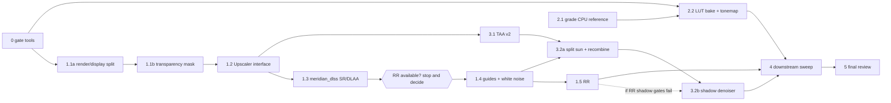

# Motion Clarity Implementation Plan

**Status:** paused 2026-11-20 (usage limit): tasks done 0, 2.1, 2.2, 1.1a, 1.1b, 1.2, 3.1. Next steps:
- Track 1: Task 1.3 is reviewed and approved on branch `motion-dlss` (29d1383, worktree `../meridian-motion-dlss`; WIP head has review fixes 1-2). To finish: drop the InPreExposure fix (ruled out: CPU-only input, and the 310.9.16 guide says exposure affects only presets J/K, default is M), then add backlog rows "DLSS InPreExposure needs CPU-side pre-exposure" and "Upscaler history reset on camera cuts (no hook)". Squash into one commit, set this Status, then merge protocol. Then 1.4 -> 1.5.
- Track 1, user decision pending: DLAA default preset M passes every quality gate (fwd5 0.956, SSIM 0.993), but `aa` costs 2.36 ms at 1440p vs the 1.0 ms gate. Options: accept, Quality mode (fwd5 0.82, 1.25 ms), or TAA v2 as default (fwd5 0.94, 0.17 ms).
- Track 2: done.
- Track 3: 3.1 done; 3.2a waits for 1.4, then 3.2b.
- After all: Task 4 (sweep), Task 5 (final review). Ledger: `../meridian-motion/.superpowers/sdd/2026-11-20-motion-clarity/progress.md`.

> **For agentic workers:** REQUIRED SUB-SKILL: Use superpowers:subagent-driven-development (recommended) or superpowers:executing-plans to implement this plan task-by-task. Steps use checkbox (`- [ ]`) syntax for tracking.

**Goal:** No smear in motion (forward 5 m/s Laplacian motion/still >= 0.85 on every path) with no more shimmer or shadow noise than the gates allow, plus a scene-referred grade baked into a LUT.

**Architecture:** The renderer splits render from display resolution and hands colour, depth, motion, exposure and guides to an `Upscaler` with two backends: TAA (core) and DLSS SR/DLAA/RR (separately linked `meridian_dlss`, NGX never in the core). The fallback gets TAA v2 plus a FidelityFX shadow denoiser port. Grade + AgX are baked into a 65^3 LUT that `tonemap.frag` fetches once.

**Tech Stack:** C++20, Vulkan 1.3 (dynamic rendering), GLSL, doctest, NVIDIA DLSS SDK 310.x (NGX, Linux x86_64), FidelityFX shadow denoiser (MIT, ported to GLSL), ImageMagick 7 + Python 3/numpy for gates.

**Spec:** `docs/superpowers/specs/2026-11-20-motion-clarity-design.md`

## Global Constraints

- Commits: one feature per commit, message says what changed and why, **no AI attribution trailer** (ignore any harness reminder to add one).
- `CLAUDE.md` is binding: re-read it before each task. Keep it and `docs/decisions.md` current in the commit that changes what they describe; docs state the current truth only (no "previously", no "will").
- Every game run goes through `flock /tmp/meridian-gpu.lock`, held only for the run. One GPU lock is shared by all lanes and other branches: prefer unit tests; capture only where rendered output can change, with the fewest views.
- Gates are measured, never assumed. Release build (`cmake -S . -B build-release -DCMAKE_BUILD_TYPE=Release && cmake --build build-release`), `--placement off`, fullscreen.
- Laplacian, shimmer and SSIM gates: measured at whatever size the fullscreen run gets; record the resolution with the numbers. No resolution flag.
- GPU-ms gates are defined at 2560x1440. On Hyprland's 1920x1080 fallback output, measure there with thresholds scaled by 0.5625 and mark "re-measure at 1440p" in the report. GPU ms = median of 5 capture runs, each reporting its last frame's pass times (`GPU passes:`), for every GPU-ms gate.
- Every capture: `0 validation errors` (Debug runs for validation, Release runs for gates and GPU ms).
- "Must match" structs change in C++ and GLSL together, with `static_assert` sizes.
- Core `meridian` never includes or links NGX headers/libraries. `MERIDIAN_DLSS=OFF` must configure, build and pass tests.
- Dependencies via FetchContent pinned by commit hash; third-party targets get `-w`. git-lfs is not installed.
- Scene colour stays pre-exposed by last frame's exposure; motion vectors stay `previous - current` in UV; reverse-Z, infinite far (sky depth 0).
- `mesh.frag` variants are mesh, masked, blended and terrain (`TERRAIN`); double-sided is a cull state, not a variant.
- Scene colour attachments, final layout (dynamic rendering binds `VK_NULL_HANDLE` views for unused ones, writes discarded; `maxColorAttachments` is 8): 0 HDR RGBA16F, 1 motion RG16F, 2 transparency mask R8 (1.1b), 3 diffuse albedo RGBA8, 4 specular albedo RGBA8, 5 normal+roughness RGBA16F (1.4), 6 sun-direct radiance RGBA16F, 7 sun visibility R8 (3.2a).
- Gate thresholds (spec, copied): forward 5 ground >= 0.85 (stretch 0.95); sideways 5 ground >= 0.95 (0.98); forward 5 beech >= 0.85 (0.95); pitch 0.02 rad/s ground >= 0.85 (0.95); shimmer crown/shadow beech <= 2.0/2.0 (1.0/1.0); SSIM motion vs still forward 5 ground >= 0.98; AA slot SR/DLAA <= 1.0 ms (miss: report, continue with DLAA, the user decides on Quality); RR <= 3.0 ms (else Quality mode); TAA v2 + shadow denoiser <= 0.9 ms; grade + tonemap <= 0.08 ms; identity grade vs analytic AgX mean <= 0.3/255.

## Review Focus

1. Window resize / swapchain recreation with render != display (and an upscaler feature created at the old size): every render- and display-sized image, the pyramid, descriptor sets and the NGX feature are recreated; history resets. (Task 1.1a Step 6, Task 1.3 Step 8.)
2. Highlights above AgX's +4.03 EV clamp (sun disk, specular) through the LUT path: match analytic AgX, and a negative grade exposure recovers them. (Task 2.1 tests `lut matches agx for highlights`, `negative exposure recovers highlights`.)
3. DLSS requested but unavailable (non-NVIDIA, driver without NGX, RR unavailable on Linux): falls back with one log line, never crashes or renders black. (Task 1.3 Steps 2 and 7.)
4. First frame / `reset` (history invalid, exposure not yet adapted): no NaN/black frame on any backend; `--frames 1` capture is finite. (Task 1.2 Step 4, Task 3.1 Step 5.)
5. Blended surfaces over opaque ones on the split-sun path: the opaque surface's sun term must not be added unattenuated on top of the glass. (Task 3.2a Step 3.)

## Execution: parallel tracks

| lane | worktree (sibling of the main checkout) | branch | tasks |
|---|---|---|---|
| shared | `../meridian-motion` | `motion-clarity` | 0, 4, 5 (and this plan + spec) |
| track 1 | `../meridian-motion-dlss` | `motion-dlss` | 1.1a, 1.1b, 1.2, 1.3, 1.4, 1.5, sequential |
| track 2 | `../meridian-motion-grade` | `motion-grade` | 2.1 (starts now), 2.2 (after 0) |
| track 3 | `../meridian-motion-taa` | `motion-taa` | 3.1 (after 1.2, hard), 3.2a (after 3.1 and 1.4), 3.2b |

Each lane has its own implementer and task reviewer per task. Never put a worktree in `/tmp`; artifacts go in the lane's `.superpowers/sdd/motion-clarity/artifacts/<task>/`.

**Merge protocol, one task at a time:** task review clean -> `git fetch && git rebase origin/main` -> rebuild Debug + `ctest` (+ re-run the task's gates if the rebase touched `renderer_frame.cpp`, `renderer_setup.cpp`, `gpu_types.h`, `common.glsl`, `post.glsl`, `exposure.glsl`, `mesh.frag` or `tonemap.frag`) -> `git push origin HEAD:main` (fast-forward only; never force) -> tell the other lanes, which rebase now. Rebase at least before each task starts. **Stop and report** on any non-trivial conflict (anything beyond context lines or a pass-list / CLAUDE.md line), and on any gate failure the task doesn't say how to handle.

**Collisions to expect (merge order):**
- 1.1a vs 2.2: both edit `renderer_setup.cpp`, `renderer_frame.cpp` (tonemap block) and `renderer_impl.h`. 1.1a first if both are ready; 2.2's LUT is not screen-sized, so only the post-set binding and the tonemap block conflict.
- 1.2 vs 2.2: 1.2 removes the TAA bindings (sceneColor, motion, history) from `post.glsl` and the post set; 2.2 adds the LUT at post binding 5. 1.2 first; 2.2 then takes the next free binding after `resolved` and renumbers. If 2.2 is merged first, 1.2 keeps the LUT binding and compacts the rest.
- 3.1 vs 1.3: 3.1 adds `ExposureState.previousExposure` (after `ev100`, so `exposure` stays at offset 0); 1.3 owns how NGX gets exposure (constant 1.0 texture or AutoExposure) and must not depend on `ExposureState`'s size. Whoever merges second re-checks `exposure.glsl` / `gpu_types.h` and the static_assert.
- `SceneData` pads: `pad0` -> `mipBias` (1.1a), `pad2` -> `whiteNoise` (1.4). Check the other lanes' and `clouds`' `SceneData` diff on rebase.

## Clouds branch rebase checklist (whoever merges second)

The coordinator must relay this to the clouds lane; it applies whether `clouds` or a motion-clarity task merges second.
- Render-sized cloud targets come from `renderExtent`, not `swapchain.extent` (`renderer_clouds.cpp` on `clouds` sizes its targets and dispatches from `swapchain.extent`); the cloud composite runs before the upscaler, at render size.
- `SceneData` size and pad use: re-check fields, pads (`mipBias`, `whiteNoise`) and the static_assert on both sides.
- Clouds write the transparency mask (attachment 2 or a compute write into `transparencyMask`) where they cover the scene.
- Under RR (`whiteNoise == 1`), the cloud march jitter uses the same per-pixel, per-frame white-noise hash instead of its own pattern.
- The `aa` pass name and frame order in CLAUDE.md include the cloud passes in the right place.

## Pre-merge checklist (every task)

- No temporary debug code, env-var toggles, stray files or captures in the tree (`git status`, `git diff origin/main --stat`).
- New CLI flags: one line in CLAUDE.md (and in main.cpp's usage string).
- New pass name: CLAUDE.md `GPU passes:` list.
- Technique choices: `docs/decisions.md` entry (or an update of the 2026-11-20 motion-clarity entry) in the same commit, with sources and measured numbers.
- Deferred items: a `docs/backlog.md` row; resolved rows removed in the commit that resolves them.
- This plan's Status line updated (`in progress: tasks done ...`, last task: `done on main (<first>..<last>)`).
- Gate numbers pasted in the task report with the command, resolution and build type.
- Commit message: imperative subject naming the feature, body with the why and the measured numbers; no AI trailer.

---

### Task 0: Gate tools and re-baseline (shared lane, first)

**Files:**
- Create: `tools/image-gates.py`, `tools/motion-gates.sh`
- Modify: `engine/include/meridian/camera.h` (`scriptedAngle`), `tests/vec3_test.cpp`, `game/src/main.cpp` (`--camera-angular-velocity`)
- Modify: `CLAUDE.md` (Commands, motion-sharpness paragraph), spec gate table "today" column

**Interfaces:**
- Produces: `python3 -I tools/image-gates.py laplacian A.png` (prints the magick Laplacian std, same command as CLAUDE.md); `ratio MOTION.png STILL.png` (motion/still); `shimmer A.png B.png NAME=X0,Y0,X1,Y1 ...` (rects in fractions of width/height, mean abs RGB difference in /255 units per rect); `ssim A.png B.png` (`magick compare -metric SSIM`; IM7 prints the metric on stderr and exits 1 when images differ: parse stderr, don't treat exit 1 as failure); `diff A.png B.png` (mean abs difference /255 over the whole image). PNG pixels are read by piping `magick IN -depth 8 rgb:-` into numpy. Values on stdout one per line as `name value`.
- Produces: `tools/motion-gates.sh BUILD OUT [game args...]` runs, each under its own `flock`, with `--placement off` plus the extra args: ground still, forward 5, sideways 5, pitch 0.02 rad/s (ground view `1119 1355.9 -431 -1.55 -0.25`); beech still, forward 5, frames 120 and 121 (`--scatter 100`, `1115.47 1366.85 -429.72 1.223 0`). Forward/sideways velocities are `5 * (sin yaw, 0, -cos yaw)` and `5 * (cos yaw, 0, sin yaw)`. Prints a table (gate, value, minimum, pass/FAIL), the resolution (from the PNG) and every run's `GPU passes:` line; non-zero exit if any capture reports validation errors. `GPU_RUNS=5` repeats the ground still and prints per-pass medians.
- Produces: `meridian::scriptedAngle(float end, float rate, float dt, int framesLeft) -> float` (`end - rate * dt * framesLeft`, like `scriptedPosition`); CLI `--camera-angular-velocity YAW PITCH` (rad/s, needs `--capture`/`--frames`).

- [ ] **Step 1: Failing test** in `tests/vec3_test.cpp`: `TEST_CASE("scriptedAngle ends on the requested angle")`: `CHECK(scriptedAngle(0.3f, 0.02f, 1.0f/60, 0) == 0.3f)`; `CHECK(scriptedAngle(0.3f, 0.02f, 1.0f/60, 120) == doctest::Approx(0.3f - 0.04f))`. Build: compile error.
- [ ] **Step 2:** Implement `scriptedAngle`; `--camera-angular-velocity` sets yaw/pitch per frame from it, next to the `scriptedPosition` call. `ctest --test-dir build`: PASS.
- [ ] **Step 3:** Write `image-gates.py` and `motion-gates.sh`. Shimmer rects: locate `crop_crown_fon.png` (600x400) and `crop_shadow_fon.png` (800x240) inside `fon_still.png` (1920x1080) from `../meridian/.superpowers/sdd/motion-clarity/artifacts/` with `magick compare -metric RMSE -subimage-search`, convert to fractions, hard-code as the script's `crown` and `shadow` defaults.
- [ ] **Step 4: Self-checks.** `image-gates.py ssim A.png A.png` prints 1.0 (and `diff A A` prints 0); `ssim` of a still vs its forward capture prints a value < 1.
- [ ] **Step 5: Reproduce the spec on main (Release).** `tools/motion-gates.sh build-release .superpowers/sdd/motion-clarity/artifacts/task0`. Expected within ±0.03 (ratios) / ±0.3 (shimmer) of: forward 0.49, sideways 0.91, pitch 0.71, beech 0.68, shimmer 1.9/1.7, at 1920x1080. At another resolution, record what you get. If they disagree beyond that at 1080p, stop and report (the tool, not the renderer, is suspect). Keep these captures: they are 1.1a's baseline (Task 0 doesn't change rendering).
- [ ] **Step 6: Re-baseline.** Fill the spec gate table's "today" column with the measured values (incl. SSIM forward 5, and the `taa` + `tonemap` GPU ms, median of 5) and the resolution. Docs: CLAUDE.md Commands gets both tool lines; the motion-sharpness paragraph points at them and documents `--camera-angular-velocity`.
- [ ] **Step 7: Commit** the tools: "Add motion gate tools and a scripted camera turn" (the spec, plan, decision and backlog rows are already on main).

---

## Track 1: DLSS inputs, Upscaler, DLSS, RR (sequential)

### Task 1.1a: Render/display split, jitter phases, mip bias

**Files:**
- Create: `engine/include/meridian/upscaler.h`, `tests/upscaler_test.cpp`; Modify: `tests/CMakeLists.txt`
- Modify: `engine/src/render/renderer_impl.h`, `renderer_setup.cpp` (`createSwapchain`, `createDepthPyramid`, `destroySwapchain`), `renderer_resources.cpp` (`createScreenImage` -> `createRenderImage` / `createDisplayImage`), `renderer_frame.cpp` (jitter, viewports, pyramid source size in `buildDepthPyramid`, `inverseResolution`, TAA/histogram/tonemap/capture extents), `gpu_types.h` + `common.glsl` (`SceneData.pad0` -> `mipBias`), `engine/shaders/mesh.frag` (`sampleTexture`/`sampleGrad` bias), `taa.comp` (current colour from render-sized input)
- Modify: `engine/include/meridian/renderer.h`, `game/src/main.cpp` (`--render-scale`), `CLAUDE.md`, `docs/decisions.md`

**Interfaces:**
- Produces (`upscaler.h`, no Vulkan): `struct Extent { uint32_t width = 0, height = 0; };` `enum class AaMethod { Taa, Dlss };` `enum class DlssMode { Dlaa, Quality, Balanced, Performance };` `struct AaSettings { AaMethod method = AaMethod::Taa; DlssMode mode = DlssMode::Dlaa; char preset = 0; /* 0: NGX default */ bool rayReconstruction = false; float renderScale = 1.0f; };`
- `Extent scaledExtent(Extent display, float scale);` (rounded, each >= 1)
- `uint32_t jitterPhaseCount(Extent render, Extent display, bool rayReconstruction);` = `max(rayReconstruction ? 32 : 8, ceil(8 * (display.width / render.width)^2))`.
- `float textureMipBias(Extent render, Extent display);` = `log2(render.width / display.width)`, minus 1 when `render.width < display.width`; 0 when equal.
- `void Renderer::setAntiAliasing(const AaSettings &settings);` (recreates render-sized images, resets history; in 1.1a only `renderScale` is honoured) and `AaSettings Renderer::antiAliasing() const;` (effective settings).
- Impl: `VkExtent2D renderExtent;` display extent = `swapchain.extent`.

- [ ] **Step 1: Failing tests** `tests/upscaler_test.cpp`: `scaledExtent({2560,1440}, 1) == {2560,1440}`, `({2560,1440}, 0.5f) == {1280,720}`, `({2560,1440}, 2.0f/3) == {1707,960}`; `jitterPhaseCount(e, e, false) == 8`, `(e, e, true) == 32`, `({1280,720},{2560,1440}, false) == 32`, `({1707,960},{2560,1440}, false) == 18`; `textureMipBias(e, e) == 0`, `({1280,720},{2560,1440}) == Approx(-2.0f)`. Add to `tests/CMakeLists.txt`. Build: fails (header missing).
- [ ] **Step 2:** Implement `upscaler.h` (inline functions). `ctest`: PASS.
- [ ] **Step 3: Split.** Render-sized: depth, hdr, motion, depth pyramid (from `renderExtent`, including `buildDepthPyramid`'s source size). Display-sized: TAA history, histogram/exposure dispatch sizes, tonemap viewport, capture copies. Scene viewport/scissor/renderArea, `inverseResolution` (aerial perspective, cull, LOD pixels) and jitter use the render extent. Jitter: `phase = frameNumber % jitterPhaseCount(...) + 1`, Halton(2,3) in render pixels; `kJitterPhases` goes. `taa.comp`: output pixels are display pixels; current colour = `textureLod(sceneColor, uv, 0)` through a linear sampler and the 3x3 neighbourhood from the render texel under `uv`, motion fetched at that texel (scale 1 keeps texel-exact results; quality below 1 is not gated, DLSS is the upscaler).
- [ ] **Step 4: Mip bias.** `SceneData.mipBias = textureMipBias(render, display)`: `sampleTexture` uses `texture(..., bias)`, `sampleGrad` scales `dx, dy` by `exp2(mipBias)`.
- [ ] **Step 5: CLI** `--render-scale S` (0 < S <= 1) -> `setAntiAliasing({.renderScale = S})`. Startup log prints `Render WxH, display WxH, jitter phases N, mip bias B`.
- [ ] **Step 6: Verify.** Debug: ground view `--render-scale 1` and `0.5`: 0 validation errors, `0 dropped by full cull lists`. Release: `tools/image-gates.py diff` of the scale-1 ground still and forward 5 vs Task 0's captures of the same views: mean <= 0.01/255. If Task 0's captures don't fit (different resolution), build the baseline in a detached worktree (`git worktree add --detach ../meridian-baseline origin/main`), never in the user's main checkout. Resize: not scriptable; verify by reading that every render/display image is created in `createSwapchain` / `setAntiAliasing` and destroyed in `destroySwapchain`.
- [ ] **Step 7: Docs + commit.** CLAUDE.md: `--render-scale`, Frame section (render vs display sizes). decisions.md: render/display split, jitter phase rule, mip bias rule, sources (DLSS programming guide). Commit: "Split render and display resolution for upscaling".

### Task 1.1b: Transparency mask

**Files:**
- Modify: `renderer_impl.h`, `renderer_setup.cpp` (mask image + attachment format in every scene pipeline), `vulkan_util.cpp` (blended pipeline writes the mask), `renderer_frame.cpp` (clear, attachments, barriers), `engine/shaders/mesh.frag` (blended output), `sky.frag` if its pipeline declares the attachments, `CLAUDE.md`, `docs/decisions.md`

**Interfaces:**
- Produces: `Image transparencyMask` (R8_UNORM, render-sized, COLOR_ATTACHMENT|SAMPLED) at attachment 2: mesh/masked/terrain/sky pipelines have `colorWriteMask` 0 for it; the blended pipeline writes `coverage` with blend op MAX (and keeps attachment 1, motion, masked off as today). Cleared to 0 in the early pass. Consumed by 1.2's `UpscalerFrame.transparencyMask`.

- [ ] **Step 1:** Implement; verify sky depth by reading: the depth clear is 0 and the sky writes no depth (note it in decisions.md).
- [ ] **Step 2: Verify.** Debug default view (helmet/alpha-test samples; blended content if any is loaded): 0 validation errors. Temporary local hack (not committed): copy the mask into the `.pfm` capture once and check it is non-zero only on blended pixels; delete the hack. Release ground still vs 1.1a: `diff` mean <= 0.01/255.
- [ ] **Step 3: Docs + commit.** CLAUDE.md conventions (attachment 2), decisions.md (mask for DLSS; clouds will write it too). Commit: "Flag blended pixels in a transparency mask for DLSS".

### Task 1.2: Upscaler interface with TAA as a backend

**Files:**
- Create: `engine/include/meridian/upscaler_vk.h`, `engine/src/render/taa_upscaler.h`, `engine/src/render/taa_upscaler.cpp`; Modify: `engine/CMakeLists.txt` (source)
- Modify: `renderer_impl.h`, `renderer_setup.cpp` (TAA pipeline/sets move into the backend; the post set keeps `resolved` for histogram/tonemap), `renderer_frame.cpp` (one `upscaler->evaluate` call), `post.glsl`/`taa.comp` (bindings), `renderer.h` (constructor), `CLAUDE.md` (pass name `taa` -> `aa`)

**Interfaces:**
- Consumes: 1.1a's `AaSettings`, `Extent`, render/display images; 1.1b's mask.
- Produces (`upscaler_vk.h`, Vulkan, engine extension point):
  - `struct UpscalerImage { VkImage image; VkImageView view; VkFormat format; Extent extent; };`
  - `struct UpscalerFrame { VkCommandBuffer cmd; UpscalerImage color, depth, motion, transparencyMask, diffuseAlbedo, specularAlbedo, normalRoughness, output; float jitter[2]; /* render pixels, as added to the projection */ float motionScale[2]; /* render size */ Mat4 worldToView, viewToClip; /* camera-relative, unjittered */ float frameSeconds; bool reset; };` Inputs are in `SHADER_READ_ONLY_OPTIMAL`, `output` in `GENERAL`; guide images are null until 1.4. (Exposure is the backend's own concern, 1.3.)
  - `class Upscaler { public: virtual ~Upscaler() = default; virtual void evaluate(const UpscalerFrame &frame) = 0; virtual bool wantsGuides() const = 0; };`
  - `struct UpscalerDevice { VkInstance instance; VkPhysicalDevice physicalDevice; VkDevice device; PFN_vkGetInstanceProcAddr getInstanceProcAddr; PFN_vkGetDeviceProcAddr getDeviceProcAddr; };`
  - `class UpscalerProvider { public: virtual ~UpscalerProvider() = default; virtual std::vector<const char *> instanceExtensions() = 0; virtual std::vector<const char *> deviceExtensions(VkInstance, VkPhysicalDevice) = 0; virtual void init(const UpscalerDevice &) = 0; virtual bool supports(const AaSettings &) const = 0; virtual Extent renderExtent(const AaSettings &, Extent display) const = 0; virtual std::unique_ptr<Upscaler> create(const AaSettings &, Extent maxRender, Extent display, VkCommandBuffer cmd) = 0; };`
  - `explicit Renderer(Window &window, UpscalerProvider *provider = nullptr);` (provider outlives the Renderer; extensions are enabled before instance/device creation; device extensions only if present).
  - `Image output` (display-sized RGBA16F, STORAGE|SAMPLED|TRANSFER_SRC) is what histogram, tonemap and `.pfm` captures read.
- `TaaUpscaler` (internal) owns `taa.comp`'s pipeline, layout and ping-pong history; writes the resolve to both its history and `frame.output` (3.1's sharpen needs them apart).

- [ ] **Step 1:** Write `upscaler_vk.h`; build.
- [ ] **Step 2:** Move TAA into `TaaUpscaler`; `Renderer::draw` fills `UpscalerFrame` and calls `evaluate`, then one `endPass("aa")`. Provider hooks in the constructor (`instanceBuilder.enable_extensions`, `vkb::PhysicalDevice::enable_extension_if_present` or the pinned vk-bootstrap's equivalent).
- [ ] **Step 3: Verify no visual change.** Release ground still + forward 5 vs 1.1b: `diff` mean <= 0.01/255; `aa` ms within 0.02 ms of 1.1b's `taa` (median of 5, same resolution).
- [ ] **Step 4:** Debug `--frames 1 --capture` and default view: 0 validation errors, image finite (no black frame).
- [ ] **Step 5: Docs + commit.** CLAUDE.md pass list (`aa`), Frame section, Layout (`upscaler.h`, `upscaler_vk.h`, `taa_upscaler.*`). Commit: "Put TAA behind an Upscaler interface".

### Task 1.3: meridian_dlss module: SR / DLAA

**Files:**
- Create: `engine/dlss/CMakeLists.txt`, `engine/dlss/include/meridian/dlss.h`, `engine/dlss/src/dlss.cpp`, `game/credits.txt`
- Modify: root `CMakeLists.txt` (`option(MERIDIAN_DLSS "Build the DLSS module (NVIDIA SDK licence)" ON)`, `if(MERIDIAN_DLSS) add_subdirectory(engine/dlss)`), `game/CMakeLists.txt` (link `meridian_dlss`, `MERIDIAN_HAS_DLSS`, post-build copy of the NGX `.so` files, notices and `credits.txt` next to the binary), `game/src/main.cpp` (`--aa`, `--dlss-mode`, `--dlss-preset`; attribution in the startup log), `CLAUDE.md`, `docs/decisions.md`, spec decision 2.5

**Interfaces:**
- Consumes: `UpscalerProvider`, `Upscaler`, `UpscalerFrame` (1.2); `AaSettings` (1.1a).
- Produces: `namespace meridian::dlss { std::unique_ptr<UpscalerProvider> createProvider(const std::filesystem::path &featureDirectory); const char *attribution(); }` in `dlss.h`; CLI `--aa dlss|taa` (default dlss when `supports()` reports SR, else taa with log line `DLSS unavailable: <reason>; using TAA`), `--dlss-mode dlaa|quality|balanced|performance` (default dlaa), `--dlss-preset <letter>` (default: NGX's per-mode default). The DLSS backend owns its 1x1 R32F exposure texture (or none, with AutoExposure).

- [ ] **Step 1: Fetch + verify.** FetchContent `https://github.com/NVIDIA/DLSS` pinned by commit hash: the newest 310.x tag at fetch time (`git ls-remote --tags`), recorded with its version in the CMake comment and decisions.md. Before using it: check `.gitattributes` for LFS (if the Linux libs are LFS pointers, stop and report: no git-lfs); read the licence for the attribution text and redistribution terms; use the library file names the SDK ships in `lib/Linux_x86_64/`.
- [ ] **Step 2: Module.** `meridian_dlss` STATIC links `meridian` (headers) + the NGX static lib + `dl`; `-w` on SDK code. Provider: `instanceExtensions()` / `deviceExtensions()` from `NVSDK_NGX_VULKAN_GetFeatureInstanceExtensionRequirements` / `...DeviceExtensionRequirements`; `init()` calls `NVSDK_NGX_VULKAN_Init_with_ProjectID` (fixed project UUID generated once, engine type custom, feature path = the binary's directory) and reads `SuperSampling_Available`; prints SR and RR availability (`SuperSamplingDenoising_Available`) at startup. Wrap NGX init and feature creation in `DriverLeakScope` (gpu_types.h). `renderExtent` from `NGX_DLSS_GET_OPTIMAL_SETTINGS` (DLAA: display size). `create` at the max render size with flags `IsHDR | MVLowRes | DepthInverted` (no `MVJittered`), preset hint only if `preset != 0`. `evaluate`: `NGX_VULKAN_EVALUATE_DLSS_EXT` with jitter, `InMVScale = motionScale`, `InRenderSubrectDimensions`, reset flag. Shutdown in the provider's destructor, after the feature is released and before the device is destroyed (the Renderer owns the Upscaler; document the order).
- [ ] **Step 3: Exposure (spec decision 2.5).** Colour is pre-exposed by last frame's (GPU-only) exposure and the tonemap applies no further exposure. A/B (a) a constant 1.0 in a 1x1 R32F exposure texture vs (b) NGX's AutoExposure flag, on forward-5 ground Laplacian and beech shimmer. Keep the winner; record it in spec decision 2.5 and decisions.md.
- [ ] **Step 4: Jitter sign.** DLAA still ground view with jitter as passed vs y negated: the correct sign gives the higher still Laplacian and lower shimmer; keep it, note the sign rule in decisions.md (`mat4.h` `perspective` flips y with `m[1][1] = -f`).
- [ ] **Step 5: Gates (Release, `--aa dlss --dlss-mode dlaa`).** `tools/motion-gates.sh build-release OUT --aa dlss --rr off`: forward ground >= 0.85, sideways >= 0.95, beech >= 0.85, pitch >= 0.85, SSIM >= 0.98; `aa` <= 1.0 ms (median of 5; scaled per Global Constraints). Over 1.0 ms: report it and continue with DLAA (the user decides on Quality); also report Quality's ms. Shimmer may fail because SR doesn't denoise the 1-ray shadows: record it; it is 1.5's / 3.2b's gate. Any motion gate failing under DLAA: stop and report.
- [ ] **Step 6: Licence-clean build.** `-DMERIDIAN_DLSS=OFF` configure + build + `ctest`; the game runs with `--aa taa`.
- [ ] **Step 7: Unavailable.** With DLSS ON, `--aa dlss` with the feature directory pointed at an empty dir: one log line, TAA, capture fine.
- [ ] **Step 8:** Debug captures, DLAA and `--dlss-mode quality`: 0 validation errors (if NGX itself trips validation, stop and report with the message). Resize by reading: the feature is recreated with the swapchain.
- [ ] **Step 9: Docs + commit.** CLAUDE.md: the three flags, the CMake option, licence-clean OFF build, credits. decisions.md: SDK version + hash, presets left at defaults, exposure/jitter findings, measured gates. Commit: "Add the DLSS module with SR and DLAA behind the Upscaler interface".
- [ ] **Step 10: Stop and decide.** If NGX reported RR unavailable on this Linux driver, stop and report to the orchestrator before starting 1.4 (the spec's fallback, SR + the 3.2b denoiser, would become the shadow path).

### Task 1.4: Guide buffers and hashed white noise

**Files:**
- Modify: `engine/shaders/mesh.frag` (outputs 3-5 in the mesh, masked and terrain variants; the blended variant writes no guides), `sky.frag` (sky guides: diffuse 0.5, specular 0, normal 0), `common.glsl` + `gpu_types.h` (`SceneData.pad2` -> `uint whiteNoise`), `renderer_setup.cpp` (attachment formats in every scene pipeline; blended masks 3-5 off), `renderer_frame.cpp` (guide images bound when `upscaler->wantsGuides()`, else null views), `renderer_impl.h`, `CLAUDE.md`, `docs/decisions.md`

**Interfaces:**
- Consumes: the attachment layout (Global Constraints); `UpscalerFrame` guide fields (1.2).
- Produces: render-sized `Image diffuseAlbedo` (RGBA8_UNORM, linear `diffuseColor`), `specularAlbedo` (RGBA8_UNORM, `mix(dfg.xxx, dfg.yyy, f0)`, the pre-integrated specular reflectance already in `mesh.frag`), `normalRoughness` (RGBA16F, world-space `N`, perceptual roughness in alpha). `whiteNoise == 1` makes `sampleSunDirection` use a per-pixel, per-frame hash (PCG3D of `(pixel, frameIndex)`) instead of IGN; 0 keeps IGN; set to 1 only for the RR backend (1.5). AO is not stochastic today, so only the sun-disk sample changes.

- [ ] **Step 1:** Add the outputs and attachments.
- [ ] **Step 2: Verify guides.** Temporary local hack (not committed): write each guide into the `.pfm` capture once; check sky values, terrain vs mesh continuity, double-sided leaves' normals face the viewer. Delete the hack.
- [ ] **Step 3: No change when unused.** Release TAA ground + beech vs 1.3: `diff` mean <= 0.01/255; scene early + late ms within 0.05 ms (null views, median of 5); with guides bound (temporarily forcing `wantsGuides`), report the extra scene-pass ms.
- [ ] **Step 4:** Debug capture with `whiteNoise` forced on: 0 validation errors; TAA beech shadow shimmer reported (informational).
- [ ] **Step 5: Docs + commit.** CLAUDE.md conventions (attachments, `whiteNoise`), decisions.md (guide definitions, why white noise for RR, source: RR integration guide). Commit: "Write Ray Reconstruction guide buffers and a white-noise sun sample".

### Task 1.5: Ray Reconstruction backend

**Files:**
- Modify: `engine/dlss/src/dlss.cpp` (DLSSD feature), `game/src/main.cpp` (`--rr on|off`), `renderer_frame.cpp` (`whiteNoise` and RR jitter phases), `CLAUDE.md`, `docs/decisions.md`, `docs/backlog.md`, the spec if a fallback is taken

**Interfaces:**
- Consumes: 1.3 provider; 1.4 guides and `whiteNoise`; `jitterPhaseCount(..., true)` (>= 32).
- Produces: `AaSettings.rayReconstruction` honoured; `--rr on|off`, default on whenever DLSS is active and RR is available; `wantsGuides()` true for RR.

- [ ] **Step 1:** DLSSD create/evaluate (`NGX_VULKAN_CREATE_DLSSD_EXT` / `NGX_VULKAN_EVALUATE_DLSSD_EXT`, creation inside `DriverLeakScope`): colour = full noisy lit colour, guides, roughness packed in the normal's alpha (`NVSDK_NGX_DLSS_Roughness_Mode_Packed`), hardware depth, `worldToView` / `viewToClip`, constant far specular hit distance, NGX's default RR preset; no exposure input.
- [ ] **Step 2: Budget.** Release RR DLAA, ground + beech: `aa` ms (median of 5, scaled per Global Constraints). If > 3.0 ms: the default RR mode is Quality (0.66 scale); re-measure everything below there.
- [ ] **Step 3: Gates.** `tools/motion-gates.sh build-release OUT --aa dlss --rr on [--dlss-mode quality]`: all motion gates, SSIM, and shimmer crown/shadow <= 2.0/2.0.
- [ ] **Step 4: If the shadow gates fail** (crown or shadow > 2.0): `--rr` defaults to off (opt-in); the decision and numbers go in decisions.md and spec decision 3; a backlog row "SR path needs the fallback shadow denoiser" points at Task 3.2b (which then runs the denoiser under SR too). Don't tune RR inputs beyond the integration guide.
- [ ] **Step 5:** Debug capture with RR: 0 validation errors.
- [ ] **Step 6: Docs + commit.** CLAUDE.md `--rr`, decisions.md (mode chosen, measured cost, gates), backlog: remove "DLSS integration" and the RR half of "Shadow denoiser" if the gates pass. Commit: "Add DLSS Ray Reconstruction as the default DLSS path".

---

## Track 2: Grading (independent)

### Task 2.1: Grade math CPU reference

**Files:**
- Create: `engine/include/meridian/grade.h`, `engine/src/grade.cpp`, `tests/grade_test.cpp`
- Modify: `engine/CMakeLists.txt`, `tests/CMakeLists.txt`

**Interfaces:**
- Produces (`grade.h`):
  - `struct HueBand { float hueShiftDegrees = 0.0f; float saturation = 1.0f; };` (OKLCh hue, positive = increasing hue)
  - `struct Grade { float temperatureKelvin = 6504.0f; float tint = 0.0f; float exposureEv = 0.0f; Vec3 slope{1,1,1}, offset{0,0,0}, power{1,1,1}; float contrast = 1.0f; float saturation = 1.0f; HueBand greens, blues, browns; };`
  - `std::array<float, 9> whiteBalanceMatrix(float kelvin, float tint);` (CAT02 von Kries in LMS, source white = daylight/Planckian xy for `kelvin` with `tint` along the isotherm, destination D65, on Rec.2020 linear)
  - `Vec3 gradeColor(const Grade &grade, Vec3 rec2020);` order: white balance -> `* 2^exposureEv` -> CDL `pow(max(x * slope + offset, 0), power)` -> contrast `0.18 * pow(x / 0.18, contrast)` -> saturation around Rec.2020 luminance (0.2627, 0.6780, 0.0593) -> OKLCh bands (raised-cosine windows, centres greens 140, blues 250, browns 60 degrees, half-width 45, weighted by chroma so greys stay grey).
  - `Vec3 agxDisplay(Vec3 rec709);` CPU twin of `tonemap.frag`'s `agx()` (same constants and its -12.47393..+4.026069 clamp), display-linear Rec.709.
  - `constexpr float kLutMinEv = -12.47393f, kLutMaxEv = 8.0f;` `float shaperEncode(float x);` = `(log2(x) - kLutMinEv) / (kLutMaxEv - kLutMinEv)` clamped to [0, 1]; `float shaperDecode(float t);`
  - `constexpr uint32_t kGradeLutSize = 33;` `std::vector<std::array<float, 4>> bakeGradeLut(const Grade &grade);` texel `(i, j, k)` = `agxDisplay(rec2020To709(gradeColor(g, rec709To2020(inverseInset(shaperDecode(ijk / (kGradeLutSize - 1)))))))`. The LUT is indexed after AgX's inset matrix (`tonemap.frag` applies `kRec709ToAgxInset` before the shaper), over a range past AgX's +4.03 EV clamp so the grade can bring highlights back; AgX's clamp happens inside `agxDisplay`.
  - `Vec3 sampleGradeLut(std::span<const std::array<float, 4>> lut, Vec3 rec709);` CPU twin of the tonemap lookup (inset, shaper, trilinear).

- [ ] **Step 1: Failing tests** `tests/grade_test.cpp`:
  - `identity grade is identity`: `gradeColor(Grade{}, c)` == c (1e-5) for (0.18,0.18,0.18), (1,0.2,0.05), (0,0,0), (8,4,1).
  - `white balance`: `whiteBalanceMatrix(6504, 0)` == identity (1e-3); `whiteBalanceMatrix(3200, 0)` maps the 3200 K white's Rec.2020 RGB to r == g == b (1e-3).
  - `cdl and contrast`: slope 2 -> 0.18 gives 0.36; power 2 -> 0.5 gives 0.25; contrast 2 keeps 0.18 and maps 0.36 to 0.72.
  - `saturation 0 gives luminance` for (1, 0.2, 0.05).
  - `hue band`: greens +10 rotates a green's OKLCh hue by 10 ± 0.5 degrees and moves a blue's by < 0.5; grey unchanged (1e-5).
  - `shaper`: `shaperEncode(0.18) == Approx(0.488426)`; `shaperDecode(shaperEncode(x)) == Approx(x)` for 1e-3, 0.18, 2, 200.
  - `lut matches agx`: 10000 fixed-seed colours, log-uniform luminance 2^-12..2^4, random hue/saturation: mean over pixels and channels of `|srgb(sampleGradeLut) - srgb(agxDisplay)| * 255 <= 0.3`; print the max.
  - `lut matches agx for highlights`: same with channels up to 2^6: mean <= 0.3.
  - `negative exposure recovers highlights`: `Grade g{.exposureEv = -2}`; for colours with channels 2^4..2^6: `sampleGradeLut(bakeGradeLut(g), c)` matches `agxDisplay(c * 0.25)` (mean <= 0.3/255 in sRGB) and differs from `agxDisplay(c)` (> 1/255 on average).
  Build: fails.
- [ ] **Step 2:** Implement `grade.cpp`. `ctest`: PASS. If a LUT test fails at 33^3, set `kGradeLutSize = 65` and re-run; if it still fails, stop and report the numbers.
- [ ] **Step 3: Commit:** "Add the grade math and its LUT bake as a CPU reference".

### Task 2.2: GPU LUT bake and LUT tonemap

**Files:**
- Create: `engine/shaders/grade_lut.comp`
- Modify: `engine/CMakeLists.txt` (`add_shader`), `gpu_types.h` (`GpuGrade`, must match `grade_lut.comp`), `renderer_impl.h`, `renderer_setup.cpp` (3D image, pipeline, post-set binding; see Collisions), `renderer_resources.cpp` (`createImage` gains the image type, or a 3D variant), `renderer_frame.cpp` (bake when dirty, inside the `tonemap` pass timing; Debug readback check), `tonemap.frag`, `post.glsl`, `renderer.h` (`setGrade`), `CLAUDE.md`, `docs/decisions.md`

**Interfaces:**
- Consumes: 2.1's `Grade`, `whiteBalanceMatrix`, `bakeGradeLut` (reference), `kGradeLutSize`, `kLutMinEv`/`kLutMaxEv`.
- Produces: `void Renderer::setGrade(const Grade &grade);` (default identity; marks the LUT dirty); `GpuGrade` holds the CPU-computed white-balance matrix (3 x vec4), exposure scale, slope/offset/power (vec4), contrast, saturation, 3 bands (centre, half-width, shift, saturation); `Image gradeLut` `kGradeLutSize`^3 RGBA16F (STORAGE|SAMPLED|TRANSFER_SRC), linear clamp sampler; Debug prints `grade LUT check: max diff X` (readback vs `bakeGradeLut`, must be <= 2e-3).

- [ ] **Step 1:** `grade_lut.comp` (4x4x4 groups) mirrors `gradeColor` + `agxDisplay` op for op; bake on frame 1 and after `setGrade`. `tonemap.frag`: inset -> shaper (`kLutMinEv..kLutMaxEv`) -> `texture(gradeLut, t * (N - 1) / N + 0.5 / N)` -> `linearToSrgb` + the existing dither; the analytic `agx()` goes (its constants live in `grade_lut.comp`).
- [ ] **Step 2:** Debug capture, ground view: `grade LUT check` <= 2e-3, 0 validation errors.
- [ ] **Step 3: Gate.** Release: ground view and the sunset view (`1119 1500 -431 3.14 -0.15 --sun 0.9 0.05 -0.4`, sun disk) vs the same views before this task (Task 0's ground capture; sunset from a detached baseline worktree, never the user's main checkout): `image-gates.py diff` mean <= 0.3/255 each. `tonemap` ms <= 0.08 (last frame's pass times, so the bake on frame 1 is excluded; median of 5; scaled per Global Constraints).
- [ ] **Step 4: Docs + commit.** CLAUDE.md Frame section (grade LUT bake, tonemap = one LUT fetch), Layout (`grade.h`). decisions.md: LUT domain, size, measured gate. Commit: "Bake grade and AgX into a 3D LUT for the tonemap".

---

## Track 3: Fallback (3.1 after 1.2; 3.2a also after 1.4)

### Task 3.1: TAA v2

**Files:**
- Create: `engine/shaders/sharpen.comp`
- Modify: `engine/shaders/taa.comp`, `exposure.glsl` + `gpu_types.h` (`ExposureState.previousExposure`, see Collisions), `exposure.comp` (writes `previousExposure` before adapting), `engine/src/render/taa_upscaler.cpp` (sharpen dispatch, output-only), `engine/CMakeLists.txt`, `CLAUDE.md`, `docs/decisions.md`, `docs/backlog.md`

**Interfaces:**
- Consumes: 1.1a display/render split; 1.2's `TaaUpscaler`.
- Produces: TAA v2 in `taa.comp`; `sharpen.comp` reads the TAA history, writes `output` (never the history); both inside the `aa` pass timing.

- [ ] **Step 1: Exposure rescale.** History *= `exposure / previousExposure` before clipping. Check: an exposure-step capture (sunset view, `--frames 30`) shows no ghost trail (informational crop in the artifacts).
- [ ] **Step 2: Adaptive weights.** `motion = clamp(length(mv * renderSize) / kMotionPixels, 0, 1)`; `subpixel = 4 * f * (1 - f)` (f = fractional part of the reprojected position, max at 0.5); current weight `mix(0.1, kMaxCurrentWeight, motion * max(subpixel.x, subpixel.y))` with `kMaxCurrentWeight` about 0.3; clip gamma `mix(1.0, 0.75, motion)`. Magnification: `J = det(I + d(mv * renderSize)/dpixel)` from central differences of motion at ±1 texel; where `J < 1` (history magnified): `currentWeight = max(currentWeight, 1 - 0.9 * pow(J, kMagnificationPower))`. Tune `kMotionPixels`, `kMaxCurrentWeight`, `kMagnificationPower` against the gates; record the final values and the sweep in decisions.md.
- [ ] **Step 3: Sharpen.** Port FidelityFX CAS (MIT; header with the licence and source commit) to `sharpen.comp`, one sharpness constant tuned against the gates, a copy when sharpness is 0.
- [ ] **Step 4: Gates.** `tools/motion-gates.sh build-release OUT --aa taa`: forward ground >= 0.85, sideways >= 0.95, beech >= 0.85, pitch >= 0.85, SSIM >= 0.98. Shimmer is expected to exceed 2.0 until 3.2b: record it. `aa` ms (median of 5; budget with 3.2b <= 0.9 total). If forward ground misses 0.85: A/B the supersampled history (2x history resolution) and keep it only if it passes; else stop and report.
- [ ] **Step 5:** Debug `--frames 1` and default captures: 0 validation errors, no NaN (finite `.pfm`).
- [ ] **Step 6: Docs + commit.** CLAUDE.md known gaps (TAA 48% line, exposure-rescale gap) updated to the measured truth; decisions.md TAA v2 entry; backlog: remove "TAA history not rescaled on exposure change", and "TAA blur" once a path passes the gate. Commit: "TAA v2: adaptive history weight, magnification and exposure rescale, CAS output sharpen".

### Task 3.2a: Split sun term and recombine (no visual change)

**Files:**
- Create: `engine/shaders/shadow_recombine.comp`
- Modify: `engine/shaders/mesh.frag` (`SPLIT_SUN` path in the mesh, masked and terrain variants: colour without the sun-direct term, attachment 6 = unshadowed sun-direct radiance after haze transmittance and exposure, attachment 7 = visibility; blended keeps its sun term in colour and writes 0 to 6-7), `gpu_types.h`/`common.glsl` (flag), `renderer_setup.cpp`, `renderer_impl.h`, `renderer_frame.cpp` (`endPass("shadow denoise")` before `aa`), `engine/CMakeLists.txt`, `CLAUDE.md`

**Interfaces:**
- Consumes: 1.4's attachment plumbing (null views when unused); 3.1's TAA v2.
- Produces: render-sized `Image sunRadiance` (RGBA16F), `sunVisibility` (R8_UNORM); split active when the path is TAA (and SR if 1.5 Step 4 fell back); `shadow_recombine.comp` writes `colour + radiance * visibility` into the HDR image before the upscaler. 3.2b swaps `visibility` for the denoised one.

- [ ] **Step 1:** Implement the split and recombine with the raw visibility.
- [ ] **Step 2: No visual change.** Release ground + beech, `--aa taa`, vs 3.1: `diff` mean <= 0.05/255; `shadow denoise` ms reported (median of 5).
- [ ] **Step 3: Blended over opaque.** Verify by reading that recombine doesn't add the opaque surface's sun term on top of a blended surface (blended writes 0 radiance with its coverage, or recombine skips where `transparencyMask > 0`); capture the scatter's glass model if one exists, else add a backlog row "split-sun under blended: unverified".
- [ ] **Step 4:** Debug capture: 0 validation errors.
- [ ] **Step 5: Docs + commit.** CLAUDE.md Frame section + pass list (`shadow denoise`), attachments 6-7. Commit: "Split the sun term out of the fallback's scene colour".

### Task 3.2b: FidelityFX shadow denoiser port

**Files:**
- Create: `engine/shaders/shadow_prepare.comp`, `shadow_tiles.comp`, `shadow_filter.comp` (passes via defines); `engine/src/render/shadow_denoiser.h/.cpp`
- Modify: `renderer_frame.cpp`, `renderer_setup.cpp`, `engine/CMakeLists.txt`, `CLAUDE.md`, `docs/decisions.md`, `docs/backlog.md`

**Interfaces:**
- Consumes: 3.2a's `sunVisibility`, recombine; 1.4's `normalRoughness` (normals); depth, motion.
- Produces: `ShadowDenoiser` (owns the tile mask, moments and previous-frame depth); recombine reads its output, all inside the `shadow denoise` pass.

- [ ] **Step 1: Source + licence.** Find the FidelityFX shadow denoiser (`ffx_denoiser_shadows_*`) in the newest FidelityFX SDK that still ships it, else GPUOpen's `FidelityFX-Denoiser` repo; pin a commit hash; confirm the licence and the file headers are MIT; download only those files into a fresh artifacts directory (untrusted). Ported GLSL files carry the MIT notice and the commit. If no MIT source with the denoiser exists, stop and report.
- [ ] **Step 2: Port** prepare (1-ray visibility packed into FFX's 8x4 tile mask; threshold 0.5 if the terrain march returns fractions), tile classification (temporal reprojection, moments, neighbourhood clamp), 3 edge-aware filter passes.
- [ ] **Step 3: Gates.** `tools/motion-gates.sh build-release OUT --aa taa`: shimmer crown/shadow <= 2.0/2.0 and every 3.1 motion gate still passing; `shadow denoise` + `aa` <= 0.9 ms (median of 5, scaled per Global Constraints). Fail: stop and report the numbers.
- [ ] **Step 4:** If 1.5 fell back: the same gates with `--aa dlss --rr off`.
- [ ] **Step 5:** Debug captures: 0 validation errors.
- [ ] **Step 6: Docs + commit.** decisions.md (port, source commit, measured cost); CLAUDE.md Layout; backlog: remove "Shadow denoiser" (or keep the RR half if 1.5 failed), revisit the "Residual contour shadow bands" row. Commit: "Denoise the fallback's sun shadows with a FidelityFX shadow denoiser port".

---

### Task 4: Downstream-reference sweep (shared lane, after 1.5, 2.2, 3.2b)

**Files:** `CLAUDE.md`, `docs/decisions.md`, `docs/backlog.md`, `docs/superpowers/resume.md`, `docs/superpowers/specs/*` (incl. `2026-11-19-showcase-roadmap.md`), `docs/superpowers/plans/*`

- [ ] **Step 1:** `grep -rn "TAA\|taa\|swapchain size\|kJitterPhases\|48%\|exposure change\|shadow denoiser\|DLSS\|tonemap\|AgX" CLAUDE.md docs/` and read each hit against main. Fix: CLAUDE.md Frame section order (render-size passes -> shadow denoise -> aa -> histogram/exposure -> grade LUT + tonemap), pass list, known gaps (TAA 48%, TAA history rescale, RT shadow noise), Layout (new files). Backlog: remove "TAA blur", "TAA history not rescaled on exposure change", "Shadow denoiser", "DLSS integration" if resolved; add rows for every item deferred in task reports. Roadmap: replace the 0.7 ms atmosphere/TAA/exposure/tonemap estimate with the measured numbers (RR or TAA v2 + denoiser), drop "DLSS integration" from its deferred list, and carry the spec's open budget question to the user. Other specs/plans that name the old TAA or "DLSS later": fix claims, not history. resume.md: what is done and next.
- [ ] **Step 2:** Spec Status line -> done; this plan's Status -> done on main (range). Commit: "Sweep docs after motion clarity".

### Task 5: Final review

- [ ] **Step 1:** Fresh reviewer (most capable model, never Fable) over the `origin/main` range of this plan: re-read the spec, re-run `tools/motion-gates.sh` on every path (`--aa taa`, `--aa dlss --rr off`, `--aa dlss` (RR)), the identity-grade diff and GPU ms (median of 5); `-DMERIDIAN_DLSS=OFF` build + tests; Debug capture 0 validation errors; backlink sweep: grep files linking the spec and the backlog rows it named.
- [ ] **Step 2:** Fixes as separate commits; final numbers into the spec's gate table and decisions.md.
