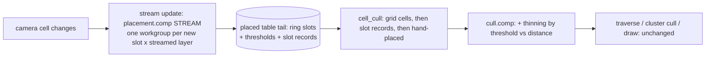

# Streamed Placement Implementation Plan

**Status:** in progress (lane M3, branch `meadow-stream`). Tasks 1-2 done and merged with a first layer setup (task 3); next: task 5 density pass, then task 4.

**Goal:** any placement layer can be *streamed*: instead of being placed
once over the whole crop at load, it is placed by the GPU in a window of
64 m cells around the camera, into a fixed ring of instance slots, and
thinned with distance inside the window. Dense near-field ground cover
(scanned grass clumps first, then flowers and small plants) becomes
possible. Static placement over the whole crop can't hold it: 4-6
clumps/m^2 over ~100 km^2 of grassland is 400-600M instances, against a
24-bit id space (16.7M) and a 1.5M budget.

**Architecture:** the same rules, dither patterns, hash and integer
keep/reject path as static placement (placement.glsl), so a streamed
instance is identical to the one static placement would produce at that
(layer, cell, point). The ring sits after the static instances in the
placed table and id space, so `loadInstance`, the cull chain and the
draw path are unchanged. Each streamed (window slot, layer) pair is one
extra cell record. Thinning and its fade happen in `loadInstance` and
cull.comp, from each instance's dither threshold.

## Design

- **API** (placement.h): `PlacementLayer::streamFullDensity` (m, default
  0 = static). A streamed layer needs `maxDrawDistance > 0`. Thinning:
  keep fraction `t(d) = 1` up to `streamFullDensity`, then
  `(streamFullDensity / d)^2` (constant density per screen area), times a
  fade to 0 over the last 20% of `maxDrawDistance`. A point with dither
  threshold `u` (0..1, its pattern threshold / 65536) is kept iff
  `u < t(d)`; since the dither pattern is progressive, any threshold
  prefix is evenly spread, so thinning keeps an even subset. `d` is the
  3D distance from the camera to the instance position. Shared CPU
  reference `streamKeepFraction(d, fullDensity, maxDistance)` in
  placement.cpp, mirrored in GLSL.
- **Fade, no pop:** an instance's scale is multiplied by
  `smoothstep(0, 0.15, t(d) - u)` (after Ghost of Tsushima's shrinking
  blades), applied in `loadInstance` for streamed ids, so culling, drawing
  and motion vectors see one scale. Culled when the factor is 0.
- **Ground following:** placement puts instances on the bilinear
  heightfield. Near the camera, the raster terrain adds detail noise
  (`terrainDetail`, up to 0.3 m, weight `terrainDetailWeight` fading out
  between the level 0 and level 1 LOD ranges). Short plants sink under
  it: this is the "black clover". The clover is hidden, and only its
  ray-traced shadow from the TLAS copy shows on the terrain.
  `loadInstance` therefore lifts streamed instances by
  `terrainDetailWeight(d) * terrainDetail(xz).x`, the same displacement
  terrain.mesh applies at that point, so raster plants sit on the
  displayed ground. Motion vectors use the same lifted transform for the
  previous frame. A distance-dependent shift of a few cm is accepted.
- **Window:** `W = 2 * ceil(R / 64) + 1` cells per side, R = the largest
  streamed `maxDrawDistance` + the streamed layers' cell margin. A cell
  (x, z) maps to slot `(floorMod(x, W), floorMod(z, W))`. The window holds
  the W x W cells centred on the camera's cell. Helpers `streamWindowCells`
  and `streamSlot` (placement.h), unit tested (negative cells, the
  round trip from slot plus camera cell back to cell).
- **Ring:** per slot, per streamed layer, a fixed run of `pointCount`
  slots (the layer's pattern size: the most it can keep). Ring capacity =
  W^2 * sum(pointCount). Ring ids start at `kPlacedBase + staticCount`.
  The placed table buffer is allocated for static + ring, so
  `loadInstance` needs no new branch to find a streamed instance. A
  parallel `uint` per ring slot holds `threshold | streamedLayer << 16`.
  A `vec2 (fullDensity, maxDistance)` per streamed layer sits in a small
  table. Total ids must stay within `kMaxInstanceId`; setPlacement throws
  otherwise.
- **Slot records:** W^2 * streamedLayers `Cell` records appended after the
  grid's cells in the cells buffer (minY, maxY, firstInstance = the run's
  first ring index, instanceCount = kept). A parallel `ivec2` per record
  holds its cell coordinates, written by the update. cell_cull.comp
  threads go grid cells, then slot records (box from the record's
  coordinates, same tests), then hand-placed instances. The visibility
  buffer grows by the ring and the records. Any SceneData field that
  today means "static placed count" for indexing (`placedCount` in
  cell_cull's visibility index) is redefined or split so that ids, ring
  and cell bits never overlap. Go through every use of `placedCount`.
- **Update:** each frame, before cull cells, compare each slot's wanted
  cell (from the camera cell) with the cell it holds (CPU array). For the
  slots that changed (all of them on the first frame and after
  setPlacement), record one dispatch of `placement_stream.comp`
  (`placement.comp` with `PLACEMENT_STREAM`): one workgroup per
  (slot, streamed layer). It walks the pattern in 64-point chunks,
  evaluates keep/reject exactly as the other variants, compacts the kept
  points in pattern order with a workgroup prefix sum (deterministic, no
  atomics on order), and writes instances, thresholds, the record (count,
  minY/maxY as placement.comp computes them) and its coordinates. A
  barrier comes before it, for earlier frames' reads of the ring on the
  same queue (write-after-read), and one after it, before cull cells. The
  placement inputs (heights, layers, points, picks, bounds) become
  persistent members while a streamed layer exists, freed on the next
  setPlacement and at teardown.
- **Debug check:** Debug builds run the same recording through
  `submitNow` before the frame, then read back the updated runs and
  compare every point of every updated (cell, layer) with `evaluatePoint`
  (keep decisions, order, prototypes, x/z exactly; height, rotation and
  scale within checkPlacement's tolerances; the threshold too). Refactor
  checkPlacement's per-run comparison into a shared function rather than
  copying it. Print `stream check: N cells, P points, M mismatches` and
  throw on any mismatch. Release records into the frame's command buffer.
- **TLAS:** streamed instances are not in the TLAS (task 4 measures what
  adding them would cost and buy). Streamed ground cover receives sun
  shadows (ray query + terrain march) and shadows itself through the
  screen-space contact shadows. It casts no ray-traced shadows.
- **Determinism:** the static table and its hash are unaffected by
  streamed layers, except that a layer moved from static to streamed
  leaves the static table.

## Tasks

1. **CPU API + reference** (placement.h/.cpp, tests): `streamFullDensity`,
   `streamKeepFraction`, `streamFade`, `streamWindowCells`, `streamSlot`;
   doctest cases. Verify: build, ctest.
2. **GPU core** (gpu_types.h + common.glsl mirrors, placement.comp
   STREAM variant, CMake variant, renderer_placement.cpp split into
   static and streamed, renderer_frame.cpp update before cull cells,
   cell_cull.comp, cull.comp + loadInstance thinning/fade, visibility
   sizing, Debug check). Capture prints gain `streamed N live (ring C)`
   (N = sum of slot record counts, read back for capture runs only).
   Verify: Debug build, ctest, Debug capture with 0 validation errors,
   `stream check` 0 mismatches, placement hash unchanged with no
   streamed layer (0x7e391ac57b8792dd without trees on main's layers), a
   `--camera-velocity` capture across a cell border (slots update
   mid-run) with 0 validation errors.
   **Opus task review** (GPU sync, the ring, the id/visibility layout).
3. **Game layers**: the four Megascans grass plants as one streamed layer
   (dense near, footprint ~0.4-0.5 m, full density to ~15-20 m, radius
   ~60-100 m), flowers and clover as streamed or static layers per
   their density. Report: static count, ring capacity, live count, GPU
   ms per pass at the start view and the open view.
4. **TLAS measurement**: a second TLAS over the ring, rebuilt when slots
   change, plus a second ray query in `sunVisibility`. Measure its build
   and per-pixel cost and the visual difference at the open view, then
   recommend. Keep it only if the user agrees.
5. **Look**: dense clumps near the camera, yellow-dominant flowers, the
   black clover fixed. Capture the open view `1119 1356 -431 -1.55 -0.02`
   next to `assets/reference/chlorophyll/flower-meadow-cumulus.png`.
6. **Docs + merge**: CLAUDE.md (Frame, Layout, placement paragraph,
   hashes, counts), decisions.md, backlog rows, resume.md; Opus final
   review; ff-merge in pieces (core first, then the look).
