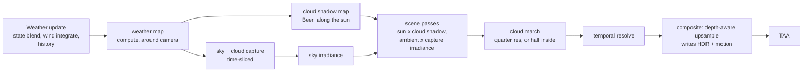

# M4 Clouds and weather — design

Milestone M4 of the showcase roadmap (`2026-11-19-showcase-roadmap.md`),
widened with the user on 2026-11-19 from "a cumulus layer" to the
engine's **weather framework plus its cloud renderer**. Built by Lane B
on the `clouds` branch in its own worktree, in parallel with M1 (Lane A),
then rebased onto main and fast-forwarded.

## Intent

Meridian is an engine for a realistic, coherent open-world game, and
weather is part of that coherence: clouds drift with the same wind that
will bend the grass, a front rolls in from the horizon instead of
appearing overhead, overcast skies turn the light flat and dim, and the
sun dims under a passing cloud. M4 builds the weather state the game
drives, the shared global wind, and volumetric clouds that read from
them, lit correctly from clear to overcast. The showcase default is
fair-weather cumulus like `assets/reference/target-meadow.png`.

## Goals

- **Weather state** the game drives and can script or time-lapse:
  cloud coverage, cloud type mix (cumulus to stratus/overcast, with room
  for cumulonimbus), wind direction, speed and gustiness, all changing
  smoothly. Changes enter upwind and travel with the wind, so fronts
  arrive from the horizon.
- **One global wind** owned by the weather system and exposed to the
  engine (GPU and CPU), with last frame's state for motion vectors. Only
  clouds consume it in M4; M3 grass and later tree wind read the same.
- **Volumetric clouds** to the horizon, visible from the ground, from
  inside the layer and from above it.
- **Lighting from clear to overcast:** a cloud shadow map dims the sun;
  scene ambient and the sky respond to cloud cover (overcast = dim, flat,
  diffuse); auto exposure handles the range.
- **No smear:** clouds write their own motion vectors and pass the same
  motion checks as the rest of the engine.
- **Budget:** ~1 ms GPU for clouds + shadow map + sky capture at
  2560x1440 (Release, median of 5).

## Non-goals (later milestones; the weather state is designed so they can read it)

- Precipitation (rain and snow particles), wet surfaces and puddles,
  lightning, fog banks and valley mist, god rays / light shafts
  (per-froxel cloud shadowing of the haze).
- Cumulonimbus rendering (the type axis has room; profiles come later).
- Authored weather zones (regional overrides; can layer onto the
  analytic map later).
- Grass and tree wind (M3 and later), GI.

## Anti-goals

- Clouds that smear, ghost or shimmer under TAA, in particular at
  mountain silhouettes in front of moving clouds and while flying
  through the layer.
- Clouds popping in or out when coverage or type changes, or when the
  camera crosses the layer.
- Clouds and future grass moving in different directions.
- Overcast scenes lit as if clear (bright ambient, hard sun) or clear
  scenes darkened by clouds that aren't there.
- Weather that depends on where the camera is or how fast frames come
  (two runs with the same seed and state history show the same sky).

## Constraints

- Everything in `CLAUDE.md` and `decisions.md`: physical units (sun in
  lux, luminance in cd/m^2, pre-exposure), camera-relative rendering,
  reverse-Z, motion vectors previous - current in UV, Hillaire 2020
  atmosphere in km, 2 frames in flight with shared images.
- **Independence from M2b's prepass (user):** the cloud composite reads
  scene depth and writes HDR color and motion, nothing else, so the
  prepass can land before or after M4 without a redesign.
- **Rebase friendliness:** clouds are separate compute + composite
  passes; changes to shared files (`common.glsl`, `mesh.frag`,
  `renderer_frame.cpp`, `gpu_types.h`) are kept to small, additive
  hunks. M1 Task 6 (curvature warp: `common.glsl`, `mesh.mesh`,
  `mesh.vert`, `mesh.frag`, culling) and Task 7 (`mesh.frag` terrain UVs)
  overlap these files and are resolved at rebase, then re-verified.
- No new third-party dependencies; noise volumes are generated on the
  GPU at load, not shipped as assets.

## Approaches (decided with the user, 2026-11-19)

1. **Cloud renderer.** Chosen: a 2.5D layer (weather map x vertical
   profile x 3D noise), ray-marched at quarter resolution every frame
   with temporal accumulation (reprojection by transmittance-weighted
   cloud depth plus the wind displacement since last frame, history
   clamped to the neighborhood), depth-aware upsampling against full
   scene depth; inside or near the layer: half-resolution tracing, less
   history, small near steps growing with distance, density fading near
   the camera (UE's approach). Rejected: HZD's 1-of-16 pixel updates
   (16-frame latency, ghosting in flight); Nubis³ voxel clouds (2-4 ms
   on PS5).
2. **Weather map.** Chosen: analytic each frame, no persistent
   simulation: low-frequency noise sampled at `position - windOffset`
   with slow evolution through a time coordinate, coverage applied as a
   threshold remap (cells grow from their cores and dissolve back), type
   continuous. Fronts: the weather at a point is the global state at the
   time that air entered the world upwind, looked up in a short history
   of past states, so a change travels with the wind. Rejected: an
   advected simulation texture (blurs, carries state, not deterministic);
   authored weather zones (not procedural).
3. **Ambient and sky.** Chosen: a small sky + cloud capture, time-sliced,
   integrated to the scene's sky irradiance (replacing today's single
   value from the atmosphere alone); haze in front of
   clouds composited the Frostbite way. Rejected: dimming ambient by a
   coverage scalar (wrong color and direction).
4. **Cloud shadow map.** Chosen: a Beer shadow map (front depth, mean
   extinction, max optical depth), orthographic along the sun.
   Rejected: exponential shadow maps (over-darken over long distances).
5. **Wind.** Chosen: one `Wind` block in the scene buffer with the
   previous frame's copy; ground-level sampling for vegetation, altitude
   scale and veer for clouds (Ghost of Tsushima, UE directional wind).

## Design

### Frame

New passes: `"weather"` (map, shadow map, capture slice, irradiance;
before the scene passes, next to the atmosphere LUTs) and `"clouds"`
(march, resolve, composite; after the late scene pass, before TAA).

### Weather state and API

New public header `engine/include/meridian/weather.h`:

- `WeatherState`: `coverage` [0, 1], `type` [0 = stratus/overcast, 1 =
  cumulus] (continuous; values above 1 are reserved for cumulonimbus),
  `precipitation` [0, 1] (carried and exposed, unused in M4), `wind`
  (direction in the horizontal plane, speed at 10 m in m/s, gustiness
  [0, 1]).
- `class Weather` (engine-side, CPU): owns the current state, a target
  and a transition (`setTarget(state, seconds)`: smooth, C1-continuous
  blend), the integrated wind offset and travel distance, and the
  history. `update(gameSeconds)` advances it; a time scale multiplies
  game time for time-lapses. Deterministic: the same seed, start state
  and target calls at the same game times give the same results
  regardless of frame rate (integration in fixed substeps of game time).
- `Renderer::setWeather(const Weather &)` copies what the GPU needs into
  the scene buffer each frame. Presets in the game: `clear`, `fair`
  (default: fair-weather cumulus), `broken`, `overcast`.
- **History and fronts:** the weather keeps (travel distance, state)
  samples, one per fixed interval of travel, covering the upwind extent
  the weather map can show (the map window plus the longest view to the
  horizon from 5 km up, ~250 km of air). The state at world position p
  is the history sample whose travel distance equals the current travel
  minus the downwind distance of p from a fixed **front line** (a world
  line perpendicular to the wind, 60 km upwind of the world origin),
  blended between samples. A state change is born at the front line and
  crosses the world at wind speed: at 10 m/s it reaches the crop centre
  ~1.7 game hours later, visible from altitude as a wall approaching.
  Points upwind of the line see the current state; points beyond the
  history see its oldest sample. Nothing depends on the camera. A wind
  direction change bends rather than breaks this (accepted for visuals).
- `--weather-front SECONDS` sets the global blend duration only; the
  time-lapse capture runs with a time scale large enough that the front
  crosses the crop during the capture (e.g. 2 game hours).

### Wind

- GPU `Wind` block in the scene buffer (must match): direction (unit,
  xz), speed at 10 m, gustiness, accumulated offset (xz, meters: the
  time-integral of the wind velocity, so speed changes never snap
  anything that scrolls with it), gust phase, altitude scale exponent
  (power-law profile), veer (radians at cloud altitude), plus the same
  block for the previous frame.
- GLSL helpers in a new `wind.glsl`: `vec2 windVelocity(Wind, float
  altitude)` (speed by power law from 10 m, direction veered with
  altitude), `vec2 windOffset(Wind, float altitude)`, `float
  gust(Wind, vec2 worldXZ)` (world-space scrolling noise, amplitude from
  gustiness). Consumers evaluate them with `wind` and `previousWind` for
  motion vectors.
- CPU mirror in `weather.h` for gameplay and tests (`windVelocityAt`).

### Weather map

- Compute pass each frame into a 2D texture (R coverage, G type, B
  precipitation; 512² over a ~60 km window centred on the camera,
  snapped to texels so it doesn't swim): tileable low-frequency noise at
  `xz - windOffset(cloud altitude)` with a slow time coordinate (cells
  form and dissolve without wind), coverage as `remap(noise, 1 -
  coverage, 1)` from the local (history-looked-up) state, type from the
  local state with low-frequency variation.
- Beyond the window (horizon from altitude), the march reads a coarse
  analytic fallback (same functions, lower frequency) so clouds reach
  the horizon.

### Clouds

- **Layer:** a spherical shell on the atmosphere's planet (km in the
  atmosphere, m in the world). Heights are above sea level (the shell is
  absolute); the defaults put fair-weather cumulus bases ~1.1 km above
  the Napf ridges, as in summer over the Swiss Prealps: cumulus base
  2.5 km, tops up to 4.5 km (towers by coverage); stratus/overcast
  1.8-3.0 km. Exact profiles in a small type texture (density and
  erosion by normalized height, Frostbite convention). With these
  defaults the existing high overview (4354 m) is inside the cumulus
  layer; a new view above the layer (~6500 m) is added. Planet-curved, so it meets M1's curvature warp at the
  horizon.
- **Density:** weather coverage x vertical profile(type, height) x base
  3D Worley-Perlin noise (128³), eroded by detail Worley noise (32³)
  distorted by curl noise; both volumes generated on the GPU at load.
- **Lighting:** sun transmittance through the layer (short light march)
  and the Beer shadow map beyond it, sun color and illuminance from the
  atmosphere's transmittance at the sample, dual-lobe phase
  (Jendersie-d'Eon approximate Mie as an option), multiple scattering
  with Wrenninge octaves (2-3), edge darkening by lowered albedo at
  thin edges (Hillaire) rather than the powder hack, ambient from the
  sky irradiance with a bottom-to-top gradient.
- **March:** quarter resolution (640x360 at 1440p) below the layer and
  above it; half resolution when the camera is inside or within a
  margin of it. Blue-noise jittered start per frame; step counts grow
  with distance (budget-driven); the march stops at scene depth (clouds
  never draw over closer geometry). Output per pixel: in-scattered
  luminance, transmittance, transmittance-weighted mean depth.
- **Haze:** clouds receive aerial perspective by their weighted depth
  (`L = L_haze(0..d) + T_haze(0..d) * L_cloud`); within the
  aerial-perspective LUT's range from it, beyond from the sky-view and
  transmittance LUTs. Haze between camera and sky behind clouds is
  attenuated by cloud transmittance.
- **Temporal resolve:** reproject history by the weighted cloud depth
  and the cloud wind displacement since last frame; clamp history to the
  current neighborhood (variance clipping); reset on disocclusion;
  history weight lower inside the layer.
- **Composite (reads depth; writes HDR color and motion only):**
  depth-aware upsample to full resolution (bilateral on scene depth so
  silhouettes in front of clouds stay sharp and history from the
  background never bleeds onto them); blended over the HDR target by
  transmittance. Where clouds dominate the pixel (cloud opacity above
  0.5) the motion target gets cloud motion: reprojection of the
  weighted cloud depth with the camera and the wind displacement, so TAA
  and later DLSS move clouds with the clouds, not with the sky's
  rotation-only motion.

### Cloud shadow map

- Beer shadow map, R11G11B10F or RGBA16F: front depth along the sun,
  mean extinction, max optical depth; transmittance at depth d is
  `exp(-min(maxOD, meanExt * max(0, d - front)))`. 1024² over ~30 km
  around the camera, orthographic along the sun, texel-snapped;
  16-32 steps per texel (amortized over frames if the budget needs it);
  bilateral blur of extinction and optical depth only.
- `mesh.frag` (and terrain via it): sun illuminance x cloud shadow
  transmittance at the surface (beyond the map: the analytic fallback's
  coverage gives a mean transmittance).
- No separate local cloud occlusion of ambient: the capture already puts
  cloud cover into the sky irradiance, and multiplying again by a local
  occlusion would darken overcast twice. Under one passing cumulus the
  dome stays mostly sky, so the visible local effect is the sun shadow,
  which the map provides. (Revisit with GI.)

### Sky + cloud capture and ambient

- A small capture (octahedral, ~64², or 6 x 32²) from the camera's
  position: sky-view LUT plus a coarse cloud march, updated over a few
  frames (time-sliced), integrated into the sky irradiance the scene
  uses today (`skyIrradiance`, now also its directional terms as SH-L1
  if cheap, else the existing single value) and into the specular sky
  fallback. Overcast: the capture is mostly dim cloud, so ambient goes
  flat and dim with no special case; the sun is dimmed by the shadow
  map; auto exposure adapts.
- The visible sky behind clouds stays the sky-view LUT; the clouds
  cover it.

### Debug and CLI

- `--weather clear|fair|broken|overcast` (default `fair`),
  `--time-scale X`, `--weather-front SECONDS` (from the start preset to
  `overcast` over that many game seconds, for time-lapse captures),
  `--clouds off`.
- Capture output: weather state at the camera (coverage, type, wind),
  and GPU ms for `"weather"` and `"clouds"`.
- New views in CLAUDE.md: ground view of fair cumulus, the high view
  above the base, a view flying through the layer, a mountain
  silhouette against clouds.

## Verification

- **Unit tests:** state blending is C1-continuous and frame-rate
  independent (same result with 1, 4 and 60 substeps per second); wind
  offset is the integral of velocity (continuous across speed changes);
  a front's arrival time at a point equals its upwind distance / wind
  speed; history lookup clamps at its ends; Beer shadow map
  transmittance against a brute-force optical depth on a synthetic
  column; phase functions integrate to 1.
- **Determinism:** two capture runs with the same weather arguments
  give the same image (mean difference within run-to-run noise).
- **Captures:** clear, fair, broken, overcast at the ground view and the
  high view (overcast flat and dim, clear unchanged from today within
  noise with `coverage = 0`); time-lapse of a front (`--weather-front`
  with `--time-scale`): a frame sequence showing the front arriving
  from upwind, no popping between frames.
- **Motion (user):** fast turn, flying toward and through the layer, and
  a mountain silhouette in front of moving clouds: Laplacian ratio
  against the still of the same view for each, reported next to the
  engine's existing baseline (TAA keeps 48% at the 5 m/s ground view;
  clouds must not make a view worse than the same view with
  `--clouds off` beyond run-to-run noise); no ghosting at
  the depth-aware upsample edges (inspect crops at silhouettes).
- 0 validation errors, no leaks.

## GPU budget

~1 ms for clouds + shadow map + sky capture at 2560x1440 at the ground
and above-the-layer views, Release, median of 5. Inside the layer
(half-resolution tracing, a transitional state while flying through) the
number is measured and reported separately, target <= 2 ms. Every game run goes through
`flock /tmp/meridian-gpu.lock` so no other GPU work overlaps. Over budget: report the numbers with the levers (step
counts, resolution inside the layer, shadow map and capture slicing)
before cutting anything.

## Left to the builder

Noise generation details and volume sizes within the stated ones;
remap and erosion constants; type profile texture contents; step
counts and light-march length; history weights and clipping;
octave coefficients; capture layout (octahedral vs cube) and slicing;
history interval and length within the ~250 km rule; CLI names.

## Sources

- Schneider, The Real-time Volumetric Cloudscapes of Horizon Zero Dawn
  (2015): https://www.advances.realtimerendering.com/s2015/The%20Real-time%20Volumetric%20Cloudscapes%20of%20Horizon%20-%20Zero%20Dawn%20-%20ARTR.pdf
- Schneider, Nubis Evolved (2022): https://advances.realtimerendering.com/s2022/SIGGRAPH2022-Advances-NubisEvolved-NoVideos.pdf
- Nubis³ (2023): https://advances.realtimerendering.com/s2023/Nubis%20Cubed%20(Advances%202023).pdf
- Hillaire, Physically Based Sky, Atmosphere and Cloud Rendering in
  Frostbite (2016): https://media.contentapi.ea.com/content/dam/eacom/frostbite/files/s2016_pbs_frostbite_sky_clouds.pdf
- Hillaire 2020 course slides: https://blog.selfshadow.com/publications/s2020-shading-course/hillaire/s2020_pbs_hillaire_slides.pdf
- UE volumetric clouds and sky light:
  https://dev.epicgames.com/documentation/en-us/unreal-engine/volumetric-cloud-component-in-unreal-engine ,
  https://dev.epicgames.com/documentation/en-us/unreal-engine/sky-lights-in-unreal-engine
- UE 5.6 reconstruction artifacts (why the upsample is verified in
  motion): https://forums.unrealengine.com/t/volumetric-cloud-temporal-artifacts-from-volumetric-render-target-reconstruction/2649937
- Takram three-clouds: https://cdn.jsdelivr.net/npm/@takram/three-clouds@0.7.4/README.md
- Jendersie & d'Eon, approximate Mie: https://research.nvidia.com/labs/rtr/approximate-mie/publications/approximate-mie.pdf
- Ghost of Tsushima wind: https://gdcvault.com/play/1027350/Blowing-from-the-West-Simulating
- UE WindDirectionalSource: https://dev.epicgames.com/documentation/en-us/unreal-engine/python-api/class/WindDirectionalSourceComponent

## Base and coordination

Built on the `clouds` branch from main at the time the worktree is
created (M1 partly landed: curvature warp is on main), against today's
code: single-pass `mesh.frag`, no prepass, no sky-visibility term. M1's
remaining tasks and, later, M2a/M2b are resolved at rebase: the
composite's reads (depth) and writes (HDR, motion) are the only contract
with the scene passes, and the ambient change is one multiplier-free
swap of the sky irradiance source, which M2b's sky visibility then
multiplies.

## Approval

Scope (weather framework + renderer, shared wind, clear-to-overcast
lighting, fair cumulus default, flight through the layer, the out-of-M4
list) set by the user on 2026-11-19; all five approaches approved; the
user added the motion checks, cloud motion vectors, the ~1 ms budget
with levers reported before cuts, and the prepass-independent
composite. Calls made without the user: the travel-distance history for
fronts, the ~60 km map window with an analytic fallback to the horizon,
the cloud-dominates threshold (opacity 0.5) for motion, edge darkening
by albedo instead of powder, SH-L1 ambient if cheap, the preset names,
deterministic fixed-substep weather integration. After the builder
check: heights above sea level with a 2.5 km cumulus base (the 4354 m
overview is inside the layer; a ~6500 m view is added above it), the
front line 60 km upwind with `--weather-front` as the global blend
duration, dropping the separate local cloud occlusion of ambient (it
double-darkened with the capture), the 1 ms budget at ground and
above-layer views with inside-the-layer reported separately (<= 2 ms),
and the motion bar "no worse than `--clouds off`".
