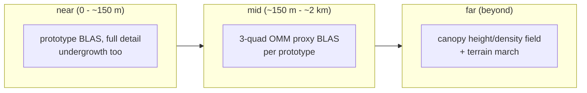

# M2b Forest lighting — design

Second half of milestone M2 (see `2026-11-19-forests-design.md` for M2a
and `2026-11-19-showcase-roadmap.md`). M2a puts millions of placed trees
and rocks on the Napf with a TLAS built once over full-detail shared
BLAS, and records what that costs. M2b makes the forest's light right and
affordable: ray representations that change with distance in a
partitioned TLAS, a canopy height/density map for everything rays no
longer reach, and sky visibility so forest interiors and the ground
under trees darken the way they do in the reference.

Execution: Lane A, after M2a. Its numbers (TLAS build time and memory,
shadow cost through the forest, the frame against the ~7.7 ms target)
are inputs here; where this document gives distances or capacities they
are starting points to replace with those measurements.

## Intent

Today ambient light is a single sky irradiance value plus a ground
bounce, unoccluded everywhere: a forest floor is lit like an open
meadow, and nothing darkens under a canopy seen from afar. Sun shadows
trace every tree at full detail to 20 km, which M2a measures and very
likely finds too expensive. M2b fixes both with one structure: rays see
the real trees near the camera, cheap proxies further out, and a
height/density field beyond that, for sun shadows and sky visibility
alike. The first undergrowth layer (ferns, saplings) arrives here,
because near-only ray representations make it affordable.

## Goals

- Sun shadows from placed objects at every distance, matching what the
  raster shows closely enough that no shadow appears without a caster or
  vice versa: full geometry near, three-quad opacity-micromap proxies
  mid, canopy field far.
- Sky visibility per pixel: forest interiors, the ground under canopies,
  gullies and the shaded side of dense stands darken; open meadow stays
  as today. Near the camera from rays, far from the canopy field and the
  terrain march.
- Partitioned TLAS updated incrementally as the camera moves, with a
  bounded number of instance writes per frame (no frame-time spikes).
- First undergrowth layer: Megascans common fern and the beech/rowan
  saplings, near the camera only.
- GPU budget: RT sun shadow + sky visibility toward the roadmap's 1.2 ms
  at 1440p (below).

## Non-goals

- Leaf light transmission: the first shading task after M2b (user,
  2026-11-19).
- Wind, dynamic objects in the TLAS (the global partition exists for
  them; nothing uses it yet), RT on clusters (virtualized geometry slice
  2).
- RT reflections, GI, a denoiser beyond the sky-visibility history.
- DLSS Ray Reconstruction integration: the design keeps a raw per-frame
  sky-visibility term available for it, nothing more.
- A non-NVIDIA path for the partitioned TLAS (accepted: NVIDIA first).

## Anti-goals

- Shadow or ambient changes visible as a band or a pop when a tree
  crosses a representation boundary, still or in motion.
- Sky-visibility noise, crawling or ghosting under TAA; dark halos at
  disocclusions.
- Light leaking under dense forest at a distance (the classic
  short-ray failure) or forests that look lit from inside.
- Frame-time spikes when partitions change.

## Constraints

- Everything in `CLAUDE.md` and `decisions.md`; M2a's instance id space,
  `loadInstance`, one BLAS per prototype, the static placed table.
- `VK_NV_partitioned_acceleration_structure` rev 1 is exposed by the
  620.70 driver (vulkaninfo); its feature bit and `maxPartitionCount`
  are queried at device creation, and their absence is a startup error
  with a clear message (no silent fallback). The driver has no
  `accelerationStructureIndirectBuild`; the partitioned build takes its
  operations from GPU buffers, which is what M2b needs.
- `VK_EXT_opacity_micromap` for the proxies.
- M1's `terrainOccludes` (hierarchical max-pyramid march) is the
  terrain's ray representation everywhere.

## Approaches (decided with the user, 2026-11-19)

- **TLAS (roadmap approach 5, staged).** Chosen: a partitioned TLAS with
  one partition per placement tile, near/mid/far representations, rebuilt
  incrementally on the GPU. Rejected: the M2a static TLAS kept as is
  (full-detail trees to the horizon: measured cost in M2a); a plain TLAS
  rebuilt per frame from GPU-written instances (no indirect build on this
  driver, so each rebuild costs the full capacity: vk_lod_clusters
  measured ~1.9 ms TLAS build at 3M instances vs ~0.4 ms partitioned).
- **Mid representation.** Chosen: three perpendicular quads through the
  tree's center with an opacity micromap per quad, one proxy BLAS per
  prototype shared by every mid instance (the HPG 2026 foliage paper's
  far proxy). Rejected: impostor-plane BLAS facing the sun (re-oriented
  per sun change, its shadow shape swims as the sun moves); coarse
  cluster levels as BLAS (the canopy collapses at coarse levels, the
  coverage problem M2a's impostors exist for).
- **Far representation.** Chosen: a canopy height/density field (2D,
  per texel: canopy bottom, top, density) marched with the terrain.
  Rejected: proxies to the horizon (millions of TLAS instances for
  sub-pixel shadows); no far tree shadows (forests seen from a ridge
  would lose their self-shadowed texture and the ground under them
  would stay bright).
- **Sky visibility (roadmap approach 6).** Chosen: one short
  cosine-distributed ray per pixel against the TLAS, continued as a far
  march through the terrain and canopy field, accumulated in its own
  temporal history. Rejected: screen-space AO (misses off-screen and
  behind-surface occluders, which is most of a canopy); baked
  per-tile occlusion (no dynamic objects later, low resolution under
  trees).

## Design

### Representations by distance

- The boundaries are distances from the camera per tile, with
  hysteresis (a tile switches at d and switches back at 0.9 d), so a
  camera hovering at a boundary doesn't thrash.
- **Shadow rays** query the TLAS over their full length (near and mid
  instances, hand-placed objects) and march terrain plus the canopy
  field; for them the field skips tiles currently represented in the
  TLAS (a per-tile flag the march reads), so a tree never occludes
  twice.
- **Sky rays** query the TLAS only up to ~20 m and then march the field
  from 20 m on *without* the tile mask: beyond 20 m every tree, near
  tile or not, is represented by the field alone, so nothing leaks under
  a canopy past the TLAS segment and nothing is counted twice (only
  crowns straddling the 20 m boundary can be, which is negligible). The
  march takes a start distance and a mask on/off per ray type.
- Starting radii: near 150 m, mid 2 km; set from M2a's measured shadow
  cost and the visual check (no visible difference at the near/mid
  boundary in a motion capture).

### Partitioned TLAS

- One partition per placement tile with instances in the TLAS (64 m
  cells grouped into tiles; tile size so partitions hold <= ~1,024
  instances, as the HPG paper and the Moana renderer found efficient).
  Hand-placed instances get their own partition(s); the global partition
  stays empty for later dynamic objects.
- Partition translation carries the tile's origin, so instance
  transforms inside a partition are tile-relative (precision headroom
  for later, larger worlds).
- **Per frame, on the GPU:** a compute pass compares each tile's wanted
  representation (from camera distance, with hysteresis) with its
  current one and appends partitioned-TLAS operations: write instances
  for tiles entering near or mid, update-instance (BLAS swap) for tiles
  moving near <-> mid, clear for tiles leaving mid. Then one
  `vkCmdBuildPartitionedAccelerationStructuresNV`.
- **Spike control:** at most N tile transitions per frame (N from
  measurement, e.g. sized so the build stays under ~0.2 ms), nearest
  first; the rest wait a frame. Teleports (start, `--camera` captures)
  run the full set once before the first frame is shown.
- Undergrowth layers (maximum draw distance) only ever enter as near.
- Capacities from M2a's counts: the instance budget is near + mid
  instances within the radii, not the placed total; overflow is counted
  and printed like every other list.

### Mid proxies (opacity micromaps)

- Baked at load per prototype next to the impostor (M2a's bake and its
  disk cache rule): orthographic coverage of the tree along three
  perpendicular axes through its center (two vertical planes at 90°
  rotated by the prototype's yaw frame, one horizontal), each written as
  a quad with an opacity micromap built from that coverage (4-state,
  subdivision level chosen by measurement; Indiana Jones used level 6).
- Coverage is thinned to match the tree's real transmittance from each
  axis (a quad stands for a whole crown's depth, so fully opaque
  coverage would cast a too-dark shadow): the bake measures the fraction
  of rays through the full tree that pass, and the micromap's opaque
  fraction matches it.
- Rays from an impostor's pixels skip their own instance's proxy (by an
  origin offset equal to the crown half-depth along the ray, or an
  instance mask scheme, whichever verifies clean).

### Canopy height/density field

- 2D, over the crop, built at load on the GPU from the placed table: per
  texel (2-4 m, from measurement) the canopy bottom and top heights and
  an extinction density, splatted from each placed tree's crown
  (prototype crown bounds and a per-prototype extinction measured from
  the full tree at bake, the same ray-pass fraction the proxies use).
  A max-height pyramid over it, like the terrain's.
- **March:** M1's `terrainOccludes` grows into a far-field march that
  returns transmittance instead of a boolean: terrain hits are 0, the
  canopy slab between bottom and top attenuates by Beer-Lambert over the
  ray's path inside it, so a low sun through a forest edge gives a soft
  partial shadow, not a hard cut. Same hierarchical skipping: the
  canopy pyramid lets empty regions be skipped like the terrain's.
- Tiles currently in the TLAS are masked out of the field (above).
- The far canopy also darkens the far ground directly through sky
  visibility (below), so a forest seen from a ridge reads as a dark,
  self-shadowed mass with lit crowns.

### Depth + normal prepass (user, 2026-11-19)

Sky visibility is traced and filtered *before* shading, so the main pass
reads a finished result. A one-pass alternative (trace in `mesh.frag`,
blend with history in the same pass) was rejected: with foliage nearly
every edge pixel disoccludes every frame in motion, so its raw one-sample
noise at disocclusions would shimmer constantly on canopy edges.

- **Prepass:** every opaque and masked surface (terrain, cluster lists,
  impostors) is drawn once into depth, motion and a normal target,
  through the existing two-phase culling: early lists, depth pyramid,
  late cull, late lists. Masked materials alpha-test here and only here.
  The prepass fragment samples what the normal needs (normal map,
  alpha) and the material's roughness.
- **Normal target:** world-space shading normal plus roughness in one
  RGBA16F target (DLSS Ray Reconstruction's packed normal/roughness guide
  layout), so the same image is the DLSS guide later. Motion vectors
  move from the main pass to the prepass.
- **Main pass:** the same draw lists again with depth test EQUAL and
  depth writes off, so each pixel shades exactly once; positions are
  computed identically in both passes (`invariant gl_Position`, shared
  position code), masked materials draw with the opaque pipeline (the
  depth already holds the alpha test). Impostors, which write
  `gl_FragDepth`, reproduce the same depth in both passes (builder's
  method, verified bit-exact). Blended surfaces keep their own path
  after it and take sky visibility 1 (as today).
- **Measured, not assumed:** the net cost (prepass + trace + filter -
  main-pass saving from shading once with no overdraw) at the forest
  views, recorded in `decisions.md`.
- **Visibility buffer later:** virtualized geometry slice 4 (visibility
  buffer) would produce the same depth, motion and normal data from one
  geometry pass and replace this prepass; nothing here may depend on the
  prepass beyond those three targets, so that swap stays local.
- Sun shadow rays stay in the main pass (unchanged); moving them into
  the trace pass is an M5 option.

### Sky visibility

- **Trace pass** (compute, after the prepass): per pixel, position from
  depth, normal from the normal target.
- **Ray:** one per pixel, cosine-distributed around the shading normal
  (blue-noise or R2 sequence indexed by frame), from the same origin
  rules as the shadow ray. TLAS query up to ~20 m (near geometry: trunks,
  undergrowth, crowns overhead), then the far-field march along the same
  direction to a few hundred meters for terrain and canopy (gullies,
  forest from below the edge). A miss is 1; transmittance from the field
  counts.
- **Filter:** its own R8 (or R16F) visibility history with temporal
  accumulation (exponential, ~0.05-0.1 per frame) using the prepass
  motion vectors, reset on disocclusion (depth/normal mismatch), then an
  edge-aware spatial filter (depth and normal weights) whose output the
  main pass reads. Disoccluded pixels get extra spatial support until
  their history refills, so canopy edges in motion don't shimmer.
  Feeding raw 1-spp noise to TAA would be clamped away and flicker.
- **Use:** in the main pass, multiplies the diffuse sky ambient (sky
  irradiance and its ground bounce) and the specular sky term (with a
  roughness-based specular occlusion approximation from the same
  visibility).
- **Ray Reconstruction later:** the raw per-frame term stays available
  (a define skips the history), since RR wants uncorrelated per-frame
  input.
- **Cost control:** full resolution first; the checkerboard (half the
  pixels per frame, filled from history) is the first gate lever.

### Undergrowth

- A placement layer like M2a's, inside the forest mask and at forest
  edges: Megascans common fern (cooked from its Fab glTF; it is textured
  alpha cards marked `BLEND`, so the cook forces `MASK` and its BLAS gets
  opacity micromaps from the same builder the mid proxies use, so fern
  rays skip any-hit alpha tests on most of the card; Megaplants leaves
  stay opaque geometry) and the
  beech/rowan saplings (from the M2a USD import), maximum draw distance
  from measurement (starting ~80 m). Raster through clusters; RT near
  only. Its placement uses M2a's rules, so it is deterministic and
  identity-stable like everything else.

### Debug and CLI

- Views: forest interior at eye height, forest edge with the sun low
  through it, a ridge view over forest (far field), and the near/mid
  boundary.
- `--sky-visibility off`, `--canopy off`, and a debug view of the
  representation per tile (near/mid/far tint) for checking boundaries.
- Capture output adds: TLAS instances by representation, partition
  operations this frame, and GPU ms for the TLAS update and the canopy
  build (load).

## Verification

- **Unit tests:** representation choice with hysteresis (no thrash
  around a boundary over a camera path); Beer-Lambert slab
  transmittance and the far march's CPU replica against a brute-force
  march over a synthetic field; proxy coverage thinning hits the
  measured pass fraction; canopy splat conserves per-tree extinction.
- **Captures:** shadows near/mid boundary in motion (no pop: Laplacian
  ratio and mean difference within noise against a full-detail-TLAS
  build of the same view, which M2a's static TLAS provides as the
  reference); far canopy vs a full-detail reference at a ridge view
  (mean difference small, no bright forest floor at distance); interior
  sky visibility still vs moving (no crawl; Laplacian ratio within noise
  of today's ground view); 0 validation errors, 0 drops, no leaks.
- **Prepass:** with sky visibility forced to 1, the prepass build's
  image matches the single-pass build within run-to-run noise at the
  forest and default views (no EQUAL-test holes: a debug clear color
  never shows through), including masked ferns and impostors; motion
  capture Laplacian ratio unchanged.
- **Spikes:** a fly-through capture at 50 m/s over the forest logs the
  per-frame TLAS update ms; its maximum stays under the per-frame cap.
- **Measurements (Release, 2560x1440, median of 5; first ask the user to
  confirm no other instance is rendering):** per-pass GPU ms at the four
  views, the frame against the ~7.7 ms target and against M2a's numbers;
  TLAS memory vs M2a's static TLAS; load time added (canopy field,
  proxy bake).

## GPU budget (M2b)

Sun shadow + sky visibility (rays, far march, filter, TLAS update)
toward the roadmap's 1.2 ms at 1440p; the prepass's net cost reported
separately.

**Gate (user, 2026-11-19):** <= 16.7 ms at the forest views with
everything on (no shadow-distance cap, sky visibility on). Beating M2a's
measured frame is a recorded goal, not the gate. If the gate is missed,
the levers, in order: checkerboard sky rays, a smaller near radius, a
smaller mid radius; any visible quality cost they bring is reported to
the user. The remaining gap to ~7.7 ms is recorded in `decisions.md` for
M5.

## Left to the builder

Tile size within the ~1,024-instance rule; per-frame transition cap;
hysteresis width; OMM subdivision level and format; canopy texel size
and pyramid layout; ray sequence; history weights and the spatial
filter; the far march's sky-visibility length; impostor self-proxy skip
method; undergrowth densities and draw distance; CLI names.

## Sources

- VK_NV_partitioned_acceleration_structure:
  https://docs.vulkan.org/features/latest/features/proposals/VK_NV_partitioned_acceleration_structure.html
- vk_partitioned_tlas sample: https://github.com/nvpro-samples/vk_partitioned_tlas
- CLAS/PTLAS preview (domino numbers): https://devblogs.microsoft.com/directx/clas-ptlas-preview/
- vk_lod_clusters partitions and PTLAS numbers:
  https://github.com/nvpro-samples/vk_lod_clusters/blob/main/docs/partitions_and_ptlas.md
- Interactive Moana, partition sizing: https://mavenkim2.github.io/2025/11/09/interactive-moana-part2.html
- Real-time Path Tracing of Massive Dynamic Foliage (HPG 2026; 3-quad
  OMM proxies, PTLAS partitions <= 1,024): https://dl.acm.org/doi/10.1145/3820021
- Indiana Jones OMM: https://developer.nvidia.com/blog/path-tracing-optimizations-in-indiana-jones-opacity-micromaps-and-compaction-of-dynamic-blass
- Lumen (short rays leak; far field): https://dev.epicgames.com/documentation/en-us/unreal-engine/lumen-technical-details-in-unreal-engine
- Bruneton & Neyret 2012, Real-time Realistic Rendering and Lighting of
  Forests: https://diglib.eg.org/items/9de7c594-877a-4d97-a2e0-bcab5acb10bf/full
- DLSS Ray Reconstruction integration guide:
  https://github.com/NVIDIA/DLSS/blob/main/doc/DLSS-RR%20Integration%20Guide.pdf

## Approval

Direction (partitioned TLAS with tile partitions, near BLAS, mid
three-quad OMM proxies, far canopy map; sky-visibility rays) approved by
the user on 2026-11-19, staged after M2a. Calls made without the user:
the starting radii and hysteresis, transmittance-matched proxy coverage,
the far march returning transmittance (growing M1's `terrainOccludes`),
tiles in the TLAS masked out of the field, the sky ray continuing as a
far march, its own history instead of TAA, undergrowth arriving here,
the gate (beat M2a's frame and stay <= 16.7 ms), and the missing-extension
startup error. After the builder check: per-ray-type field masking (sky
rays march the full field past 20 m), and opacity micromaps on the
fern's alpha cards (both approved). The user chose the depth + normal
prepass over in-pass accumulation and set the gate. Calls made without
the user in the prepass: RGBA16F normal + roughness, motion moved to the
prepass, masked drawn opaque in the main pass, blended surfaces at
visibility 1, sun shadows staying in the main pass.
