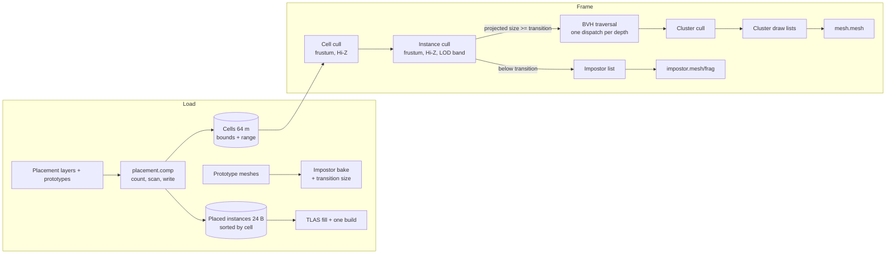

# M2a Forests — design

Milestone M2 of the showcase roadmap (`2026-11-19-showcase-roadmap.md`) is
split in two, each visible on screen with its own GPU budget:

- **M2a forests (this document):** procedural placement, instance cells,
  cell and instance culling, cluster-group BVH traversal, hemi-octahedral
  impostors, rocks and boulders, every placed object in a TLAS built once.
- **M2b forest lighting (separate spec, after this one):** partitioned TLAS
  with tile partitions and near/mid/far ray representations, a canopy
  height/density map, sky-visibility rays.

Execution: Lane A, after M1 lands. This design assumes M1's code is on main
(GPU heightfield sampling, `terrainOccludes`, `curvatureDrop`, wrapped
terrain UVs, walk mode).

## Intent

Meridian is an engine for a realistic, coherent open-world game; the
meadow reference (`assets/reference/target-meadow.png`) is the quality bar,
not the game. Vegetation is part of the world, not decoration: the engine
must know where every tree and rock is (later collision, gameplay queries,
wind), keep it stable, and render millions of film-weight instances from
eye height inside a forest to a 3000 m overview. M2a builds that framework
and shows it on the Napf: broadleaf forest covering hillsides with edges
and lone trees, rock outcrops and boulders on steep ground.

Trees are real temperate species from Megascans Megaplants (European
beech, English oak, Norway maple, plus beech and rowan saplings), brought
in by an import tool that is part of M2a (below). Poly Haven has no
European broadleaf trees; its island trees stay the fallback if the
import fails. M2a's systems must not depend on which assets fill them.

## Goals

- Deterministic placement of forests, lone trees, rocks and boulders over
  the 15 x 15 km crop from rules (slope, altitude, a forest-mask noise
  with edges, clustering), generated once at load on the GPU, resident,
  sorted by cell, with stable instance indices. Same inputs, same
  instances, every run and every machine.
- Scale: about 2-3 million trees (forest cover ~35-40% of 225 km² at
  ~300 canopy trees/ha) plus rocks, at interactive frame rates.
- Cluster LOD traversal whose cost follows what is on screen, not the
  total clusters of visible instances (a Poly Haven tree has ~33K clusters
  across its DAG levels).
- Far trees as hemi-octahedral impostors that relight under a moving sun,
  write real depth and correct motion vectors, and hand over to the
  cluster tree without a visible pop.
- Every placed object casts RT sun shadows through a TLAS built once for
  the static world (never rebuilt per frame); its build time and memory
  are measured and recorded.
- GPU budget measured in Release at 2560x1440, median of 5 (below).
- **Done bar (user, 2026-11-19):** M2a is done only if the forest views
  (edge, interior, overview) hold a frame at or under 16.7 ms with RT
  shadows on.

## Non-goals (M2a)

- Partitioned TLAS, near/mid/far ray representations, canopy map, sky
  visibility: M2b.
- Tree wind and sway: deferred (the RT BLAS can't sway with the raster).
  No wind field and no wind bytes in the instance format; added when wind
  lands.
- Collision, CPU queries of placed instances, editing/overrides of the
  procedural result: the placement is deterministic and readable so these
  can come later; none is built now.
- Undergrowth (shrubs, ferns): the placement framework supports a layer
  with a maximum draw distance, but the first undergrowth layer comes with
  M2b, when near ray representations make millions of small plants
  affordable in RT.
- Virtualized geometry slices 2-4 (RT on clusters, coverage-preserving
  foliage simplification, visibility buffer) and slice 5's compression
  and streaming. Only slice 5's hierarchical traversal moves forward
  (below).
- Real land-cover data (e.g. swissTLM3D forest polygons as a mask
  texture): content work, separate.
- Leaf light transmission (backlit leaves): `mesh.frag` has none today.
  It is the first shading task after M2b (user, 2026-11-19); M2a's
  per-leaf tint (below) keeps canopies from reading as plastic until
  then.
- Layered dithering between layers (HZD's collision between layers that
  share a footprint): rocks and trees use disjoint rules (steep rock
  ground vs forest), so overlaps are rare; revisit with undergrowth.

## Anti-goals (a failure even if it works)

- Placement that changes when the camera moves, between runs, or when an
  unrelated layer changes.
- Visible popping, shimmering or smearing at the impostor transition or
  between LOD levels, still or in motion.
- A canopy that thins out or loses coverage with distance (leaf cards
  collapsing under simplification: island_tree_01's leaf primitive
  simplifies from 9,021 leaf clusters to a 32-triangle root).
- Frame-time spikes from placement or TLAS work after load.
- A design tied to the current Poly Haven assets or the Napf data.

## Constraints

- Everything in `CLAUDE.md` and `docs/decisions.md`: camera-relative
  rendering, reverse-Z, motion vectors `previous - current` in UV,
  buffer-device-address scene tables, two-phase Hi-Z occlusion, the
  Nanite LOD cut rule, "must match" structs with static_asserts.
- M1's curvature display warp applies to every raster stage and every
  culling bound, impostors and cells included.
- The driver (620.70) has no `accelerationStructureIndirectBuild`; a
  compute pass may fill TLAS instances, but the build's primitive count
  comes from the CPU.
- One feature per commit; decisions logged with sources; CLAUDE.md
  current in the same commit.

## Approaches (decided with the user, 2026-11-19)

1. **Placement.** Chosen: generated once at load by GPU compute (Horizon
   Zero Dawn: a fixed dither pattern per layer, a point kept when the
   layer's density exceeds its threshold), resident, sorted by cell.
   Rejected: regeneration in rings around the camera (streaming
   complexity for ~70 MB of data that fits resident); offline baking (a
   tool and stale files on every rule change; Black Ops 4 bakes, but its
   world is authored, ours is rule-driven).
2. **Instances.** Chosen: 64 m cells (bounds + instance range) and a
   compact 24-byte placed instance; the 80-byte `InstanceData` stays for
   hand-placed objects. Rejected: growing the flat 80-byte table (~240 MB
   and millions of per-instance tests per frame). No wind bytes.
3. **Cluster traversal.** Chosen: a BVH over cluster groups per DAG level,
   entered at the levels an instance's LOD band allows, traversed
   breadth-first with one indirect dispatch per BVH depth (ping-pong
   queues, like terrain selection). This pulls virtualized geometry slice
   5's hierarchical traversal forward; slice 5's compression and streaming
   stay deferred. Rejected: the roadmap's flat level-range cut
   (vk_lod_clusters measured flat iteration within a level ~2x slower than
   its BVH: 226-252 vs 111-118 µs, 3M instances); Nanite's persistent-
   thread traversal (vendor-tuned, heuristic thread counts; Nanite reports
   25% over per-level dispatch, worth revisiting in M5 if traversal shows
   in profiles).
4. **Far trees.** Chosen: hemi-octahedral impostors with albedo, normal
   and depth atlases. Rejected: three crossed quads with opacity
   micromaps for raster (reads as cards; kept for M2b's mid-range RT
   proxy); coverage-preserving cluster simplification or voxels (slice
   3, a research project of its own).
5. **RT for placed objects (M2a stage).** Chosen: every placed object in
   one TLAS built once with full-detail shared BLAS per mesh, measured.
   M2b replaces it with a partitioned TLAS and near/mid/far
   representations, informed by those measurements.

## Design

### Overview

### Prototypes and layers (engine API)

A **prototype** is a placeable thing: a set of meshes (a tree's trunk,
branch and leaf primitives), their combined bounds, an optional impostor,
and its transition size. A **placement layer** is a rule set that places
prototypes. New public header `engine/include/meridian/placement.h`:

- `Prototype`: mesh ids, `bool impostor`.
- `PlacementLayer`: the prototypes it picks from (weights), footprint (the
  pattern's minimum spacing, m), density rules, scale range, rotation
  mode (yaw only for trees; full random rotation for rocks), sink depth
  (trunks and rocks sink into slopes), maximum draw distance (0 = none).
- Density rules, each a smoothstep-shaped factor multiplied together:
  slope range (from the terrain normal), altitude range, a mask from
  fractal noise (frequency, threshold, edge width; the edge band thins
  and shrinks trees toward the forest edge), clustering noise. An
  optional mask texture input is designed for (real land cover later)
  but not built.
- `Renderer::setPlacement(prototypes, layers, seed)`: runs placement,
  bakes impostors, builds the static TLAS. Called once after
  `setTerrain`. Placement stays inside the heightfield crop.

The game sets up three layers on the Napf: forest (dense inside the
mask), lone trees (sparse, outside the mask, on gentle meadow slopes),
rocks (boulders and outcrops where the slope matches the terrain
material's rock rule, so rocks sit on rock-textured ground: the slope
thresholds are shared constants, not duplicated; placement evaluates them
in integer math, the material in float, which agree to well under a
degree).

### Placement (load time, GPU)

- Per layer, a dither pattern: a fixed point set over one pattern tile
  with a per-point threshold ranked so that raising density adds points
  evenly (progressive blue noise), generated on the CPU from a fixed seed
  and uploaded. The pattern tile is scaled by the layer's footprint.
  Pattern repetition is broken per cell by a hash of (cell, layer,
  seed) (offset and/or rotation of the pattern); no visible grid.
- `placement.comp` runs per (cell, layer) in three steps so the result is
  deterministic without relying on atomic order: count kept points per
  cell, exclusive scan, write. Instance order is (cell, layer, pattern
  point). Altitude and slope for the rules come from the 16-bit height
  samples in integer math (slope from central differences of the samples,
  not from the float normal map); the instance's height is
  `heightAt`-exact. Prototype choice,
  yaw/rotation and scale come from hashes of the point's stable id.
- Output: the placed-instance table and the cell table, both resident.
  The CPU reads back counts (to size the TLAS build); the full tables
  are readable for later CPU use.
- **Bit-exact everywhere.** Hashes, noise and rule math are integer or
  fixed-point (value noise on integer lattices, polynomial fades in fixed
  point; no transcendentals, no float `smoothstep` on the keep/reject
  path), so the keep/reject decision is identical on any GPU, driver and
  the CPU. A unit-tested C++ reference evaluates any single point exactly
  like `placement.comp`; a Debug load-time check compares a sample of GPU
  instances with it for equality. Continuous attributes that don't decide
  existence (height, rotation, scale) may use floats.
- **Identity:** the table index is not a persistent id; it shifts when an
  earlier layer or cell changes. A placed object's persistent identity is
  (layer id, cell, pattern point), recomputable from the rules; future
  overrides and saves key on it. Nothing stores it in M2a.

### Instance format and id space

- **Placed instance, 24 bytes** ("must match"): world position (3 x f32;
  the same ~0.5 mm precision camera-relative rendering already accepts),
  rotation as a unit quaternion's x, y, z in snorm16 (w >= 0
  reconstructed), uniform scale as f16, prototype index (u32). No
  non-uniform scale. ~72 MB for 3M instances.
- **Cell** (64 m square, ~55K over the crop): world AABB (curvature drop
  applied at cull time), first instance, instance count.
- **Id space:** one instance id for culling, draw lists, visibility and
  the TLAS custom index (24 bits, 16.7M; asserted). Ids below
  `placedBase` index `InstanceData`; ids from `placedBase` index the
  placed table (one id per placed instance; its prototype's meshes are
  enumerated during culling). A single `loadInstance(id)` in
  `common.glsl` returns transform, scale and mesh/prototype for both, so
  `mesh.mesh`, the cull shaders and the shadow alpha test share it.

### Culling

Two-phase occlusion stays (phase 0 last frame's visible, phase 1 the
rest against the new pyramid, a visibility bit per instance id).

1. **Cell cull** (one thread per cell, both phases): frustum, then Hi-Z
   in phase 1; distance against the layer maximum draw distance. Emits
   chunks of up to 64 instances.
2. **Instance cull** (one thread per instance of a chunk; hand-placed
   instances are one more chunk source): frustum and Hi-Z on the
   prototype bounds; projected size against the prototype's transition
   size picks impostor or clusters; for clusters, the LOD band (which DAG
   levels can hold the cut, from per-level min/max error and bounds
   stored per mesh, as vk_lod_clusters' `classifyInstanceLod`) seeds the
   traversal with (instance, mesh, level root) entries.
3. **BVH traversal:** per mesh and DAG level, a BVH over that level's
   cluster groups (built at load from clusterlod's groups, stored in the
   `.clusters` cache with a version bump). Node data: bounds sphere for
   culling and conservative LOD bounds (enclosing sphere, max error) of
   the clusters below. A node is skipped when frustum- or Hi-Z-culled or
   when no cluster below can satisfy the cut rule. Breadth-first, one
   indirect dispatch per BVH depth over ping-pong node queues; leaves
   emit clusters to the existing cluster cull (cut rule, frustum,
   occlusion, retest queue), so the draw path is unchanged.
4. Occlusion stays conservative at every level: what phase 0 rejects is
   retested in phase 1 (at node or cluster granularity, builder's
   choice), never dropped.
5. The old flat work-item path stays as a compile-time define for A/B
   (same image required); it is removed once the BVH path is verified.

Capacities: every queue and list has a fixed capacity, overflow is dropped
and counted, and capture runs print the drops (the existing rule).

### Impostors

- **Bake** at load, per prototype with `impostor`, on the GPU: render the
  full-detail mesh (LOD error 0) into a hemi-octahedral grid of frames
  (views from above the horizon down to slightly below it, so trees
  uphill of the camera still have frames). Per texel: albedo + coverage,
  normal, depth offset, and the other material inputs `mesh.frag` uses
  (roughness, occlusion) so impostors shade with the same BRDF. Frame
  resolution is chosen so a frame texel is no larger than a screen pixel
  at the transition size. Mips are built with coverage-preserving alpha
  (alpha scaled so the alpha-tested area matches across mips).
- **Transition size, measured per prototype at bake:** render the cluster
  tree at the default LOD threshold at a series of projected heights and
  compare its coverage with the full-detail coverage; the transition is
  the smallest projected height at which coverage stays within 5% (a
  constant to tune). This puts the switch where the cluster tree is
  still dense, for any asset, without hand tuning.
- **Draw:** instances below their transition size go to an impostor list;
  `impostor.mesh` emits one view-facing quad each (curvature warp
  applied); `impostor.frag` picks the three nearest frames by the
  octahedral triangle of the view direction and blends them with smooth
  weights (no per-pixel dithering between frames), offsets by the depth
  atlas (parallax), alpha-tests, writes `gl_FragDepth` with a conservative
  depth layout so early depth testing still rejects, and shades with the
  same lighting as `mesh.frag` (sun, RT shadow ray from the reconstructed
  world position, sky ambient, aerial perspective).
- **Motion vectors** from the reconstructed world position with last
  frame's camera, like any static surface. Frame blend weights depend on
  the view direction, which changes slowly; verify they don't smear (a
  motion capture across the transition).
- **Transition:** a short dithered cross-fade band in projected size,
  resolved by TAA (method left to the builder if another proves cleaner);
  no pop in a motion capture across it.
- Impostor pixels' shadow rays must not hit their own tree's BLAS as acne
  (offset by the impostor's depth error, or another verified scheme).

### Tree import: Megascans Megaplants USD

The Megaplants downloads (`~/Downloads/tree_*_usd.zip`) are binary USD
(usdc), Y-up, meters. Beech_01_A is 26.5 m tall with a 13 m crown and
real leaf geometry (no alpha cards), built from nested PointInstancers
(651 branch instances of ~175K-triangle prototypes, ~46M triangles
flattened); variants A-D per species. Materials are UsdPreviewSurface flat
colors only (bark 0.142/0.066/0.031, leaves 0.087/0.153/0.021); UVs
(`st`..`st4`) and skinning primvars exist (skinning ignored: no wind).

**Two stages, each tool doing what it is best at:**

1. **`tools/usd2gltf/usd2gltf.py`** (Python, `usd-core` pinned in
   `tools/usd2gltf/requirements.txt`, installed in a git-ignored venv by
   `tools/usd2gltf/setup.sh`): opens the stage with Pixar's reference
   reader and writes an *unflattened* glTF: each PointInstancer prototype
   becomes one glTF mesh, each instance a node referencing it (glTF's own
   instancing), transforms composed through the nesting, Y-up meters kept,
   `st` as TEXCOORD_0, normals as authored, one material per USD material
   (flat base color, roughness from the preview surface). No geometry
   processing in Python. The file stays small because nothing is
   flattened.
2. **`meridian-cook --tree in.gltf out --triangles N`** (C++, existing
   meshoptimizer): simplifies each prototype mesh once so the flattened
   tree lands at the budget (N weighted by each prototype's instance
   count), then flattens the nodes into one mesh per material and writes
   a cooked glTF into `assets/source/megascans/<species>_<variant>/`
   (git-ignored, like all of `assets/`). Wood uses
   `meshopt_simplify` with normal attributes; leaves are disjoint pieces,
   so they are reduced per leaf (fewer triangles per leaf) and, if still
   over budget, by stochastic pruning with area compensation (remaining
   leaves scaled so total leaf area is kept; Cook et al. 2007). The cook
   prints source/result triangles and total leaf area before/after
   (within 5%).
- **Budget:** 3-5M triangles per tree (island_tree_01, 3.7M in its
  primitives, already runs through the cluster path); the cluster-cache
  build time and size per tree are measured and recorded.
- **Materials:** bark keeps the flat color at a distance and adds a CC0
  bark texture set from ambientCG (no login) at close range; leaves are
  double-sided and opaque (real geometry needs no alpha test, which also
  keeps their RT hits opaque and cheap).
- **Per-leaf tint (user, 2026-11-19):** flat single-color leaves read as
  plastic. The cook gives each leaf piece a hashed tint of a few percent
  in hue and brightness around the species' leaf color, for the canopy
  mottling seen in the reference. The engine `Vertex` has no color
  attribute, so instead of vertex color (a vertex-format and shader
  change) the cook writes a small tint palette as the leaf material's
  base color texture and sets every vertex of a leaf piece to the UV of
  one hashed palette texel (leaves have no texture to keep, and a
  constant UV per leaf samples mip 0 with no bleed). No engine change;
  the impostor bake captures the tint like any texture.
- **Variants:** start with variant A of each species (3 canopy trees, 2
  saplings) and add variants while the VRAM headroom rule holds:
  full-detail BLAS at ~4M triangles per tree are on the order of 0.3 GB
  each before compaction (estimate, to measure). The shared vertex and
  cluster pool capacities in `gpu_types.h` grow to fit, sized from the
  measured totals.
- **Why `usd-core`:** it is Pixar's own reader, shipped as an official
  binary wheel (no build), and is the only reader certain to handle
  nested PointInstancers and every usdc crate version Fab ships. It is
  an offline import dependency only, outside the engine and the CMake
  build, pinned. Rejected: OpenUSD from source in `meridian-cook` (a
  large C++ build with TBB for an offline step); tinyusdz (single C++
  library, would fit FetchContent, but its usdc and nested
  PointInstancer support is unverified for these files: a
  half-imported tree is worse than a Python step); Blender as converter
  (not installed, heavy, and its USD instancer import is another
  unknown). Recorded in `decisions.md` with the import.
- **Fallback:** if the import fails, the forest uses Poly Haven island
  trees scaled to canopy height, and the failure is reported to the user.

The Fab glTF downloads (`*_ue_high.zip`, tier_1 glTF with 4K textures)
go through the existing `meridian-cook` path: massive sandstone cliff and
rough sandstone rock join the rock layer (layered rock cliff, clover, wild
grass and the flower sets are surfaces and texture sets for M3 and the
terrain material; common fern waits for undergrowth in M2b).

### Rocks and boulders

A layer like any other, through clusters (solid meshes simplify well to
their roots; no impostors). Prototypes: the Megascans sandstone cliff and
rock, plus the existing Poly Haven rocks for variety. Full random rotation, sunk into the slope.

### Static TLAS

- One TLAS for the static world (hand-placed and placed instances),
  built when the instance set changes, not per frame; per-frame TLAS
  copies in `FrameData` go away. A compute pass writes
  `VkAccelerationStructureInstanceKHR` records from the instance tables
  (BLAS address per mesh in `MeshInfo`); the CPU supplies the count.
- **One BLAS per prototype**, holding each of its meshes as a geometry
  (full detail, compacted), shared by every instance: one TLAS record per
  placed object, not per mesh. A hit's geometry index selects the mesh,
  so the masked alpha test resolves (instance id from the custom index,
  mesh from the prototype's geometry list). Hand-placed instances keep a
  BLAS per mesh.
- Memory: 3M records x 64 B = ~190 MB of instance records plus the TLAS
  itself; everything M2a adds must leave >= 3 GB of the 16 GB free at the
  forest views (measured).
- Measured and recorded in `decisions.md`: instance count, TLAS size,
  instance buffer size, BLAS total, build time, and the sun-shadow cost
  through dense forest (scene-pass delta vs shadows off). These numbers
  decide M2b's ray representations.

### Load time and caches

Release load time added by placement, the impostor bake (including the
transition-size measurement) and the BLAS/TLAS builds is measured and
recorded. If the impostor bake or the transition measurement exceeds
~5 s, its result is cached on disk next to the cooked tree (atlases and
transition size), versioned and validated like the `.clusters` cache
(keyed by the source's hash and the bake settings; a damaged or stale
cache is rebuilt, an unwritable one only warns), so iterating on the
game doesn't re-bake every run.

### Debug and CLI

- `--placement off` (no placed layers) and `--impostors off` (clusters to
  any distance) for A/B; `--no-bvh` only while the flat path exists.
- Capture output adds: placed instances, cells drawn, impostors drawn,
  BVH nodes visited, and drops per queue.
- New views in CLAUDE.md: a forest edge seen from a meadow, inside the
  forest at eye height, an impostor-transition view, the overview.

## Verification

- **Unit tests:** dither pattern (determinism, progressive density
  evenness); density rules and hashes (C++ reference, stable ids);
  instance encode/decode round trip; BVH build invariants (node bounds
  contain children, node error >= every cluster below); a CPU replica of
  the BVH traversal selects exactly the clusters the flat cut rule
  selects, on a real tree, at several distances and thresholds.
- **Import:** each imported tree lands within its triangle budget, leaf
  area within 5% of the source, bounds equal to the USD bounds (26.5 m
  for Beech_01_A); a capture of one imported tree beside its source
  silhouette (rendered at `--lod-error 0`) shows no missing branches.
- **Determinism:** two runs produce byte-identical placed-instance tables
  (hash compare in Debug).
- **Captures** (fewest views): forest edge, interior, overview; BVH vs
  flat path mean difference within run-to-run noise; impostors on vs off
  at the transition view (small difference, no holes, no coverage loss);
  motion capture across the transition (Laplacian ratio within noise of
  the still, no pop); 0 validation errors, 0 drops, no leaks.
- **Measurements (Release, 2560x1440, median of 5; every game run under
  `flock /tmp/meridian-gpu.lock` so no other GPU work overlaps):** per-pass GPU ms at the forest-edge, interior and
  overview views; TLAS build time and memory; load time added by
  placement, impostor bake and BLAS/TLAS builds.
- **Recorded in `decisions.md`:** the measured forest-view frame against
  the roadmap's ~7.7 ms target (16.7 ms is M2a's gate, not the target),
  so M2b and M5 know the gap they have to close.

## GPU budget (M2a)

Trees and rocks (cell, instance, traversal and cluster culls, cluster and
impostor raster) <= 2.0 ms at the forest-edge view, as the roadmap set.
The whole frame with RT shadows on must stay <= 16.7 ms at the forest
views (the done bar). The plan carries a fallback task, run only if the
bar is missed: cap the shadow-ray distance against placed instances
(terrain march unaffected), recorded as a stopgap that M2b's ray
representations replace on the way to the roadmap's 1.2 ms (RT shadow +
sky visibility).

## Left to the builder

Pattern tile size and point count; hash functions; BVH branching factor
and build heuristic; node retest granularity; queue capacities (sized from
measurements with headroom); atlas frame count and resolution within the
texel rule; the per-leaf reduction method within the leaf-area rule;
the coverage tolerance constant and fade band width; workgroup
sizes; exact CLI names; which of the existing rocks fill the rock layer.

## Sources

- GPU-based procedural placement in Horizon Zero Dawn (GDC 2017):
  https://www.guerrilla-games.com/media/News/Files/GDC2017_VanMuijden_GPUBasedProceduralPlacementInHorizonZeroDawn.pdf
- CoD BO4 vegetation system: https://c0de517e.com/015_vegetation_system.htm
- UE5 PCG runtime generation and GPU processing:
  https://dev.epicgames.com/documentation/unreal-engine/runtime-hierarchical-generation
- Nanite instance hierarchy culling and BVH traversal: Karis 2021,
  https://advances.realtimerendering.com/s2021/Karis_Nanite_SIGGRAPH_Advances_2021_final.pdf
- vk_lod_clusters (LOD classification, per-level BVH, discrete LOD,
  partitions): https://github.com/nvpro-samples/vk_lod_clusters/blob/main/docs/blas_sharing.md ,
  https://github.com/nvpro-samples/vk_lod_clusters/blob/main/docs/lod_generation.md ,
  https://github.com/nvpro-samples/vk_lod_clusters/blob/main/docs/partitions_and_ptlas.md
- Witcher 4 foliage demo (500K trees on 26 km², ~20K after culling):
  https://readray.ai/notes/vi/unreal-engine-5-20251128/witcher-4-large-animated-foliage-demo
- Impostors: https://arycama.github.io/2024/10/05/Imposters.html ,
  https://c0de517e.com/007_impostors.htm
- UE 5.7 Nanite foliage: https://dev.epicgames.com/documentation/unreal-engine/nanite-foliage
- Real-time Path Tracing of Massive Dynamic Foliage (HPG 2026):
  https://dl.acm.org/doi/10.1145/3820021
- Indiana Jones OMM and BLAS compaction:
  https://developer.nvidia.com/blog/path-tracing-optimizations-in-indiana-jones-opacity-micromaps-and-compaction-of-dynamic-blass
- Poly Haven API (asset inventory, 2026-11-19): https://api.polyhaven.com

## Approval

Approaches 1-4 and 6 (sky visibility, M2b) approved by the user on
2026-11-19; approach 5 approved as a direction and staged (static TLAS
here, partitioned TLAS in M2b). The user dropped the wind slot, split
M2 into M2a and M2b, set the 16.7 ms done bar with shadows on (fallback
task kept), and chose real Megascans trees over scaled placeholders; in review it
added the load-time cache rule, the per-leaf tint, leaf transmission as
the first shading task after M2b, and recording the frame against the
~7.7 ms target. Calls made without the user: the 24-byte instance
layout, prototypes as the placed unit, the coverage-measured transition,
three-step deterministic placement, the BVH dispatch per BVH depth,
undergrowth moved to M2b, the two-stage USD import (usd-core in Python
for reading, meridian-cook for geometry) and its leaf reduction, variant A
first, the per-leaf tint through a palette texture instead of vertex
color, the shared slope rule for rocks, bit-exact
integer/fixed-point placement, (layer, cell, point) as persistent
identity, one multi-geometry BLAS per prototype, the 3 GB VRAM headroom.
