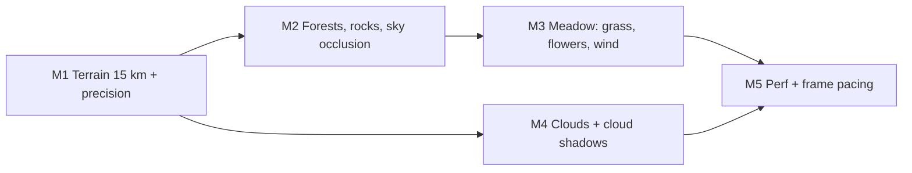

# 15 km showcase scene — roadmap

Agreed with the user on 2026-11-19. Goal: as fast as possible, a proper
15 x 15 km natural scene (hills and a peak, forests, meadows, grass,
flowers, rocks, clouds), walkable and flyable, resembling
`assets/reference/target-meadow.png` (git-ignored reference shot: dense
meadow to the horizon with clustered wildflowers, broadleaf forest
covering hillsides with edges and hero trees, rock outcrops on steep
slopes, cumulus clouds, soft tree shadows; it runs at 60 fps with 7.67 ms
GPU and 0.96 ms CPU, our target at 1440p). The systems (terrain,
placement, streaming, instance scale, sky) are engine framework and
must be built properly; the content (terrain shape, assets, textures) is
placeholder.

## Milestones (each visible on screen, each with its own GPU budget)

- **M1 terrain** (done; spec `2026-11-19-terrain-15km-design.md`,
  plan `../plans/2026-11-19-terrain-15km.md`): Napf swissALTI3D 2 m
  heightfield, GPU CDLOD, heightfield-marched sun shadows,
  camera-relative rendering, curvature display warp to the horizon,
  wrapped terrain UVs, walk mode.
- **M2 forests**, split in two: M2a forests and rocks (spec
  `2026-11-19-forests-design.md`, plan `../plans/2026-11-19-forests.md`;
  far field `2026-11-20-far-field-design.md`) and M2b forest lighting
  (spec `2026-11-19-forest-lighting-design.md`, plan
  `../plans/2026-11-19-forest-lighting.md`). The specs supersede this
  bullet where they differ: the level-range cut gave way to a
  cluster-group BVH traversal, and far trees became hemi-octahedral
  impostors mid-range plus per-cell voxel bricks beyond ~4 km. As first
  proposed: GPU procedural placement framework (Horizon Zero Dawn
  style: per-tile compute, deterministic hash, rules on slope, altitude,
  forest-mask noise, distance to forest edge, clustering) writing the GPU
  instance table; instance count to millions with cell-level culling;
  cluster traversal that doesn't overflow with thousands of visible
  trees (proposed: a level-range cut — clusters sorted by DAG level,
  per-level min/max error, the instance cull emits only levels whose
  conservative error bounds straddle the threshold; full group-BVH
  traversal stays in virtualized geometry slice 5); octahedral impostors
  for far trees; rocks and boulders on steep/rock ground; the TLAS built
  once for the static world, partitioned TLAS
  (`VK_NV_partitioned_acceleration_structure`, available on the 620.70
  driver) for incremental updates; sky-visibility rays (one short ray
  per pixel, TAA-accumulated, plus the terrain heightfield march) for
  darker forest interiors — Meridian has no sky occlusion today.
- **M3 meadow**: Ghost of Tsushima style procedural grass blades
  (Bezier, mesh shader, generated every frame in rings around the
  camera, never stored, not in the TLAS; they receive RT shadows and get
  a self-shadow/density AO approximation); wind from scrolling noise
  with motion vectors that include last frame's wind; flower patches
  from the same density masks; far grass fades into a matching terrain
  shading layer so the ground never reads bare.
- **M4 clouds** (spec `2026-11-19-clouds-weather-design.md`, plan
  `../plans/2026-11-19-clouds-weather.md`): 2.5D cumulus layer (weather
  map + 3D Worley-Perlin noise), ray-marched at quarter resolution with
  temporal reprojection (Schneider/Nubis 2015-17, Hillaire 2016),
  composited with the existing Hillaire 2020 aerial perspective, plus a
  2D cloud shadow map. Nubis³
  voxel clouds rejected as too heavy for a first look. Independent of
  the terrain work.
- **M5 performance and frame pacing**: spikes (TLAS updates, tile
  generation), CPU per frame, the remaining budget. Each milestone
  measures its own budget as it lands (Release, 2560x1440, median of 5;
  capture runs print GPU ms per pass).

## Rough GPU budget at 1440p (estimates to replace with measurements)

Terrain 0.8, trees and rocks 2.0, grass and flowers 1.5, RT shadow + sky
visibility 1.2, clouds 1.0, atmosphere/TAA/exposure/tonemap 0.7: ~7.2 ms.
Measured costs are tracked in `docs/backlog.md`.

## Deferred and why

- Virtualized geometry slice 2 (RT on clusters): the shadow-ray offset
  workaround holds; the partitioned TLAS comes first.
- Slice 3 (coverage-preserving foliage simplification): impostors cover
  far trees.
- Slice 4 (visibility buffer): only if measurements call for it.
- Slice 5 (disk streaming): the world needs no disk streaming yet
  (heightfield resident, placement procedural, few dozen assets).
- Tree wind: the RT BLAS wouldn't sway with the raster, so shadows
  wouldn't match.
- Water, collision beyond walking on the heightfield, DLSS integration.

## Assets

- Trees: Megascans Megaplants (USD from Fab, imported by
  `tools/usd2gltf` and `meridian-cook --tree`; see `docs/decisions.md`,
  "Tree import"). The Poly Haven trees first listed here were replaced.
- Undergrowth: `shrub_01-04`, `fern_02`, `nettle_plant`, `weed_plant_02`.
- Rocks: existing set plus `mountainside`, `rock_face_01/02`,
  `namaqualand_cliff_01/02`.
- Grass: procedural (no asset), plus a scanned grass ground texture for
  the far shading layer.
- Flowers: procedural heads first; `dandelion_01`, `periwinkle_plant`
  up close if needed (`celandine_01` is 1.7M triangles, skipped).

## Sources

- Real-time Path Tracing of Massive Dynamic Foliage (HPG 2026,
  partitioned TLAS + cluster LOD + opacity micromaps, 5x5 km, 60M
  plants, 60 fps on an RTX 4090): https://dl.acm.org/doi/10.1145/3820021
- VK_NV_partitioned_acceleration_structure:
  https://docs.vulkan.org/features/latest/features/proposals/VK_NV_partitioned_acceleration_structure.html
- GPU-based procedural placement in Horizon Zero Dawn:
  https://www.guerrilla-games.com/read/gpu-based-procedural-placement-in-horizon-zero-dawn
- Procedural Grass in Ghost of Tsushima (GDC 2021):
  https://gdcvault.com/play/1027214/contactUs
- Nubis³: https://www.guerrilla-games.com/read/nubis-cubed
- UE 5.7 Nanite voxel foliage:
  https://80.lv/articles/get-a-glimpse-of-nanite-foliage-with-voxel-representation-in-ue5-7
