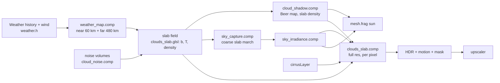

# 2.5D clouds (heightfield cloud slab) — design

Status: draft (2026-11-20), lane `clouds-25d`, worktree
`../meridian-clouds25d`.

## Goal

User decision 2026-11-20: 2.5D clouds in the Chlorophyll Engine's style,
the default once the look is accepted. Same look and idea as today's
volumetric clouds (fair cumulus with bright tops and smooth light-grey
bases, cirrus, broken and overcast, weather fronts, wind drift), chosen
for image clarity, temporal stability (the volumetric path jitters,
stripes and flickers in motion), cost (volumetric 1.3-2 ms) and
art-directability. The volumetric renderer stays, behind
`--clouds volumetric`.

## What "2.5D" means (research)

- Guerrilla uses the term for its own Nubis line ("2.5D Clouds, est.
  2015", Nubis Cubed, Advances 2023): 2D authoring fields (coverage,
  type) plus a vertical profile, ray-marched through 3D noise. By that
  definition Meridian's volumetric path already *is* 2.5D in its data;
  what the user dislikes is its rendering: a stochastic 3D-noise march at
  quarter resolution that only converges through a temporal history.
- Chlorophyll's author: "Since they are 2.5D and not truly volumetric I
  can get away with some art direction." Read with the frames
  (`flower-meadow-cumulus.png`: soft, loaf-shaped cumulus, flat
  light-grey bases, soft edges, no wisps or overhangs), "not truly
  volumetric" means the shape is a 2D field, not a 3D density.
- Candidates weighed:

| Technique | Ground view | Fly / above layer | Stability | Cost | Verdict |
|---|---|---|---|---|---|
| Sky-dome / plane texture (Clouds2D-style) | good far, flat near | no parallax, broken from altitude | perfect | ~0 | rejected: breaks fly mode |
| Billboard / impostor clouds (Harris 2001, MSFS 2004, Nubis "RGB billboards") | good | sorting, popping, turning cards | popping | low | rejected: authoring per cloud, pops |
| Layered parallax sheets | good from below | thin slices visible from the side | good | low | rejected: slices at layer altitude (the horizon seam the user saw) |
| Today's 3D-noise march (HZD/Nubis/Frostbite) | best | best | needs history; flickers | 1.3-2 ms | stays, `--clouds volumetric` |
| **Heightfield cloud slab** (2D thickness map over a flat base, relief-mapping style intersection, analytic lighting) | good: domed loaves, flat bases | domed tops, reads correctly from above and at layer height | deterministic, no history | ~0.3-0.5 ms (target) | **chosen** |

## Chosen technique

Each cloud is a column over a flat base: at world xz the cloud occupies
altitudes `[b(xz), b(xz) + T(xz)]`, with `b` the layer base of the local
type (as `cloudLayer`) lifted slightly where the cloud is thin (the rim
of a cumulus curls up, `b += kRimLift (Tmax - T)`) and `T` a thickness
from 2D fields only:

```
s(xz)  = saturate(remap(coverage(xz) * shape2D(xz), cut(type), 1))
T(xz)  = Tmax(type, coverage) * dome(s)        // dome: s^p, p < 1 rounds the tops
```

- `coverage`, `type`: the weather map (`weatherMapAt`, history rule,
  wind, fronts unchanged), plus a new far cascade (below).
- `shape2D`: slices of the existing noise volumes (base Perlin-Worley for
  the cells, the detail volume at 4x for billows, at 1x near the camera
  for the edge breakup) at a slice coordinate that advances slowly with
  game time, so clouds form and dissolve, scrolled by the cloud wind
  offset (the same modulo offsets).
- Stratus / overcast: `Tmax` the stratus slab, cut near 0, so `T` is a
  thick continuous deck whose thickness varies (darker and brighter
  patches from below, as today).

**Rendering** (`clouds_slab.comp`, new, after the late scene pass, at the
render resolution, compute): per pixel the jittered camera ray (the
upscaler antialiases cloud edges like geometry; no cloud history)
through the slab envelope on the curved shell (as `cloudLayerSpan`),
cut at the scene depth. A deterministic march of the 2D field: step
positions fixed along the ray (no per-frame jitter), length growing with
distance, at most ~32 steps; at each step the signed height
`f = b + T - y` (and `y - b`), density `smoothstep(0, kSoft T, f)`
(soft edges in proportion to the cloud's size, as in the frames),
integrated per segment with the trapezoid rule (density continuous
between steps, so no step banding without jitter). Stops at opacity
0.99. Lighting only on steps inside a cloud:

- sun optical depth from the column toward the sun: 2-3 taps of `T`
  along the sun's ground track (self-shadowing of lobes, the next cloud
  over), then `cloudShadow` beyond as the volumetric path does;
- scattering: the volumetric path's phase, octaves and diffuse
  multiple-scattering term (`clouds_march.glsl` constants, shared), so
  the silver lining, sunset tint and grey shaded sides behave the same;
- ambient: the clear-sky irradiance by height in the column (top 1, base
  `kAmbientBottom`), ground bounce mirrored, as today; plus a normal from
  the gradient of `T` for a cheap directional term on the domes (the art
  direction lever: `kSunWrap`).

Haze in front (`haze`, moved from `clouds_march.comp` into a shared
include), the cirrus sheet behind (`cirrusLayer`, unchanged). Output as
the volumetric composite writes it: premultiplied over HDR, cloud motion
(`cloudPreviousClip` at the opacity-weighted depth, wind displacement)
where opacity > 0.5, transparency mask raised to the coverage (A/B:
without the mask, since the clouds are now deterministic).

**Far weather cascade:** per-step `weatherMapAt` beyond the 30 km
window falls to the analytic fallback (history search + Worley per call),
the volumetric path's cost floor. A second weather map, 1024^2 over
480 km (470 m texels) centred on the camera, written by `weather_map.comp`
with a cascade index, one of every 4 rows per frame (the far field moves
under a texel in many seconds). `weatherMapAt` reads near, then far,
then the analytic fallback (beyond 240 km: only seen from high up).

**Consumers (reuse, a mode switch, no copies):**



- `sky_capture.comp` and `cloud_shadow.comp` pick the slab density or the
  volumetric `cloudDensity` by a `Clouds.renderer` field, so ambient,
  reflections and ground shadows follow whichever clouds are drawn. The
  shadow fallback (`cloudShadowFallback`) keeps its form; its fit is
  re-checked against the slab map (refit if off by > 0.05).
- Volumetric-only resources (march targets, histories) are created only
  for `--clouds volumetric`.

**Flag:** `--clouds 2.5d|volumetric|off` (`on` = the default). Engine:
`Renderer::setCloudRenderer(CloudRenderer::{Off, Volumetric, Slab})`
replaces `setCloudsEnabled`. The default stays volumetric until the user
accepts the look, then flips to 2.5D in its own commit.

## Expected degradation (proposed as acceptable)

- No overhangs, no wisps hanging below the base, no towering cumulus
  with undercut sides: a column has one top and one base.
- Inside a cloud (flying through) the slab reads as fog of the column's
  density with no internal structure.
- From far above, tops read as soft domes lit by their normal (Chlorophyll's
  aerial frames show exactly that); thin edges are translucent.

## Gates (from the brief)

- Flicker on cloud regions, `--capture-sequence 1` ~120 frames: drifting
  clouds `--time-scale 1` with a static camera, slow yaw
  (`--camera-yaw-rate 0.1`) and fast turn (`1`), DLSS SR DLAA (`--rr off`)
  and TAA, clearly better than volumetric in the same conditions.
  Metric: mean and p99 of frame-to-frame |difference| after compensating
  the camera rotation is not possible for yaw runs, so for yaw runs the
  measure is the cloud-region temporal Laplacian of consecutive frames
  differences vs a still-camera reference (tool in the plan).
- `clouds` GPU ms at 2560x1440 <= 0.5 (well under volumetric).
- Views: CLAUDE.md cloud views plus a mid-height sun behind a cumulus
  (the disk occluded); no horizon seam at layer altitude.
- Debug validation clean; unit tests for CPU math (the far cascade's
  placement, any CPU twin).

## References

- Schneider, Nubis Cubed (Advances 2023), "2.5D Clouds, est. 2015":
  https://advances.realtimerendering.com/s2023/Nubis%20Cubed%20(Advances%202023).pdf
- Schneider, Nubis Evolved (Advances 2022, vertical profile and envelope
  methods): https://advances.realtimerendering.com/s2022/SIGGRAPH2022-Advances-NubisEvolved-NoVideos.pdf
- Policarpo, Oliveira: Relief Mapping of Non-Height-Field Surface Details
  (I3D 2006; linear + secant search on a height field):
  https://www.inf.ufrgs.br/~oliveira/pubs_files/Policarpo_Oliveira_RTM_multilayer_I3D2006.pdf
- Harris, Lastra: Real-Time Cloud Rendering (Eurographics 2001,
  impostors): https://www.cs.unc.edu/~harrism/clouds/
- Hillaire, Physically Based Sky, Atmosphere and Cloud Rendering in
  Frostbite (2016), the lighting model reused:
  https://media.contentapi.ea.com/content/dam/eacom/frostbite/files/s2016_pbs_frostbite_sky_clouds.pdf
- Ford, Real-Time Rendering of Atmospheric Clouds (UW MS thesis, 2024;
  survey, step-banding vs jitter).
