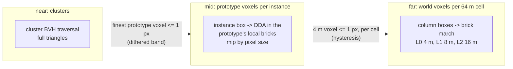
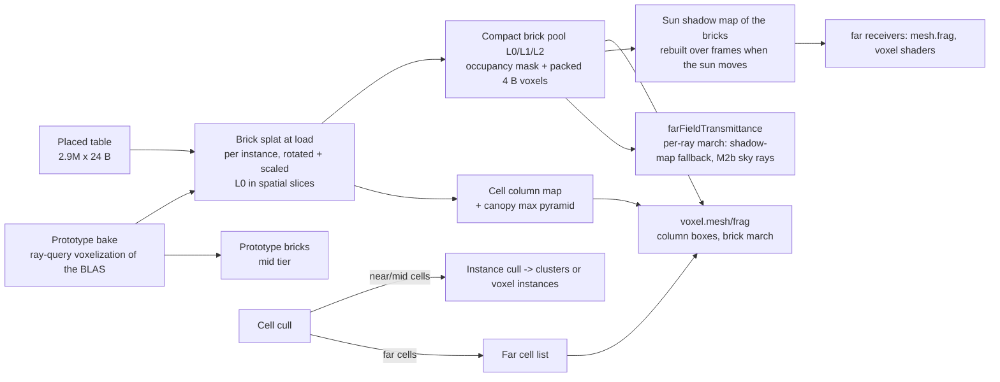

# Far-field forests: voxel tiers (M2a)

**Status:** revised 2026-11-20 (lane M2a-far): three tiers, no impostors.
The far tier's prototype is built (Task 8, gates failed as measured); Tasks
9-13 of the forests plan build the revision.

Decided with the user on 2026-11-20: option C of the far-field draft
(voxels), and no impostors anywhere. The model is Chlorophyll Engine, whose
author describes three tiers: GPU-driven meshlets near, "small triangles
rendered as voxels" per instance, and past a screen-footprint threshold only
a per-tile voxel hierarchy (per-instance data dropped). This spec follows
that:

1. **Near:** each tree as clusters of its LOD DAG (unchanged).
2. **Mid:** each tree as its prototype's voxels, from where its triangles
   go sub-pixel. Every tree prototype has a sparse brick hierarchy in its
   own space, shared by all its instances (memory per prototype).
3. **Far:** forest cells past the far switch as one aggregate each, a
   sparse hierarchy of world voxel bricks (the Task 8 prototype).

The world bricks are also the far ray field for sun shadows (through a sun
shadow map built from them) and for sky visibility (M2b), replacing M2b's
2D canopy field. Read this spec with the M2a forests spec
(`2026-11-19-forests-design.md`) and M2b's
(`2026-11-19-forest-lighting-design.md`).

## Goals

- Forests to the edge of the 15 km crop at a cost that scales with covered
  pixels, not with the 2.9M placed trees.
- Trees whose triangles are sub-pixel are prefiltered voxels, not
  simplified or alpha-tested triangles, so crowns keep their coverage (the
  DAG's coarse foliage loses leaves) and don't shimmer. Every tier gives
  TAA/DLSS exact depth and motion vectors, like any static surface.
- One far ray field for sun shadows and sky visibility.
- Built at load on the player's GPU (nothing on disk unless a bake exceeds
  ~5 s).

## Non-goals

- 3D silhouettes of single crowns beyond the far switch (~4.8 km). The
  user accepted this if the ridge views look right; it keeps the world
  bricks coarse (see Resolution).
- Streaming. Everything stays resident unless the VRAM gate fails.
- Low-end pure-2D far field (backlog). Hand-placed models stay
  per-instance meshes at every distance.
- Animated voxels (wind). Trees are static.

## Representations by distance (raster)

- **Near to mid, per instance** (cull.comp): an instance switches to its
  prototype's voxels when the prototype's finest voxel projects to at most
  `kVoxelSwitchPixels` (1 px to start; the finest voxel is the prototype's
  height / 128, ~0.2 m for a 25 m tree, so ~250 m at 1440p). Over a short
  band (10% of that distance) both draw with complementary per-pixel
  dither masks, resolved by DLSS/TAA. The switch distance is tuned by
  measurement (coverage against the reference, the look at the band).
- **Mid to far, per 64 m cell** (cell_cull.comp): a cell goes far when an
  L0 voxel (4 m) projects to at most 1 px from the nearest point of its
  canopy box (~4.8 km), and back at 1.1x (hysteresis, `farSwitch`). A far
  cell skips its tree-layer instances (rock instances still go through);
  the placed table stays resident. Mid trees at that distance draw their
  4 m mip, so the switch is between two 4 m voxel images: a hard switch
  with hysteresis, no dither band unless the motion captures show a pop.
- **Cell borders:** bricks are splatted by world position, but the switch
  works on whole cells by tree origin. A crown that crosses into a far
  neighbor is drawn twice, one from a far cell is cut where it reaches a
  mid one: about half a crown, ~1 px at 4.8 km. **Accepted** (user,
  2026-11-20); if the captures show it, the fix is bricks per owner cell.

## Mid tier: prototype voxels

- **Bake** at load per tree prototype (extends Task 8's bake): ray queries
  against a one-instance TLAS of the prototype's full-detail BLAS (alpha
  test included) measure three-axis pass fractions per finest voxel
  (height / 128), giving extinction calibrated against what RT shadows
  trace, plus the mean hit normal and albedo-palette entry. Mips halve down
  to 4 m (5-6 levels). Bricks of 4^3 voxels in the prototype's local space,
  only occupied ones stored, same 4 B voxel as the world bricks; a brick
  table per mip (dense grid of brick indices, the prototype's bounds are
  small). Expected a few MB per prototype.
- **Draw:** cull.comp appends mid instances (instance id, mip) to a voxel
  instance list (fixed capacity, overflow counted). `voxel_instance.mesh`
  packs many instances per workgroup, emitting each one's oriented box
  (instance quaternion and scale, curvature drop of the box center, padded
  by the drop's variation). `voxel_instance.frag` moves the view ray into
  the prototype's space and runs the same brick DDA as the far tier at the
  instance's mip (the coarsest whose voxel projects to <= 1 px), stopping
  at accumulated opacity 0.5 or discarding; conservative depth, motion
  vectors from the flat hit with last frame's camera, shading through
  `lighting.glsl`. Drawn in the early and late scene passes like clusters
  (the instance's visibility bit decides which).
- **Shadows on mid receivers:** the hit lies inside the crown, so a TLAS ray
  from it would hit the tree's own leaves at a random depth. The ray toward
  the sun marches the prototype's own bricks to the instance box's exit
  (Beer-Lambert self-shadow), then traces the TLAS from the exit point (and
  the far rule below beyond `kFarShadowDistance`).
- **Ray-traced occluders** stay full-detail BLAS for every tier in the TLAS
  (the reference), as now.

## Far tier: world bricks

- **Splat** at load, in compute over the placed table, from the prototype
  bake's 1 m template filtered to 4, 8 and 16 m. Each forest or lone tree
  resamples its template through its inverse transform into the world
  voxels it overlaps. Occupancy, count, scan and allocate give each level
  its brick pool; fixed-point integer atomics (order-independent,
  deterministic) accumulate extinction, normal and albedo, then pack.
  The worst-case overlap can't overflow. L0 is accumulated in spatial
  slices (bands of cells), so the transient peak is one slice's
  accumulators, freed before the next slice and level.
- Rocks are not voxelized: their layer has no far switch and keeps the
  per-instance cluster path at every distance (the lever if they cost too
  much is the layer's maximum draw distance).
- **Voxel (4 B):** extinction u8 (log-encoded, 1/m), octahedral normal
  2 x u8, albedo index u8 (palette of mean albedos measured at bake).
- **Brick:** 4^3 voxels, the same count at every level (16 m at L0, 32 m
  at L1, 64 m at L2). Only occupied bricks are allocated, and a brick
  stores a 64-bit occupancy mask plus only its occupied voxels (the
  prototype measured 31.7 of 64 occupied on average at L0), found by
  `bitCount` of the mask below the voxel.
- **Cell column map:** per 64 m cell, per level, the brick columns (4x4 at
  L0, 2x2 at L1, 1 at L2), each `uvec2(firstBrick, baseHeight |
  brickCount << 16)`, `baseHeight` in 0.25 m units above the heightfield's
  minimum less 32 m; a per-cell canopy top and bottom and a max-top pyramid
  over cells for hierarchical skipping.

## Resolution and VRAM (the dial)

- **Finest world level 4 m:** the far switch sits where 4 m is one pixel,
  and the mid tier covers everything nearer. 2 m would be ~8x the memory.
- **4 B voxels**, compacted bricks (above).
- **Measured** by the Task 8 prototype (Napf, seed 1, uncompacted 256 B
  bricks): L0 2.15M / L1 426k / L2 84k bricks, 659 MiB resident, 3.68 GB
  load peak (all L0 accumulators at once). Compaction cuts brick storage
  to ~(8 + 4 x 31.7) B / 256 B ~ 53% (~370 MB est. with the column map),
  slicing cuts the peak to one slice. The sun shadow map counts against
  the same 500 MB.
- If it still measures over the gate, the next dial is distance residency
  for L0 (re-splat per cell from the placed table, no disk), decided with
  the user.

## Raster (far tier)

- `voxel.mesh` takes one far cell per workgroup and emits one box per
  occupied brick column (top and bottom from the column map; the prototype
  emitted one canopy box per cell, which marched the cell's empty columns),
  displayed with the cell's constant curvature drop and padded by its
  variation across the cell (under 0.2 m) and by one voxel of the level.
- `voxel.frag` marches in flat space: it shifts the displayed view ray up
  by the cell's drop, runs the brick DDA at the cell's level and stops
  where the accumulated opacity reaches 0.5, or discards. The level is
  chosen per cell (the coarsest whose voxel projects to <= 1 px), with
  hysteresis.
- `gl_FragDepth = min(hitDepth, gl_FragCoord.z)` with `layout(depth_less)`
  (reverse-Z: the hit is behind the box face), so early depth testing stays
  valid. Motion vectors from the flat hit displayed with last frame's
  camera and its own drop. Shading through `lighting.glsl`, shared with
  `mesh.frag`; it writes every scene attachment `mesh.frag` writes (sun
  light for contact shadows, the Ray Reconstruction guides).
- A deterministic 0.5 threshold, not stochastic transparency or stochastic
  normals (Nanite's are noisy): a stable image matters more than partial
  coverage. Edges antialias through the upscaler's jitter.
- Culling: far cells go through the cell cull's frustum and Hi-Z tests and
  the two-phase scheme (drawn early if visible last frame, retested late),
  like instance chunks, after the terrain so hills reject them early.

## Rays

- **Representation per ray, by receiver distance** (M2a, static TLAS
  holding every tree): receivers nearer than `kFarShadowDistance` (the
  far switch distance, ~4.8 km) trace the TLAS with every tree (the
  reference; mid receivers first march their own prototype bricks, see
  the mid tier). Receivers beyond it trace the TLAS with placed trees
  masked out (instance-mask bit on tree-layer records; rocks and
  hand-placed objects stay) and take forest occlusion from the far field.
  Every ray uses exactly one tree representation.
- **Sun shadow map of the far field** (replaces the prototype's per-pixel
  Beer-Lambert march, which was 60-70% of the far pass): an orthographic
  map along the sun over the crop's forest bounds, 4 m texels to start
  (8 m is the lever), R16 depth of the first point where the opacity of the
  world bricks along the sun reaches 0.5, built by the same brick march
  in compute. Receivers compare depth with a small PCF. A sun-space texel
  is perpendicular to the sun, so low suns don't stretch it; long ground
  shadows resolve through the depth compare.
- **The sun moves** (G panel now, time of day later): the map records the
  sun direction it was built for. When the sun has turned more than
  `kShadowMapRebuildAngle` (0.1 degree to start: a 500 m low-sun shadow
  moves < 1 m), a rebuild starts into a second map, a slice of texels per
  frame under a fixed budget (~0.3 ms), and the maps swap when it
  completes, so no frame stalls. Until the swap, receivers keep the old
  map while the sun is within `kShadowMapStaleAngle` (1 degree to start)
  of its build direction, else they use the per-ray `farFieldTransmittance`
  march (correct, costlier, only while a fast sun drag outruns the
  rebuild). Report: full rebuild ms, frames per rebuild, frame cost while
  dragging.
- `float farFieldTransmittance(origin, direction, startDistance,
  maxDistance, bool skipTlasCells)` stays: the fallback above, the CPU
  replica's twin (tests), and M2b's sky rays (march from 20 m, partitioned
  TLAS with per-cell `cellInTlas` flags), the role M2b's 2D canopy field
  had.

## Resolved with the user (2026-11-20)

1. Shadow rays from receivers beyond `kFarShadowDistance` use the voxels
   only, never the TLAS trees.
2. Crowns that straddle a mid/far cell border at the switch are accepted,
   fixed (bricks per owner cell) only if the captures show them.
3. No impostors anywhere (mid range is the prototype-voxel tier); option B
   dropped.
4. Whether the voxels replace M2b's mid-range OMM shadow proxies is
   decided in M2b, from Task 12's ray-cost numbers.

## Gates

Measured with `--trees`, Release, 2560x1440, median of 5, under the GPU
lock, at the forest edge, forest overview, ridge (default start) and high
overview views. A gate that is truly unreachable goes to the user with
numbers and a recommendation before it is relaxed.

| Gate | Pass | Task 8 prototype |
|---|---|---|
| VRAM | far field resident (bricks, column map, prototype bricks, shadow maps) <= 500 MB; load peak transient <= 2.5 GB, freed after load | 659 MiB; 3.68 GB |
| Far pass | `far field` <= 1.0 ms | ridge 2.40, overview 6.16 |
| Mid pass | voxel instances <= 1.5 ms | (not built) |
| Shadow cost | scene early + far field + scene late with far shadows from the far field <= the same with `--far-shadows tlas` | ridge 5.94 vs 4.01, overview 19.49 vs 14.29 |
| Shadows | receivers beyond `kFarShadowDistance` vs the reference `--far-shadows tlas`: mean difference reported, pairs for the user; no lit forest floor, staircase or seam at `kFarShadowDistance`; sun rebuild cost reported | unmeasured |
| Coverage | each prototype's voxel image vs its full-detail BLAS ray-traced at 2-200 px tall: coverage within 5%; in captures, no luminance step across the mid switch, the far switch or the level bands | unmeasured |

The coverage reference is ray-traced per prototype because the clusters'
default cut is not a reference (coarse DAG foliage loses leaves, which is
why the mid tier exists). The milestone's done bar (forest views <= 16.7
ms per frame) is Task 12's.

## Testing

- Unit:
  - Template round trip: a solid synthetic box voxelizes to full
    occupancy, an empty prototype to none; prototype mips conserve
    extinction-weighted mass.
  - The splat conserves extinction (world sum within 1% of the template
    sum x scale^3), sliced and unsliced splats are identical.
  - Compacted brick lookup matches the dense brick for every voxel.
  - The CPU replica of `farFieldTransmittance` matches a brute-force march
    within 1e-3, including a 2-degree grazing ray and a ray along a cell
    boundary; the shadow-map texel depth matches the replica's 0.5 point.
  - `farSwitch` over an oscillating path changes at most once per crossing;
    the mid switch band weights are complementary.
- Captures: the gate views, sunset, the far-horizon summit view, and the
  switches in motion (`--camera-velocity` toward and away): no pop or
  flicker, 0 dropped, 0 validation errors.

## Sources

- UE 5.7 Nanite Foliage: per-cluster 4x4x4 voxel bricks, switched to
  when lower error; hardware RT uses a fallback mesh:
  https://dev.epicgames.com/documentation/unreal-engine/nanite-foliage
- User reports of poor RT shadows from that fallback:
  https://forums.unrealengine.com/t/bad-raytraced-shadows-with-voxelised-nanite-foliage-in-5-7/2696233
- Chlorophyll Engine, 10M trees over 15 km^2 (voxel far field per tile,
  no hardware RT): https://www.youtube.com/watch?v=VC_NUxbeA0E ,
  https://wccftech.com/custom-forest-engine-delivers-stunning-visuals-at-130-fps-on-an-rtx-3080-at-1440p-without-hardware-ray-tracing/
- HPG 2026, path tracing massive foliage (far plants baked into aggregates
  per group): https://dl.acm.org/doi/10.1145/3820021 ; summary:
  https://www.jonpeddie.com/news/amd-nvidia-rework-foliage-rendering/
- Loubet and Neyret 2017, hybrid mesh-volume LoDs (prefiltered volumes for
  far detail): https://hal.archives-ouvertes.fr/hal-01468817v1
- Amanatides and Woo 1987, voxel DDA:
  http://www.cse.yorku.ca/~amana/research/grid.pdf
