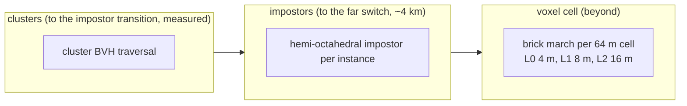
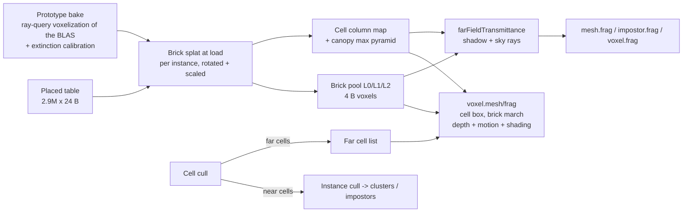

# Far-field forests: per-cell voxel bricks (M2a)

Decided with the user on 2026-11-20: option C of the far-field draft. Forest
cells past a screen-size threshold are drawn as one aggregate each, a
sparse hierarchy of voxel bricks, instead of per-instance impostors. The
same bricks are the far ray field for sun shadows (M2a) and sky
visibility (M2b), so one structure serves raster and rays. The reference
is Chlorophyll Engine's per-tile voxel far field. Read this spec with the
M2a forests spec (`2026-11-19-forests-design.md`) and M2b's
(`2026-11-19-forest-lighting-design.md`), whose far canopy field it
replaces.

## Goals

- Forests to the edge of the 15 km crop at a cost that scales with covered
  pixels, not with the 2.9M placed trees.
- Distant forests are prefiltered rather than built from sub-pixel
  alpha-tested quads, so they don't shimmer. They also give TAA/DLSS
  exact depth and camera motion vectors, like any static surface.
- One far ray field for sun shadows and sky visibility, traced in the
  shader alongside the TLAS query.
- Built at load on the player's GPU from the placed table (nothing on
  disk). Prototype bricks are cached like impostors if their bake exceeds
  ~5 s.

## Non-goals

- 3D silhouettes of single crowns beyond ~4 km. The user accepted this if
  the ridge views look right. That is what lets the bricks stay coarse
  (see Resolution).
- Streaming. Everything stays resident unless the prototype fails the VRAM
  gate.
- Low-end pure-2D far field (backlog). Hand-placed models in the far field:
  they stay per-instance meshes.
- Animated far field (wind). Trees are static.

## Representations by distance (raster)

- The far switch is per 64 m cell, by projected size. A cell goes far when
  its tallest prototype projects under `kFarSwitchPixels` (starting at
  6 px, ~4 km for a 25 m tree, where one pixel is ~3.9 m, one L0 voxel).
  It switches back at 1.1x that size (hysteresis), so a camera hovering at
  the boundary doesn't thrash.
- A far cell skips its tree-layer instances entirely: the cell cull emits
  no chunk for them (rock instances still go through). This is Chlorophyll's "per-instance data streamed out", without
  moving memory: the placed table is 70 MB and stays resident.
- Handoff: a short projected-size band where the cell's impostors dither
  out and its voxels dither in with complementary per-pixel masks,
  resolved by TAA (the same scheme as the cluster-to-impostor fade).
- Cell borders: bricks are splatted by world position, but the switch
  works on whole cells by tree origin. A crown that crosses into a far
  neighbor is drawn twice (as an impostor and as voxels), and one from a
  far cell is cut where it reaches into a near one. At ~4 km that is
  about half a crown, ~1.5 px, inside the dithered band. **Accepted**
  (user, 2026-11-20),
  and measured in Task 8's handoff capture. If it shows, the fix is
  bricks per owner cell (each cell's bricks padded by the largest crown
  radius, the DDA testing overlapping neighbors).

## Data

- **Prototype bricks** are baked at load per tree prototype. Ray queries
  against a one-instance TLAS of the prototype's full-detail BLAS (alpha
  test included) measure, per 1 m template voxel, the fraction of rays
  that pass along three axes. That gives extinction calibrated against
  the same geometry the RT shadows trace. Each voxel also stores the
  mean normal of the hits and the material (leaf or bark). The 1 m
  template is filtered down to 4, 8 and 16 m.
- **Splat** at load, in compute over the placed table. Each forest or
  lone tree resamples its prototype template through its inverse
  transform into the world voxels it overlaps, at each level. It
  accumulates extinction-weighted density, normal and per-material
  weight into a transient buffer, then packs them. First an occupancy
  pass marks touched bricks, and then count, scan and allocate (the
  placement pattern) give each level its dense brick pool. Only those
  bricks get accumulators: ~6 u32 per voxel (extinction, normal xyz,
  RGB albedo; the palette entry nearest the mean albedo is picked at
  pack time). The atomics are fixed-point integer, so the sum doesn't
  depend on order and the build is deterministic. The scale is chosen
  so the worst-case overlap (every tree of a dense 64 m cell in one
  voxel) can't overflow. Levels are built one at a time, so the peak
  transient VRAM is one level's accumulators (L0: ~1.1-1.45M bricks x 64
  x 24 B, ~1.7-2.2 GB, freed before the next level). Rocks are
  not voxelized: their layer has no far switch and keeps the
  per-instance cluster path at every distance (a 10 m rock is ~3 px at
  4 km). Task 12 measures what that costs; the lever is the rock layer's
  maximum draw distance (Task 5).
- **Voxel (4 B):** extinction u8 (log-encoded, 1/m), octahedral normal
  2 x u8, albedo index u8 (the dominant (prototype, material) entry of a
  palette of mean albedos measured at bake).
- **Brick:** 4^3 voxels (256 B), the same voxel count at every level, so
  the brick edge is 16 m at L0, 32 m at L1 and 64 m at L2. Only occupied bricks are allocated.
- **Cell column map:** per 64 m cell (the existing `Cell` grid), per
  level, the brick columns (4x4 at L0, 2x2 at L1, 1 at L2). Each column
  is `uvec2(firstBrick, baseHeight | brickCount << 16)`, with
  `baseHeight` in 0.25 m units above the heightfield's minimum. There is also a
  per-cell canopy top and bottom, and a max-top pyramid over cells (like
  the terrain's) for hierarchical skipping.

## Resolution and VRAM (the dial)

Option C as drafted assumed 2-4 m voxels and 8-16 B per voxel (0.3-1 GB,
streaming needed). Relaxing silhouettes beyond ~4 km lets it dial down:

- **Finest level 4 m**, not pixel-sized at 2-4 km: impostors cover to ~4
  km, so voxels only appear where a pixel is already ~4 m. 2 m would be
  ~8x the memory (~1.9 GB est.) and buys only silhouettes the user
  accepted losing.
- **4 B voxels** (an albedo index instead of RGB, octahedral normal): half
  of an 8 B layout.
- **Brick-level sparsity, with a 16 m L0 brick:** the canopy band (trees
  up to ~27 m, plus ~10 m of ground relief across a column on steep
  slopes) needs 3-4 bricks per column.
- **Estimate** (Napf, seed 1): forest 2.59M trees at 6 m footprint is
  ~93 km^2, ~363k L0 columns. L0 is ~1.1-1.45M bricks, ~280-370 MB; L1
  ~46 MB; L2 6-12 MB; column map 4-9 MB; lone trees and partial edge
  columns a little more: **~350-450 MB resident**, under the 500 MB gate
  with a thin margin. The load-time peak (above) is the bigger VRAM
  risk, so it has a gate too. The prototype measures both.
- If it measures over the gate, the next dial before falling back is
  distance residency. L0 would stay resident only for cells within ~8 km
  of the camera, re-splatted per cell from the placed table on demand.
  That is streaming without disk: GPU work only, built on the player's
  hardware. It is decided after the prototype.

## Raster

- `voxel.mesh` takes one far cell per workgroup and emits the cell's
  canopy box (top and bottom from the column map), with the curvature
  warp like every raster stage, padded by the drop's variation across
  the cell (under 0.2 m).
- `voxel.frag` marches in flat space. The voxels are flat (curvature is
  a display warp), so it shifts the displayed view ray up by the cell's
  `curvatureDrop`, a constant per cell. It marches the cell's bricks
  (DDA) at the cell's level and stops at the first point where the
  accumulated opacity reaches 0.5, refined inside the voxel by trilinear
  density. If the ray leaves the cell below 0.5, it discards. The
  level is chosen per cell, by its voxel's projected size, with the same
  hysteresis as the far switch, so filtered density never shifts the
  hit within a cell.
- `voxel.frag` writes `gl_FragDepth = min(hitDepth, gl_FragCoord.z)`
  from the displayed hit position. The hit is behind the box face, so in
  reverse-Z that is `layout(depth_less)`, and the `min` enforces it so
  early depth testing stays valid. Motion vectors come from the flat hit
  displayed with last frame's camera and its own drop. Shading uses
  `mesh.frag`'s lighting through a shared include, which Task 8 creates.
- A deterministic threshold, not stochastic transparency: an image that
  is stable frame to frame matters more here than partial coverage, which
  TAA would have to integrate (Nanite's voxel normals are stochastic and
  noisy). Edges antialias through TAA jitter.
- Culling: far cells go through the cell cull's frustum and Hi-Z tests and
  the two-phase scheme (drawn early if visible last frame, retested
  late), like instance chunks. They are drawn after the terrain, so
  hills reject them early. The order within the list is an atomic
  append, unsorted. Task 8 appends far cells in phase 0 only; Task 9
  adds the two-phase scheme.

## Rays

- `float farFieldTransmittance(origin, direction, startDistance,
  maxDistance, bool skipTlasCells)` (`startDistance` ~one L0 voxel, 4 m,
  for rays from voxel surfaces, so they don't shadow themselves): DDA over the cell grid with the
  canopy pyramid. Inside a cell's canopy band it marches bricks with
  Beer-Lambert (L0 for the first 256 m of the ray, L1 to 1 km, L2
  beyond: starting values the prototype tunes). The terrain stays
  `terrainOccludes` (boolean, unchanged); the voxel march runs only if
  that misses.
- **M2a, static TLAS holding every tree:** the representation is chosen
  per ray by the receiver's distance from the camera against
  `kFarShadowDistance` (starting at 4 km, the far switch's distance for a
  25 m tree at 1440p; its own constant, because the switch is in pixels).
  That avoids double occlusion without per-cell TLAS masking, which a
  static TLAS can't do.
  - Receivers nearer than `kFarShadowDistance` trace the TLAS as today:
    full detail and the reference.
  - Receivers beyond it trace the TLAS with a cull mask that excludes
    placed trees (a new instance-mask bit on tree-layer records; rocks keep
    theirs), then
    `farFieldTransmittance` with `skipTlasCells = false`. Voxel surfaces
    shadow themselves the same way.
  - Hand-placed objects stay in the TLAS for every ray.
- **M2b:** the partitioned TLAS holds near and mid tiles. Shadow rays
  call `farFieldTransmittance(..., skipTlasCells = true)`, with a
  per-cell flag for cells held by the TLAS. Sky rays trace the TLAS to
  ~20 m and then march from 20 m with no skip. This is the role M2b's
  2D canopy field had, which this spec replaces.

## Resolved with the user (2026-11-20)

1. Shadow rays from receivers beyond `kFarShadowDistance` (4 km) use the
   voxels only, never the TLAS trees.
2. Crowns that straddle a near/far cell border at the switch are
   accepted. Task 8 measures them, and they are fixed (bricks per owner
   cell) only if the captures show them.
3. Whether the voxels replace M2b's mid-range 3-quad OMM shadow proxies
   is decided after Task 8's numbers.

## Prototype gates (M2a Task 8)

A minimal end-to-end prototype comes before the full build-out: bake,
splat, far raster without the handoff band, and far shadows. It is
measured against these gates. A failed gate does not trigger a fallback
automatically. The numbers and captures go to the user, and the user
decides after the prototype: tune C, take the gate's lever, or fall back
to option B (a 2.5D canopy aggregate: the same splat into one
column-height layer, the same raster and march shape).

| Gate | Pass | Measured at | Lever inside C | Fallback |
|---|---|---|---|---|
| VRAM | far field resident <= 500 MB over the crop; load-time peak transient <= 2.5 GB, freed after load | log at load | distance residency for L0 (streaming without disk); L0 built in spatial slices | B (~225 MB est., no 3D) |
| GPU ms | far raster pass <= 1.0 ms; scene early + far field + scene late, `--far-shadows voxel` <= the same sum with `--far-shadows tlas` | overview + ridge views, Release, 1440p, median of 5 | coarser level per cell; fewer march steps | B |
| Shadows | ground and rock receivers beyond `kFarShadowDistance`: voxel vs the reference `--far-field off --far-shadows tlas` (clusters to the horizon, full-detail TLAS): mean difference reported, the user inspects the pairs; no lit forest floor, no voxel staircase, no seam at `kFarShadowDistance` | ridge + sunset | finer level for shadow rays only | B (2.5D slab march) |
| Coverage | far forests vs that reference: mean luminance over forest regions within 5%, and no step across the far switch or the L0/L1/L2 bands (lone trees and sparse edges included) | ridge + overview | lower opacity threshold; per-prototype extinction scale | B |

Also reported, but not gates: bake + splat load time (Release), brick
count, far cells drawn, a still/motion pair across the switch with the
Laplacian ratio, and the cell-border error at the handoff.

## Testing

- Unit:
  - The template round trip: a synthetic solid box voxelizes to full
    occupancy and an empty prototype to none.
  - The splat conserves extinction: the sum over world voxels is within
    1% of the template sum times scale^3.
  - The CPU replica of `farFieldTransmittance` matches a brute-force
    march within 1e-3, including a 2-degree grazing ray and a ray along
    a cell boundary.
  - The hysteresis switch over an oscillating path changes at most once
    per crossing.
- Captures:
  - Ridge, overview, sunset and the far-horizon summit view: far
    forests present, 0 dropped, 0 validation errors.
  - The switch in motion (`--camera-velocity` toward and away): no pop
    or flicker.
  - `--far-field off` A/B: the switch is off, so far cells draw their
    instances (clusters until Task 11, then impostors).

## Sources

- UE 5.7 Nanite Foliage: per-cluster 4x4x4 voxel bricks, switched to
  when lower error; hardware RT uses a fallback mesh:
  https://dev.epicgames.com/documentation/unreal-engine/nanite-foliage
- User reports of poor RT shadows from that fallback:
  https://forums.unrealengine.com/t/bad-raytraced-shadows-with-voxelised-nanite-foliage-in-5-7/2696233
- Chlorophyll Engine, 10M trees over 15 km^2 (voxel far field per tile,
  no hardware RT): https://www.youtube.com/watch?v=VC_NUxbeA0E ,
  https://wccftech.com/custom-forest-engine-delivers-stunning-visuals-at-130-fps-on-an-rtx-3080-at-1440p-without-hardware-ray-tracing/
- HPG 2026, path tracing massive foliage (far plants baked into aggregates
  per group): https://dl.acm.org/doi/10.1145/3820021 ; summary:
  https://www.jonpeddie.com/news/amd-nvidia-rework-foliage-rendering/
- Loubet and Neyret 2017, hybrid mesh-volume LoDs (prefiltered volumes for
  far detail): https://hal.archives-ouvertes.fr/hal-01468817v1
- Amanatides and Woo 1987, voxel DDA:
  http://www.cse.yorku.ca/~amana/research/grid.pdf
