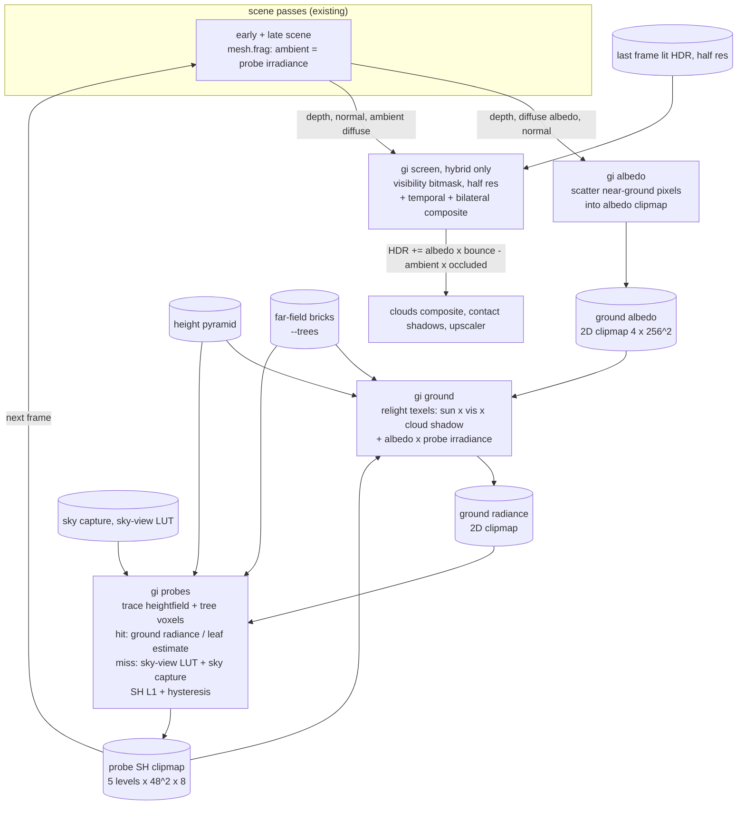

# Global illumination: terrain-following probes + screen-space bitmask

**Status:** probes on main and the default since 2026-11-23 (decisions.md "GI probes on by default"); ground cache, albedo feedback and foliage radiance landed. The screen-space bitmask (`hybrid`) pass is not built: plan Tasks 6-8, backlog.

## Goal

Bounce light, which the engine has none of today: ambient is the sky
irradiance (clouds included, through the sky capture) times AO, plus a
grey constant ground bounce (`kGroundAlbedo` 0.1 in lighting.glsl).
Visible goals: green bounce in the meadow and under canopies, warm bounce
at sunset, lifted shadow sides of rocks and cliffs, shadow luminance
~10-20% of sunlit, sky occluded by ridges and crowns, no leaks, and no
added shimmer or smear (the user's top priority). DLSS-ready: the GI is
part of the shaded colour, nothing view-noisy reaches the upscaler that it
couldn't already handle.

Resolves backlog rows "Bounce light / GI", "Ground bounce is grey",
"Shadows too dark" (the bounce half), revisits "Cloud occlusion of
ambient" and "Ambient visibility inside crowns" (with `--trees`).

## Non-goals

- No ray tracing: no TLAS, no ray queries in any GI pass.
- Specular GI beyond what rough surfaces get from the irradiance (glossy
  reflections stay the sky's).
- Rocks and hand-placed models as GI occluders/emitters at the world
  scale (the screen-space part covers them near the camera; a voxelized
  rock layer is a follow-up, below).
- Indoor/cave scenes: the world representation is a heightfield.

## Choice

Research in decisions.md ("Global illumination"). In short:

- **Per-pixel world traces + screen probes (Lumen, Brixelizer GI)** are the
  quality bar, but they are a deferred renderer's design (screen probes
  read a G-buffer and a surface cache of every mesh) and their noise is
  spatial-temporal, which is exactly what shimmers under foliage.
- **Voxel cone tracing (VXGI, SVOGI)** is noise-free but needs every mesh
  voxelized into a clipmap, leaks through thin walls, and costs cones per
  pixel.
- **Probe volumes traced in software (DDGI-style probes, Godot
  SDFGI/HDDAGI)** are world-space: stable in motion by construction, cheap
  to sample per fragment in a forward renderer (a few filtered texture
  fetches), and HDDAGI shows the traces need no RT, only a voxel/DDA
  structure. Their weakness is detail below the probe spacing, which is
  exactly what screen-space visibility bitmasks (Therrien et al. 2023)
  recover cheaply from the depth buffer.

Meridian's world is a heightfield plus vegetation, so the scene the probes
trace is already voxel-like and exact: the heightfield's max pyramid (the
Tevs march `terrainOccludes` uses) and the far-field world bricks (4/8/16 m
voxels of every tree, `farFieldTransmittance`). The hybrid:

1. **World part (probes):** a camera-centred clipmap of irradiance probes
   whose vertical axis follows the terrain (probes live where receivers
   are, in the air above the ground, never under it). Probes trace the
   heightfield and the tree voxels; hits on the ground read a 2D **ground
   radiance cache** (the terrain's surface cache: albedo x direct sun +
   albedo x the probes' own irradiance, so bounces accumulate over frames);
   misses read the sky (sky-view LUT + sky capture, so clouds stay in
   ambient). Stored as SH L1 per colour channel, sampled in mesh.frag's
   ambient term.
2. **Screen part (hybrid only):** a half-resolution visibility-bitmask pass
   over the depth buffer, radius ~2 m, gives near occlusion and near bounce
   (last frame's lit image) that the probe spacing can't resolve: plant
   bases, rock contacts, crevices, grass on grass. It replaces the occluded
   share of the probe light with what it saw.
3. **Ground albedo feedback:** the ground cache's albedo comes from the
   rendered image (diffuse albedo of visible pixels near the terrain
   surface, scattered into a top-down map), so the streamed grass, flowers
   and the terrain material all colour the bounce as they look.

The probe and ground passes run before the scene passes and read last
frame's probes; the feedback runs after the late scene pass (this frame's
albedo, used from the next frame). One frame of latency on slow-changing
light is invisible.

## World part

### Probe clipmap

- **Levels:** 5, spacing `s_k = 2 m x 2^k` (2, 4, 8, 16, 32 m), each a
  48 x 48 grid of columns centred on the camera (snapped to whole columns),
  so level k covers +-48 `s_k` / 2: 48 m, 96 m, 192 m, 384 m, 768 m.
  Beyond level 4 the ambient falls back to today's analytic sky + ground
  term (fades over the last 4 columns). Toroidal addressing: a scroll
  rewrites only the columns that entered.
- **Vertical:** 8 slices per column at heights above the column's base
  `h_t = b_k (2^t - 1)`, t = 0..7, `b_k = 0.25 m x 2^k` (level 0: 0 to
  32 m, covering grass to crowns; level 4: 0 to 508 m). The base is the
  max of the bilinear heightfield over the column's footprint
  (`terrainHeightBounds`) plus 0.05 m, so no probe is underground. A
  receiver's slice coordinate is `log2(1 + h / b_k)` with `h` its height
  above the base interpolated from a per-level base-height map (R32F,
  filtered), clamped at 0 (a receiver in a dip below the column max reads
  the bottom slice).
- **Storage:** SH L1 radiance, per level one RGBA16F 3D texture per
  colour channel (48 x 48 x 8), ~2.2 MB in all. Sampled through the
  bindless `textures3D[]` with a GI sampler: trilinear, REPEAT in xz (the
  toroidal wrap), CLAMP_TO_EDGE across slices.
- **Update:** one workgroup of 64 threads per probe, one ray each
  (spherical Fibonacci set rotated per update by a frame-indexed rotation,
  deterministic for captures). Radiance is projected to SH L1 in shared
  memory and blended into the stored value with hysteresis 0.9 (0.0 for a
  probe that just entered). Per frame: level 0 every 4th probe, levels 1-4
  every 8th (by a frame-indexed stride over the probe index), ~14k probes,
  ~0.9M rays. On a history reset or a teleport every probe updates once
  with hysteresis 0.
- **New columns** start from the next coarser level's value at their
  position (so a scroll never shows black), then update with hysteresis 0
  on their first update.
- **Rays** march up to 4 km:
  - **Heightfield:** `terrainRayDistance` (the max-pyramid march
    `terrainOccludes` uses, returning the hit distance; `terrainOccludes`
    becomes a wrapper, unchanged results). Hit radiance: the ground
    radiance cache at the hit's xz (the finest level that holds it); past
    the cache, the fallback albedo lit by the sun without a shadow test.
  - **Trees** (`--trees`): `farFieldTransmittance` over the same segment,
    read only through that function (the far-field lane owns the format).
    The ray's radiance is `T L_behind + (1 - T) L_leaf`, `L_leaf` = leaf
    albedo / pi x (sun x the probe's own canopy transmittance toward the
    sun x 0.5 + sky irradiance x 0.5): crude, and the place the raster
    lane's cascades improve later.
  - **Miss:** `skyLuminance(dir) x capture.a + capture.rgb` (as the
    specular sky term), so the clouds' dimming of ambient is kept.

### Ground cache

- **Albedo clipmap:** 4 levels of 256^2 texels at 1, 2, 4, 8 m (256 m to
  2 km), toroidal, RGBA8 (alpha = confidence). Filled by **gi albedo**:
  every visible opaque pixel within 1.5 m above the bilinear heightfield
  and within the finest level that holds it adds its diffuse albedo
  (scene attachment 3) to a fixed-point accumulator per texel (atomics),
  then a resolve blends the mean into the texel (rate 0.1, confidence up).
  Coarser levels are filled from the same pixels. A never-seen texel uses
  the next coarser level's, else a default meadow albedo.
- **Radiance:** RGBA16F, same layout, rewritten by **gi ground** for a
  quarter of the texels per frame (all on reset): `albedo / pi x (sun at
  surface x NoL x V + E(probes at the texel, bottom slice, up normal))`, V
  = terrain march toward the sun (pyramid level >= 1 is enough at this
  resolution) x `farFieldTransmittance` toward the sun x cloud shadow.
  Normal from the terrain normal map.
- **Dependency:** the raster lane's cascaded shadow maps
  (`docs/superpowers/specs/2026-11-20-raster-sun-shadows-design.md`) will
  give V the rocks' and near trees' shadows on the ground; until they land
  V is the heightfield + far-field trees + cloud shadow. The hook is one
  function, `giGroundSunVisibility`.

### Sampling (the hook)

`giIrradiance(worldPosition, N)` in `gi.glsl`: level = finest whose
interior holds the point (blend to the next over the last 4 columns), the
point offset along N by 0.25 `s_k`, three filtered fetches, SH L1
evaluated with the cosine lobe (Geomerics' non-negative L1 reconstruction,
no ringing). In lighting.glsl's `addAmbientLight` the diffuse irradiance
(sky above, grey ground below) becomes `giIrradiance` when GI is on, and
rough specular's irradiance fallback uses it in the reflected direction;
mesh.frag's leaf back irradiance uses it with -N. AO (material, multi-
bounce, micro, specular occlusion) stays on top: it is sub-probe detail.
`Shading` gains the flat world position. That is the whole edit to
lighting.glsl/mesh.frag (the raster lane owns their sun term).

## Screen part (`--gi hybrid`)

- **gi screen**, half resolution, after the late scene pass: visibility
  bitmask (32 sectors per slice), 2 slices per pixel per frame (rotated
  per frame: interleaved gradient noise, the PCG hash under
  `whiteNoise`), 8 steps per side, world radius 2 m, thickness 0.5 m
  (light passes behind grass blades). Per pixel: V, the cosine-weighted
  unoccluded share of the hemisphere, and B, the bounce from the occluded
  sectors (last frame's lit image, half res, reprojected by motion,
  rescaled by exposure / previous exposure).
- **Temporal:** reprojected history of (B, V), depth-tested for
  disocclusion, 1/8 blend, variance clip; then **composite** at full
  resolution with a depth/normal bilateral upsample: `HDR += albedo / pi x
  B - ambient diffuse x (1 - V)`. The ambient diffuse (GI part only,
  exposed) is a new scene attachment 7 (RGBA16F, 6 is the sun light),
  written by mesh.frag only in hybrid mode. Faded out 60-100 m.
- **Guides:** the feedback and the screen pass need the diffuse albedo and
  normal attachments (3, 5), today only created under Ray Reconstruction;
  they are created whenever GI is on.

## Budget (2560x1440 render size, RTX 4080)

| Pass (GPU timer name) | Work | Budget ms |
|---|---|---|
| `gi probes` | ~14k probes x 64 rays, SH project + blend | 0.70 |
| `gi ground` | 65k texels: terrain march + far field + cloud shadow | 0.15 |
| `gi albedo` | scatter + resolve | 0.10 |
| scene early/late | probe sampling in mesh.frag, guides when RR is off | 0.25 |
| `gi screen` | bitmask half res, temporal, composite (hybrid) | 0.75 |
| **Total** | | **1.95** |

`probes` alone ~1.2 ms. Dials, in order: rays per probe (32), update
fraction, level 0 columns (32^2), the screen pass's slice count (1).

## Stability and leaks

- Probes are world-space and snap by whole columns: no sub-pixel motion,
  nothing view-dependent but the albedo feedback (static colour, slowly
  blended). Ray noise is low frequency (64 rays per update, hysteresis
  0.9); the gate is the static-camera flicker metric.
- Terrain leaks: probes never sit underground; receivers below their
  column base clamp to the bottom slice. Across a sharp ridge the coarse
  levels blend lit and shadowed columns; the levels near the camera are
  2-8 m. Gate: the sunset view and the low-sun view (no glow behind
  ridges), the forest interior (no bright bleed under crowns).
- Disocclusion in the screen part: depth-tested history, short history
  (8 frames), so its errors are local and brief; gated by the motion
  Laplacian and shimmer metrics against GI off.

## Gates

- GPU: total <= 2 ms (sum of the GI passes plus the scene passes' delta).
- Stability: `tools/motion-gates.sh` and `image-gates.py shimmer` with GI
  `probes` and `hybrid` no worse than `off` under DLSS SR DLAA (`--rr off`)
  and TAA; static-camera flicker (two consecutive frames) no worse.
- Look: open view, full-ground view, low sun `1119 1356 -431 1.57 -0.02
  --sun 0.9 0.05 -0.4`, sunset view, forest interior + edge (`--trees`),
  placed moss rock close up; shadow/sunlit luminance ratios from `.pfm`
  with `tools/region-luminance.py` (target 10-20%); judged against
  `assets/reference/chlorophyll/` and `target-meadow.png` (Opus).
- Debug: validation clean, `placement check` and the other Debug checks
  unchanged, unit tests for the CPU math (SH, slice mapping, toroidal
  clipmap indexing).

## Follow-ups (not in this spec)

- Rocks as GI voxels: voxelize the rock prototypes at load (as the
  far-field bake does for trees) and splat into a near voxel clipmap.
- Probe visibility (DDGI's per-probe depth moments) if the ridge leaks
  show at the coarse levels.
- The leaf radiance from the raster cascades instead of the canopy
  transmittance estimate.
- G panel toggle for the GI mode (it recreates resources).

## Sources

- Therrien, Levesque, Gilet, Screen Space Indirect Lighting with
  Visibility Bitmask (2023): https://arxiv.org/abs/2301.11376
- Wright, Narkowicz, Kelly, Lumen: Real-time Global Illumination in Unreal
  Engine 5 (SIGGRAPH 2022 Advances):
  https://advances.realtimerendering.com/s2022/SIGGRAPH2022-Advances-Lumen-Wright%20et%20al.pdf
- Majercik et al., Dynamic Diffuse Global Illumination with Ray-Traced
  Irradiance Fields (JCGT 2019): https://jcgt.org/published/0008/02/01/
- Godot HDDAGI (hierarchical DDA voxel probes, no RT; PR #86267):
  https://github.com/godotengine/godot/pull/86267
- Godot SDFGI (cascaded probes traced against an SDF):
  https://godotengine.org/article/godot-40-gets-sdf-based-real-time-global-illumination/
- AMD FidelityFX Brixelizer GI (sparse distance-field bricks, no RT):
  https://gpuopen.com/fidelityfx-brixelizer/
- Sloan, Stupid Spherical Harmonics Tricks (2008) and the Geomerics L1
  reconstruction (Hazel, "Reading Between the Lines"):
  https://www.ppsloan.org/publications/StupidSH36.pdf
- Tevs, Ihrke, Seidel, Maximum Mipmaps for Fast, Accurate, and Scalable
  Dynamic Height Field Rendering (2008), the march reused for probe rays.
