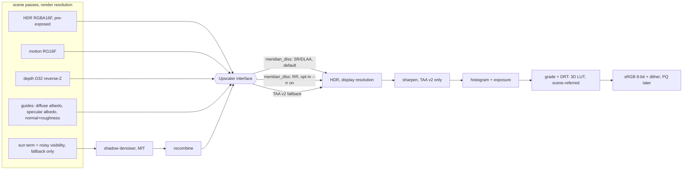

# Motion clarity: DLSS 4.5, Ray Reconstruction, TAA v2 fallback, grading

**Status:** decided with the user 2026-11-20; plan
`docs/superpowers/plans/2026-11-20-motion-clarity.md` (not started).

This is quality pass step 2 (TAA sharpness and the shadow denoiser), plus a
scene-referred grading system. Measurements, crops and the experiment diff
are in `.superpowers/sdd/motion-clarity/artifacts/` (git-ignored). The look
reference is Chlorophyll Engine (`assets/reference/chlorophyll/`).

## Goal

The user's goal is "absolutely no smear while moving", with no more
shimmer or shadow noise than the gates below allow (dropping temporal
accumulation would bring far more).

Gate, at eye height moving forward at 5 m/s (the original definition, a
Laplacian motion/still ratio >= 0.85, was replaced 2026-11-20 by the
motion frame's absolute Laplacian, see Gates):

| | Laplacian motion/still |
|---|---|
| minimum | >= 0.85 |
| stretch | >= 0.95 |
| today | 0.49 |

The gates are measured on every path, both DLSS and the fallback.

## Findings that drive the design

All numbers are Release at 1920x1080 with `--placement off`. The ground
view is `1119 1355.9 -431 -1.55 -0.25` and the beech view is
`1115.47 1366.85 -429.72 1.223 0` with `--scatter 100`. Shimmer is the
mean absolute difference /255 between frames 120 and 121 of a still
camera.

### Today's TAA (`taa.comp`)

Today's TAA uses:
- current-frame weight 0.1;
- 9-tap Catmull-Rom history;
- YCoCg variance clip with gamma 1;
- no motion-vector dilation;
- HDR history that is pre-exposed.

| case | Laplacian motion/still |
|---|---|
| forward 5 m/s | 0.49 |
| forward 1 m/s | 0.64 |
| forward 10 m/s | 0.42 |
| sideways 5 m/s | 0.91 |
| backward 5 m/s | 0.95 |
| pitch 0.02 rad/s | 0.71 |
| beech, forward 5 m/s | 0.68 |

The TAA pass costs 0.16-0.19 ms.

### Root causes

1. **History resampling blur compounds over about 10 frames.** The
   history is resampled at a fractional pixel offset every frame and kept
   at 90%. Whole-pixel shifts stay sharp (0.97); 0.5 px per frame drops to
   0.72.
2. **Forward motion magnifies older, coarser history.** This is why
   forward (0.49) is so much worse than backward (0.95).
3. **The clip bounds colour, not blur.** Clip gamma 0.75 gives 0.58;
   current weight 0.2 gives 0.68.

### What is not a cause

- **Motion vectors are correct.** The reprojection residual has a sharp
  minimum at scale 1.0: 9.2/255, versus 19 at scale 0.97 or 1.03 and 53
  with motion vectors off.
- No jitter is in the motion vectors.
- The curvature warp and terrain morph are correct.
- Exposure is not a factor.
- Dilation does not help.

### No temporal AA

It reaches 1.000, but shimmer becomes unacceptable (beech view):

| | crown | shadow |
|---|---|---|
| TAA on | 1.9 | 1.7 |
| TAA off, jitter on | 19.1 | 17.0 |
| TAA off, jitter off | 0.4 | 14.3 |

The 1-ray-per-pixel sun penumbrae dither, and alpha-test edges alias.

The spatial alternatives were rejected:
- SSAA 2x2 is estimated at 12-15 ms at 1440p.
- MSAA + alpha-to-coverage needs a pipeline rework and fixes neither
  shading aliasing nor shadow noise.
- Forza Horizon 5's MSAA lost to its later TAA on tree shimmer
  (ComputerBase 2022).

Temporal accumulation stays. The resolver changes.

### Shortening the TAA history raises shadow noise

Shortening the history buys sharpness but raises shadow noise roughly in
proportion:

| config | forward 5 ground | forward 5 beech | crown shimmer | shadow shimmer |
|---|---|---|---|---|
| CW 0.2 + gamma 0.75 | 0.79 | 0.86 | 4.1 | 3.3 |
| CW 0.3 + gamma 0.75 | 0.88 | 0.91 | 6.0 | 4.9 |

So a sharp fallback needs a shadow denoiser of its own.

### Chlorophyll reference

- The engine's AA method is unknown: no source names it.
- Engine facts (custom engine, clustered LOD with voxel far field, screen
  and voxel GI, no hardware RT, native at about 130 fps on an RTX 3080 at
  1440p) come from press relays: wccftech, gamegpu, shazoo.
- Its motion/still ratio, estimated from the video (1440p60 VP9,
  13.8 Mbit/s): about 0.9.
  - The range is 0.8-1.0: median 0.92 over 34 pairs of slow and moving
    ground crops.
  - Low confidence. The video has no static shots, only slow-downs, and
    the content differs between pairs.
  - The codec cuts Laplacian by 30-40% whether moving or not.
  - The user's "~0.99" is plausible but not provable from the video. The
    0.95 stretch gate sits inside the measured range.

## Decisions

### 1. Upscaler interface; DLSS in an optional, separately linked module

**Interface.** The engine owns an `Upscaler` with one `evaluate` call. Its
inputs are color, depth, motion, jitter, exposure, the guide buffers and a
reset flag; it writes the display-resolution HDR output. There are two
backends:
- `meridian_dlss`: the NGX SDK, in its own CMake target.
- TAA v2, in the core.

**Licence.** The core library never includes or links NGX.
- `MERIDIAN_DLSS` (CMake option, default ON) builds the module and links
  it into the game.
- OFF gives a licence-clean build: the DLSS SDK licence forbids making
  the SDK subject to an open-source licence.
- The binaries are redistributed only inside the app. The game prints
  NVIDIA's attribution in the startup log and in an about/credits text.
- The SDK's third-party notices ship next to the `.so`.

**SDK version.** NVIDIA/DLSS 310.9.x, the newest in the repo: SR presets
L and M (2nd-generation transformer), RR preset F. It is pinned by commit
hash via FetchContent, and the version is verified at fetch time.

**Updates are a version bump.**
- Leave presets at NGX's per-mode defaults, so a new `.so` brings the new
  model.
- `--dlss-preset X` overrides the preset for A/B.
- Query the Vulkan extensions at runtime
  (`NVSDK_NGX_VULKAN_GetFeature*ExtensionRequirements`).
- Create the feature at the maximum render size.
- Linux uses direct NGX (the SDK's static NGX library +
  `libnvidia-ngx-dlss*.so`);
  Streamline is Windows-only.

**Modes.** `--aa dlss|taa`; the default is dlss with Ray Reconstruction
(decided 2026-11-20, user: RR removes the shadow shimmer; optimise from
the most demanding configuration down), falling back to SR DLAA preset M
when RR is unavailable and to TAA v2 when NGX reports no Super
Resolution. `--dlss-mode dlaa|quality|balanced|performance`, default
dlaa. `--rr on|off`, default on (decision 3). The SR preset defaults to
M for DLAA, Quality and Balanced.

**Out of scope** (backlog rows):
- DLSS 5: RTX 50 only, no Linux evidence, and the dev GPU is an RTX 4080.
- Frame Generation: NVIDIA recommends Streamline; native Linux is
  unverified; MFG needs RTX 50.

### 2. DLSS input fixes (before any SDK code)

1. **Render vs display resolution.**
   - HDR, motion, depth, depth pyramid and guides are render-sized (the
     visibility buffer is per instance).
   - The Upscaler output, histogram, exposure, grade and tonemap are
     display-sized.
   - Cull and pyramid code that assumes the swapchain size reads the
     render size instead.
2. **Jitter phases** = `max(8, ceil(8 * s^2))`, where s = display/render. RR wants at least 32
   phases, so the RR path uses at least 32. The jitter is reported to NGX
   in render pixels with the correct y sign (`mat4.h:81` flips y).
3. **Motion vectors** stay previous minus current in UV. NGX gets
   `InMVScale` = render size and no dilation.
   - Blended instances don't write motion. They are flagged in a
     transparency mask; clouds will use it too.
4. **Depth** is passed with `DepthInverted`. Sky depth 0 (infinite far) is
   verified in the task.
5. **Exposure.** Colour is already pre-exposed by last frame's exposure
   (GPU-only). Task 1.3 measured a constant 1.0 exposure texture and
   NGX's AutoExposure flag the same (DLAA, 1080p: forward 5 ground
   0.4600 vs 0.4596, beech shimmer 0.311 vs 0.312); DLSS uses
   AutoExposure, which needs no texture (presets L and M always use it).
6. **Mip bias** = `log2(render/display)`, plus -1 when upscaling; 0 for
   DLAA. It is applied to the material samplers.
7. **Guides** (for RR):
   - diffuse albedo RGBA8 (linear, sky 0.5);
   - specular albedo RGBA8 (sky 0);
   - normal RGB16F + roughness in alpha (world space, sky 0).
   - Specular hit distance gets a constant far value until RT reflections
     exist.
   - Depth and motion are the existing ones.
   - The opaque `mesh.frag` variants write them: mesh, masked and
     terrain (the `TERRAIN` define). Double-sided is a cull state, not a
     variant. The blended variant writes no guides.
8. **Noise for RR.** The sun-disk sample uses a hashed
   white-noise sequence, independent per pixel and per frame, in place of
   interleaved gradient noise (the RR guide rules out screen-space
   dithering and correlated patterns). The fallback keeps its own pattern.

### 3. Ray Reconstruction first, for shadows and AO

Outcome (Task 1.5, measured; default since 2026-11-20): RR removes the
shadow and foliage shimmer (beech crown/shadow 0.59/0.41 in Quality vs
TAA's 2.35/1.97). It failed the original motion/still ratio gate in both
modes (forward 5 ground 0.71 Quality / 0.79 DLAA; DLAA costs 4.71 ms,
Quality 2.35 ms at 1440p) only because its stills are much sharper than
TAA's; under the absolute-sharpness gate it passes. The fallback denoiser
(decision 4) serves `--aa taa` and `--rr off`. Numbers: decisions.md,
"Ray Reconstruction backend" and "DLSS DLAA with Ray Reconstruction is
the default". RR uses preset F, the newest model in SDK 310.9.16, pinned
explicitly (user requirement). The design below is what it implements.
- Its input is the full noisy lit colour: raw 1-ray visibility times the
  sun, not pre-blurred. AO today is material/terrain AO, which is not
  stochastic; a future stochastic AO feeds RR the same way.
- RR's guide never names direct-light shadows. That RR denoises them in a
  hybrid renderer is an inference, so the shadow gates decide it.
  - Resolved: the shadow gates pass under RR (crown/shadow 1.41/0.35
    DLAA); the fallback denoiser (decision 4) is fallback-only.
- Mode: DLAA if it fits the budget. NVIDIA publishes only Performance-mode
  numbers (1.80 ms at 1440p on an RTX 4080); DLAA is estimated at 4-7 ms
  and must be measured.
- If RR DLAA costs more than 3.0 ms at 1440p, RR runs in Quality mode
  (0.66 scale) and the gates are re-measured there.
- RR's slot (<= 3.0 ms) replaces TAA + the shadow denoiser, and exceeds
  the showcase roadmap's 0.7 ms atmosphere/TAA/exposure/tonemap allotment
  (`2026-11-19-showcase-roadmap.md`). The roadmap budget is updated with
  measured numbers when this work lands (open question below).
- RR takes no exposure input; the pre-exposed colour is fine.

### 4. Fallback (non-NVIDIA, or `--aa taa`): TAA v2 plus an MIT shadow denoiser

**TAA v2** (built in Task 3.1; values, sweep and measurements in the
decisions.md "TAA v2" entry):
- Current-frame weight adapts to speed and subpixel offset (0.1 still,
  up to 0.3 in motion).
- Clip gamma stays 1.0 in motion: 0.75 pulled the history toward the
  blurry neighbourhood mean and measured softer in every view (sideways
  0.89, below its 0.95 gate).
- History weight drops with local magnification (root cause 2): the
  Jacobian determinant of the reprojection, each derivative taken from
  the smaller of the two one-sided motion differences so a depth edge on
  one side doesn't read as magnification.
- History is rescaled on exposure change.
- An output-only FidelityFX CAS sharpen that never feeds back into the
  history, present at strength 0 (a copy): any strength failed the SSIM
  gate. Re-tuned after the shadow denoiser (3.2b).
- The supersampled history (2x history resolution) was not needed: the
  forward minimum passed without it.

**Shadow denoiser:**
- Approach: a port of AMD FidelityFX's shadow denoiser (MIT): tile
  classification, temporal reprojection with neighbourhood clamping, and
  an edge-aware spatial filter.
- NRD SIGMA is not used: the NVIDIA RTX SDKs licence would break the
  licence-clean core.
- On this path, the opaque `mesh.frag` variants (mesh, masked, terrain)
  write the following; blended keeps its sun term in its colour:
  - colour without the sun-direct term;
  - the unshadowed sun-direct radiance;
  - the noisy visibility.
- A recombine pass adds the radiance times the denoised visibility before
  TAA v2.
- Estimated cost: 0.3-0.5 ms plus the extra attachments at 1440p. Measure
  it.

### 5. Grading system (build now, tune the look later)

The grade is scene-referred and runs after exposure, before the display
rendering transform (DRT), so one grade serves SDR and the mandatory HDR
output (backlog row).

**Parameters**, in scene-linear Rec.2020:
- white balance (CAT02);
- exposure offset;
- ASC CDL: slope, offset, power, plus contrast around a 0.18 pivot;
- global saturation;
- per-hue saturation and hue rotation in OKLCh, in 3 bands: greens,
  blues, browns.

**Bake.** Grade + DRT go into one 65^3 RGBA16F 3D LUT, indexed by a
log2 shaper over -12.47..+8 EV (log2 of the value, as AgX's own shaper),
after AgX's inset matrix. The range reaches past AgX's +4.03 EV clamp so
a negative exposure offset in the grade recovers highlights; AgX's clamp
is applied inside the bake. Indexing after the inset keeps saturated
highlights from clipping early. CPU tests check both. 33^3 fails the
identity gate (mean 0.47/255 > 0.3/255); 65^3 passes (0.11/255).
- A compute pass rebuilds it only when the grade or the display changes.
- `tonemap.frag` does one trilinear fetch, then the existing dither.
- A CPU reference of the grade math is unit-tested against the shader
  constants.

**DRT.** Today it is AgX (SDR). The HDR DRT is an A/B of AgX HDR against
GT7, on the user's monitor, under the HDR output item. Display-referred
LUT import is a non-goal.

**Defaults.** The default grade is identity, so the look doesn't change
in this work. The identity LUT must match today's analytic AgX within a
mean of 0.3/255. A measured "reference" starting set is kept in
decisions.md for later tuning:
- CDL power 1.10;
- saturation 1.10;
- greens: rotate 10 degrees toward yellow, saturation x1.15;
- blues: rotate 10 degrees toward cyan.

Why the gap to the reference isn't the tone curve: AgX already matches
its highlight rolloff and green handling. Most of the gap is lighting and
content: exposure keys on the bright placeholder ground, foliage has no
translucency or occlusion, there are no clouds, and the distant haze has a
violet cast (next section).

## Distant haze colour (investigated, not changed)

The cause is content, not the atmosphere.

**Terrain albedo.** The placeholder terrain textures are brown: linear
mean albedo about (0.16-0.24, 0.11-0.15, 0.06-0.09), red/green 1.4-1.9,
where meadow or forest is about 0.6. Seen through blue in-scatter, they
give violet. The aerial far band, with placement on, measures OKLCh hue
and chroma:

| ground | h | C |
|---|---|---|
| today (brown) | 277 | 0.018 |
| mid-green albedo | 242 | 0.031 |
| reference | 236-252 | 0.040 |

The in-scatter alone is already blue (h 249-252), and the horizon sky
measures h 238 in every A/B.

**Minor contributors:**
- AgX desaturates bright haze by 20-30% chroma: intended rolloff.
- The aerosol and ozone parameters are physical and stay: SSA 0.925,
  Angstrom exponent 1.42 (OPAC continental), Bruneton's ozone.

**Fix.** Green ground cover or vegetation albedo beyond the near range,
with the terrain layer choice in `game/src/main.cpp`. It waits for real
terrain albedo (framework over content). Captures are in
`artifacts/haze/`.

## Gates (measured, never assumed)

The capture drift fix landed in b6432cf. Gate scripts live in `tools/`
(plan Task 0).
- Laplacian, shimmer and SSIM gates are measured at whatever size the
  fullscreen run gets, and the resolution is recorded with the numbers.
- GPU-ms gates are defined at 2560x1440 (the monitor). On Hyprland's
  1920x1080 fallback output, they are measured there with thresholds
  scaled by 0.5625 (the pixel ratio) and marked "re-measure at 1440p".
- GPU ms = the median of 5 capture runs, each reporting its last frame's
  pass times, for every GPU-ms gate.
- SR/DLAA over 1.0 ms: report it and continue with DLAA; the user
  decides on Quality mode.

| gate | view | minimum | stretch | today |
|---|---|---|---|---|
| Laplacian std of the motion frame, forward 5 m/s (absolute; ratio informational) | ground | >= 0.10 (TAA v2 0.114) | | |
| same, sideways 5 m/s | ground | >= 0.10 (0.118) | | |
| same, forward 5 m/s | beech | >= 0.20 (0.226) | | |
| same, pitch 0.02 rad/s | ground | >= 0.09 (0.108) | | |
| shimmer crown / shadow (/255) | beech | <= 2.0 / 2.0 | <= 1.0 / 1.0 | 2.0 / 1.5 |
| SSIM motion vs still, forward 5 | ground | >= 0.98 | | 0.95 |
| AA slot GPU ms, SR/DLAA | 1440p | <= 1.0 | | 0.18 (TAA, 1080p); DLAA preset M 2.36 (1440p): measured miss, accepted: the default is RR DLAA (4.71 ms) |
| AA slot GPU ms, RR | 1440p | <= 3.0 (else Quality mode) | | n/a |
| TAA v2 + shadow denoiser GPU ms | 1440p | <= 0.9 | | 0.18 (1080p) |
| grade + tonemap GPU ms | 1440p | <= 0.08 | | 0.06 (1080p) |
| identity grade vs analytic AgX | all | mean <= 0.3/255 | | |

Baseline measured on main with `tools/motion-gates.sh` (Release,
1920x1080: the session's fullscreen gives the 1080p fallback output, so
GPU ms are 1080p, median of 5, `taa` 0.18 + `tonemap` 0.06; re-measure
at 1440p). Captures: `.superpowers/sdd/motion-clarity/artifacts/task0`.

Every capture keeps 0 validation errors.

## Open questions (for the user)

- Post budget: RR at up to 3.0 ms (or TAA v2 + denoiser at up to 0.9 ms)
  against the roadmap's 0.7 ms for atmosphere/TAA/exposure/tonemap. Which
  roadmap line pays for it? Measured numbers come with the plan's final
  tasks.

## Non-goals (backlog rows)

- Frame Generation / MFG.
- DLSS 5.
- FSR 4 as an AMD backend (the `Upscaler` interface admits it later).
- XeSS: no Linux binaries.
- HDR DRT and HDR swapchain: an existing row.
- Look tuning of the grade: after lighting, leaf translucency and forests.
- RT reflections and GI through RR: RR becomes the denoiser for them when
  they arrive.

## Sources

- NVIDIA DLSS SDK, programming guide, RR integration guide and licence:
  https://github.com/NVIDIA/DLSS
- Streamline is Windows-only: https://github.com/NVIDIA-RTX/Streamline
- RR on Linux Vulkan:
  https://forums.developer.nvidia.com/t/ngx-reports-dlss-rr-as-unavailable-on-linux/353770
- DLSS 4.5 cost on RTX 20/30: https://hothardware.com/news/nvidia-dlss-45-benchmarked
- Transformer model vs TAA in motion:
  https://www.techspot.com/article/2957-nvidia-dlss-4-vs-dlss-3/
- Forza Horizon 5 MSAA vs TAA:
  https://www.computerbase.de/2022-06/forza-horizon-5-series-9-update-taa-test/
- NRD and its licence: https://github.com/NVIDIA-RTX/NRD
- FidelityFX SDK (MIT; shadow denoiser, CAS, FSR):
  https://github.com/GPUOpen-LibrariesAndSDKs/FidelityFX-SDK and
  https://gpuopen.com/manuals/fidelityfx_sdk/techniques/denoiser/
- Unreal TSR (history weight vs sharpness):
  https://dev.epicgames.com/documentation/en-us/unreal-engine/temporal-super-resolution-frequently-asked-questions-for-unreal-engine
- Grading:
  - Unreal scene-referred grading:
    https://dev.epicgames.com/documentation/en-us/unreal-engine/color-grading-and-the-filmic-tonemapper-in-unreal-engine
  - Frostbite HDR grading: https://gdcvault.com/play/1024253/High-Dynamic-Range-Color-Grading
  - GT7 tonemapper:
    https://blog.selfshadow.com/publications/s2025-shading-course/pdi/s2025_pbs_pdi_slides.pdf
  - Blender 5.0 AgX HDR:
    https://developer.blender.org/docs/release_notes/5.0/color_management/
  - Filament AgX:
    https://raw.githubusercontent.com/google/filament/main/filament/src/ToneMapper.cpp
