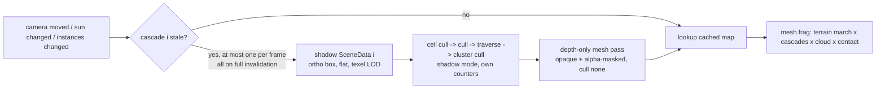

# Raster sun shadows: cached cascaded shadow maps

**Status:** implemented as an opt-in (`--shadows raster`, default rt until it passes the shimmer gates; see decisions.md "Raster sun shadows"). Changed in implementation: every cascade that needs re-centring renders the same frame (no one-per-frame limit).

## Goal

Replace the per-pixel TLAS shadow ray for objects (trees, rocks, plants,
hand-placed models) with a raster technique: better motion clarity (no
one-ray-per-pixel noise for the upscaler to accumulate), lower cost, no
denoiser. Everything else in the sun's visibility stays: the terrain's
heightfield march (`terrainOccludes`, including cluster_cull's per-cluster
visibility), the cloud shadow, contact shadows, and the far-field path for
receivers beyond `kFarShadowDistance` (owned by the far-field lane).

`--shadows raster|rt` (default raster) keeps the TLAS ray as an A/B until
the user accepts the raster look. No TLAS/BLAS code is removed here.

## Choice: cached camera-centred cascades (a coarse clipmap)

Research (decisions.md, "Raster sun shadows"):

- Virtual shadow maps (UE5) get resolution where the screen needs it and
  cache pages, but page marking, allocation, a physical page pool and
  per-page culling are a large system, and Epic's own docs single out
  foliage and alpha-masked geometry as their expensive case.
- Cached cascades are what shipped open worlds use for the sun: Insomniac's
  CSM scrolling (SIGGRAPH 2012) reuses ~70% of static shadow rendering per
  frame; Crytek (Kasyan 2013) and Cyberpunk 2077 (Dybisz 2021) refresh
  distant cascades periodically over several frames.
- Meridian's casters are fully static (no vertex wind animation on plants
  yet), and the sun only moves when the user changes it. A cascade whose
  light-space window is texel-snapped and whose LOD depends only on its own
  texel size renders the same image wherever it is re-centred, so a cascade
  can be cached until the camera nears its edge. That is a VSM clipmap's
  caching at the granularity of whole levels, with none of its machinery.

Shimmer: classic CSM shimmer comes from re-fitting the cascade to the view
each frame (sub-texel motion, rotation, scale changes). Here a cascade is
only rendered when it re-centres, on whole texels of a fixed light-space
grid, at a fixed size, so the texels never move relative to the world; a
receiver's lookup filters the same depths every frame. Filtering is a
deterministic tent PCF (no per-frame noise), so nothing flickers for DLSS
to average away.

## Cascades

- `kShadowCascades = 5`, guaranteed radius `R_i = 20 * 4^i` m (20, 80,
  320, 1280, 5120: the last covers the far-field switch at 4-4.8 km).
  Window half-size `H_i = 1.25 R_i + filter margin`, `kShadowMapSize =
  2048` texels per cascade (c0 texel ~2.5 cm, c4 ~6.3 m). One D32_SFLOAT
  image per cascade (array or separate images; each registered in the
  bindless table so the lookup reads it with `textureGather`).
- Light basis: d = -sunDirection (into the scene), u, v perpendicular,
  computed in double on the CPU from the sun direction alone (stable while
  the sun is). A cascade's centre is the camera position projected on
  (u, v), snapped to whole texels of that cascade; its depth origin is the
  camera's projection on d (not snapped, depth has no texels).
- Depth range: from the receivers' far side (`+H_i` beyond the centre along
  d) to the sunward point where a caster could still shadow them: the
  highest caster top (the placement cells' max y and the hand-placed
  instances' bounds) climbed from the lowest receiver at the sun's
  elevation, `(top - (centre.y - H_i)) / max(sin(elevation), 0.02) + H_i`,
  capped at `kShadowRayLength`. Casters are culled to that box, which is
  exactly the set that can shadow a receiver in the window.
- Re-centre when the camera's offset from the cascade centre along u, v
  or d exceeds `0.5 (H_i - R_i)`: the cascade still covers the guaranteed
  radius (laterally and in depth) while it waits its turn.

## Update policy (CPU, per frame)

- Full invalidation (every cascade rendered this frame): first frame, sun
  direction changed (any change), instances or placement changed, shadow
  mode switched to raster.
- Otherwise at most one cascade per frame: the finest that needs
  re-centring. A cascade that has fallen behind still serves receivers
  inside its rendered window; the lookup falls back to the next coarser
  one for receivers outside it.
- Capture runs follow the same rules (fixed 1/60 s steps make them
  deterministic).

## Culling: the existing GPU-driven path in a shadow mode

A shadow view is a second `SceneData` (one buffer per cascade, written by
the CPU when the cascade renders) copied from the frame's, with:

- `cameraPosition` = the cascade centre, `frustumPlanes` = the six planes
  of the light box relative to it, `viewProjection` = the light's
  orthographic projection of camera-relative positions (rotation only),
  `drawLists` = the shadow draw lists.
- a new `shadowView` flag (1) and `orthoPixelsPerMeter` (texels per meter,
  `kShadowMapSize / (2 H_i)`; 0 for perspective views). `projectedError`
  (cull.glsl) and `seedTraversal`'s finest-error bound use `error *
  orthoPixelsPerMeter` when it is set, so the LOD cut is a fixed texel
  error, view independent. `lodErrorPixels` = 1 texel. The CPU reference
  (`projectedErrorPixels`, `lodVisible`, `selectClustersBvh`, cluster.h)
  gains the orthographic case, with tests that the BVH selection still
  equals the `lodVisible` set.
- No curvature warp (the world is flat for lighting): `curvatureDrop` is 0
  when `shadowView` is set.
- cell_cull.comp: in shadow mode every grid cell is tested against the box
  (no visibility read or write, no far switch, no far list); streamed
  records and blended instances are skipped (streamed layers are not in the
  TLAS either: parity with today, deferred in the backlog).
- cull.comp, cluster_traverse.comp, cluster_cull.comp: shadow mode is a
  single pass, frustum and LOD only, no occlusion, no visibility writes, no
  retest, no terrain-sun code; draw lists by bucket as phase 0.
- Own `DrawCounters` buffer (push constant); the chunk, node-queue and
  work-item scratch buffers are shared with the main view, which is safe
  because the shadow passes finish (barriers) before the main cull resets
  and reuses them.
- Prototype draw distances are measured from the cascade centre.

## Rendering

- `shadow.mesh`: mesh.mesh's vertex fetch, `gl_Position = light projection
  * (world - centre)`, outputs only the UV and material index (masked).
- Pipelines: depth-only opaque (no fragment shader) and alpha-masked
  (`shadow_masked.frag`: base colour alpha test at the material cutoff,
  `discard`), cull none (double-sided foliage, no leaks from back faces),
  depth compare GREATER_OR_EQUAL against a cleared 0 (reverse depth along
  d: depth 1 = sunward end), slope-scaled depth bias (tuned).
- The four buckets (opaque/masked x single/double) are drawn with
  `vkCmdDrawMeshTasksIndirectEXT` from the shadow counters.
- Pass name `sun shadows` (0 ms on frames that render nothing; the GPU
  passes line shows it when a cascade renders).

## Lookup (lighting.glsl)

- `shadowMode` in SceneData: 0 raster, 1 rt. In raster mode
  `traceSunVisibility` skips the ray query and multiplies the terrain march
  by `cascadeVisibility(origin, normal)`; the far branch (receivers beyond
  `kFarShadowDistance` with `voxelFarShadows`) is unchanged.
- Cascade selection by distance from the camera: the finest i with
  `distance < R_i` whose rendered window contains the receiver plus the
  filter footprint; over the outer 15% of `R_i` it blends linearly with
  cascade i + 1. Beyond `R_4` (or outside every window): lit.
- Receiver offset along the geometric normal by `k_n * texel_i` and a depth
  bias of `k_d * texel_i` (tuned against acne and peter-panning at the
  midday, low sun and sunset views).
- Filter: 3x3 tent-weighted bilinear PCF (9 `textureGather`s), the same
  kernel in texels for every cascade.
- Leaf back faces (diffuse transmission) use the same lookup with the
  flipped normal, as today.

## CPU module

`engine/include/meridian/shadow_cascades.h` + `engine/src/shadow_cascades.cpp`
(pure math, unit-tested in `tests/shadow_cascades_test.cpp`): light basis,
cascade window (snapped centre, half-size, texel size, depth range), the
orthographic projection and box planes, the re-centre test and the update
policy (which cascades render this frame). The renderer only feeds it the
camera, the sun, the scene bounds and change flags.

## Gates

At 2560x1440 fullscreen, Release, identical `Render` lines, raster vs rt:

- Motion gates (`tools/motion-gates.sh`): all pass; `shimmer shadow` no
  worse than rt.
- Shimmer in motion on shadowed rocks/plants: mean consecutive-frame
  `shimmer` over a slow strafe (`--capture-sequence 1`) at the start view
  and the forest edge, no worse than rt.
- Re-centre invariance: a still capture after the camera arrives by motion
  (cascades re-centred on the way) matches the plain still (mean diff
  comparable to two identical runs' noise floor plus TAA history).
- GPU ms: midday (start view), low sun (`1119 1356 -431 1.57 -0.02 --sun
  0.9 0.05 -0.4`), sunset (`1119 1500 -431 3.14 -0.15 --sun 0.9 0.05
  -0.4`), forest edge and overview with `--trees`: the shadow pass on a
  full-invalidation frame and the steady-state frame; the sun-visibility
  share of `scene early` lower than rt's.
- Looks: before/after captures of each view, near contact crisp (contact
  shadows unchanged), no acne, no light leaks at cascade bands.
- Debug: validation clean, `placement check` and `stream check` 0
  mismatches, unit tests pass.

## Risks

- Cascade 4 with `--trees` holds most of the 2.65M trees: if its render
  overflows `kMaxDrawnClusters` or costs too much on full invalidation,
  far-field layers are skipped in cascade 4 and their shadows come from the
  far-field path from `R_3` on (needs the far-field lane's agreement:
  reported, not decided here).
- A re-centre of a coarse cascade is a frame-time spike (one cascade per
  frame bounds it); if c3/c4 spikes are too big, split their render over
  frames by cell ranges (deferred unless measured).
