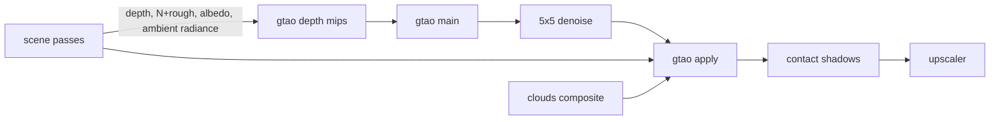

# GTAO (issue #2, gap G2)

Status: draft for user review. Pillar 2 of
`2026-11-21-chlorophyll-parity-programme-design.md`; sources and their
verification status in `../research/2026-11-21-B-ambient-occlusion.md`.
All ms figures below are estimates until measured on this GPU.

## Intent

Meridian has no screen-space occlusion: creases, rock bases, trunk/ground
contacts and tree-on-tree gaps read flat, which Chlorophyll's frames do
not. Add GTAO (Jimenez et al. 2016, XeGTAO implementation class) darkening
the ambient term only, never the sun, never the sky specular beyond what
its lobe sees.

## Technique

- Per pixel, one slice pair per frame (estimate: 2 slices x 6 steps per
  side, XeGTAO "High"), directions and step jitter from a per-pixel
  Hilbert + R2 sequence; radius 1.5 m default (view-space, clamped in
  pixels), falloff to 0 at the radius so it hands over to the voxel/GI
  scale instead of fighting it.
- Linear-depth MIP prefilter (small separate pass; the existing depth
  pyramid is min-reduced reversed-Z, wrong filter for AO).
- Thickness heuristic for thin occluders (XeGTAO's), bent normal output,
  multi-bounce fit `G = aA^3 - bA^2 + cA` with a = 2.0404 rho - 0.3324,
  b = 4.7951 rho - 0.6417, c = 2.7552 rho + 0.6903 (Jimenez 2016; the code
  already has `multiBounceOcclusion`, reuse it), specular occlusion from
  bent normal + AO against the lobe (GTSO if its table is cheap to bake,
  else the existing `specularAmbientOcclusion`).
- Fallback if foliage over-darkens despite the heuristics: visibility
  bitmask variant (research R4); same passes, different main shader.

## Full resolution, spatial denoise (rule 1)

The AO main pass runs at render size with 1 slice pair, then a 5x5
depth-aware spatial filter (XeGTAO's, designed for TAA) makes the single
frame usable on its own. Rejected: half-res + temporal accumulation. It
is cheaper (estimate 0.15-0.25 ms) but loses thin-foliage detail and makes
correctness depend on history, which rule 1 forbids; the TAA only polishes.
No AO-specific history buffer. Cost estimate, 1440p: 0.3-0.5 ms total
with bent normals; budget in the parity route 0.3-0.4 ms.

## Frame placement and data flow

Decisions:

1. **Normals always written.** Attachment 5 (world N + roughness) and
   attachment 3 (diffuse albedo, needed for multi-bounce) are written in
   every run, not only under RR. Rejected: reconstructing from depth,
   which is wrong on alpha-tested foliage and silhouettes, exactly the
   content that matters here. Cost estimate: ~0.1-0.2 ms of write
   bandwidth plus two render-sized images; RR parity comes free.
2. **Ambient-radiance attachment (research option a).** Attachment 7
   (RGBA16F, render-sized): mesh.frag, terrain and voxel shaders write
   the pre-exposed ambient radiance they added (diffuse + specular, after
   material occlusion), alpha = specular share. The sun-light attachment 6
   pattern, same shaders, same clear to 0. Rejected: (b) sampling last
   frame's AO in the late pass (a frame of lag; breaks rule 1).
3. **Apply in the contact-shadows slot.** After the clouds composite and
   before/with `contact_shadows.comp`, a compute apply pass reads depth,
   attachments 3/5/7 and the denoised AO and bent normal, then
   `HDR -= ambient * (1 - occlusionFactor)`, where the factor is
   multi-bounce(AO, albedo) for the diffuse share and GTSO for the
   specular share. Everything before the upscaler, so TAA/DLSS sees it.
   Sky pixels and blended surfaces have attachment 7 = 0 and are
   untouched. New passes: `gtao depth`, `gtao`, `gtao denoise`,
   `gtao apply` (one `endPass` each, or merged where barriers allow).

Dataflow:

## Double darkening

Micro occlusion (leaf/grass height gradient) and crown sky visibility
already sit inside attachment 7. Rule: screen AO is weighted per pixel by
`w` in attachment 3's unused alpha (diffuse albedo is RGBA8): 1 for terrain,
rock, bark, models; low (default 0.25, estimate) for leaf/grass materials
(`diffuseTransmission > 0`) and tree crowns, whose own terms are the
authority inside the mat or crown. Screen AO still acts on them at contacts
(trunk vs leaf, tuft vs ground) through that residual. A/B plan: captures of
meadow, forest interior and a rock/ground contact at `micro=0` x `ao=0|1`,
and `w` in {0, 0.25, 1}; pick the lowest `w` that keeps crown gaps and
bases dark without banding the mat. Record in decisions.md.

## Exposure

AO multiplies pre-exposed ambient radiance, a dimensionless factor, so no
exposure term. Apply is before the upscaler and the meter (after bloom)
sees the darker image; EV100 shifts slightly, which is correct.

## Parameters and controls

`Effects` gains `ao` (on/off, off skips all four passes), `aoStrength`
(0..2, scales 1 - AO), `aoRadius` (m), `aoFoliageWeight` (w above). G panel
Effects section sliders plus the toggle; `--effects ao=0,ao-strength=1,ao-radius=1.5`
for A/B. Slice/step counts compile-time. Defaults on.

## Gates

- Matched views #13: forest interior, forest edge, meadow, rock close-up,
  beside the Chlorophyll frames, `ao=0` vs `ao=1`.
- Parity route #14: `gtao*` + apply + the extra writes <= 0.4 ms at 1440p
  (estimate), the 180 fps line holding; per-pass ledger row.
- Still/motion: `tools/motion-gates.sh` Laplacian, shimmer and SSIM on
  meadow and forest views; no worse than `ao=0` beyond tolerance.
- Foliage: thin-occluder view (grass over ground, leaves against sky
  gaps): no halo, no dark fringe on sky-adjacent leaves.
- Debug validation clean; if a CPU reference of the horizon integral is
  cheap, a unit test (plane = 1.0, 90-degree corner = known value).

## Risks

- Over-darkening foliage (mitigated by `w`, thickness heuristic, R4).
- Halos at depth discontinuities (radius falloff, depth-aware denoise).
- Added attachment 7 bandwidth in every shading shader (measured by the
  route; could pack ambient into R11G11B10 if hot).
- Curvature display warp: depth and view positions must be the displayed
  ones, as culling and aerial perspective are.
- Reversed-Z infinite far: linearize carefully; sky pixels skipped.
- XeGTAO is archived (22 Apr 2024): we own the code, MIT.
- Dependence on research figures marked unverified there.

## Left to the planner

Exact slice/step/radius defaults from measurement; GTSO table vs the
existing specular fit; pass merging and barrier layout; packing of
attachment 7; per-material `w` plumbing; the voxel/far-field shaders'
writes; unit-test scope; the decisions.md entry (GTAO choice, apply path,
foliage policy, double-darkening rule) before implementation; the
R2 (grass gradient) and R3 (canopy map) items stay separate issues.
