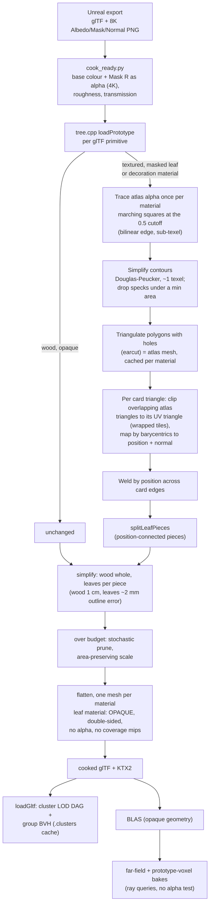

# Materials and texture fidelity (Pillar 1: G6, G12)

Status: draft for user review (leaf geometry, section 2, decided
2026-11-22; three decisions below still open)
Date: 2026-11-21, revised 2026-11-22
Programme: `2026-11-21-chlorophyll-parity-programme-design.md` (Pillar 1)
Audit: `2026-11-21-look-gap-audit.md` (G6, G12; leaf geometry also
bears on G9, G13, G14, G18, G19). Issues #6, #12.

## Intent

A 4M-polygon tree must look like a photograph up close and far, and
hold still in motion. What reads as "not a photo" is the material: wrong
channels, a fixed specular, scans cooked down, and detail that turns to
flatness or sparkle with distance. On the Megascans Trees a second cause
is the leaf itself: alpha-tested cards, whose cut-out edge shimmers in
motion once it falls below a pixel (G19 measurements, 2026-11-22: even
DLSS flickers ~6x more moving than still). Pillar 1 fixes the inputs
once, so Pillar 2 (foliage model, GTAO) and Pillar 3 (voxel albedo) are
tuned on correct materials and the final leaf geometry. Estimates below
are marked (est.). CE evidence: virtual textures on its terrain (F18);
BRDF Lambert + GGX, EON for some materials, grass and canopy fitted to
measured data (F20); trees and bushes fully triangles or voxels, only
grass and small ground cover alpha tested (F17), and "alpha grass still
smears a little, trees don't" (F16).

## Decisions

| # | Decision | State |
|---|---|---|
| D1 | Tree leaf and decoration cards become opaque leaf triangles at cook time, traced from the atlas opacity (section 2). Trees then carry no alpha test; grass, flowers, ferns and the streamed meadow stay masked. | **Decided 2026-11-22** (user chose approach A, section 2) |
| D2 | Tree geometry budget: ~30M cooked triangles over all tree prototypes (~2x today's 13.7M), by cutting variants from 55 to ~30 rather than pruning leaves hard or keeping every variant. | **Decided 2026-11-22** (Claude's call, delegated by the user) |
| D3 | Trunk-base blend: trunk-base-only extension (`blendTexture` + `blendRange`) or a general layer system (section 1). | Open, default trunk-base-only |
| D4 | Texture caps: bark 4K + detail textures, virtual texturing deferred (section 3). | Open, default as recommended |
| D5 | `specularFactor`: only if the A/B shows a visible change (section 1). | Open, A/B first |

## 1. Import standard per asset class

Common rules: glTF metallic 0 for every organic; normals OpenGL (green
up), verified by the curl test already in assets.md; roughness in G,
occlusion in R of one packed map where the source has AO; every
non-default decision recorded in `docs/assets.md` in the commit that makes
it.

| Class | Route (current -> standard) |
|---|---|
| Trees (Unreal export) | Mask: R opacity, G roughness, B translucency. Done: base alpha, roughness, metallic 0, mean-B transmission. To add: leaf and decoration cards traced into opaque geometry (section 2; R opacity then only drives the trace), translucency as a map (thickness for Pillar 2's model, packed with AO), per-material specular, blend reproduction (below). |
| Plants (Megaplants USD, `*_ue_high`, atlases) | Same outputs as trees; translucency map where the pack has one, else a per-prototype constant (research C). Root-to-tip AO from `Prototype` height stays shader-side. |
| Ground surfaces | B/N 4K, ARM+H 2K (current). ARM stays (AO, roughness, metal 0 forced). Height only feeds parallax. |
| Rocks / cliff | ORM from the source; metallic forced 0 unless the scan states otherwise; AO via `occlusionStrength` (already). |

**Layer blends (Megascans MA_Foliage).** The engine has one material per
glTF primitive and the cook drops `COLOR_0`. Reproduction, cheapest first:
(a) per-primitive materials already separate Trunk / Tileable / Decoration
(done, UV ranges verified); (b) the trunk-base to bark dithered blend over
1.0-1.5 m (COLOR_0.A ~225): keep COLOR_0.A as a vertex attribute for those
primitives and blend base-colour/normal toward the bark layer in
`mesh.frag` with the same stable dither as the voxel coverage; (c) the
Decoration cards (lichen, knots) are alpha cards, traced into opaque
geometry with the leaves (section 2). Option
(b) needs a second texture slot per material: decision for the user,
default is a trunk-base-only extension (`blendTexture` + `blendRange`), not
a general layer system (est. ~1 day).

**Specular factor.** Hypothesis (open): fixed F0 0.04 against MI specular
0.2-0.3 (Unreal F0 0.016-0.024, about half) gives the silvery sheen.
Add `specularFactor` to `MaterialData` (KHR_materials_specular's factor
only; default 1) scaling the dielectric F0 and the specular DFG term;
cook writes the extension from the MI parameter (inventory.json).
**A/B before committing the cook change:** same alder crown, sun-lit,
specularFactor 1 vs 0.5 (a one-line override via `--effects`-style flag
or a temporary constant), judged on the bench views and region luminance
(`tools/region-luminance.py`) on the sheen highlights. If no visible
change, drop it and record the null result in decisions.md (as the
metallic A/B).

## 2. Tree leaves as opaque geometry (D1, D2)

**Why.** An alpha-tested card's edge is decided per sample by a texture
fetch whose mip level moves with distance and motion, so below a pixel the
cut-out flickers even under DLSS (G19). Opaque triangles are rasterized
exactly; what remains is ordinary geometric aliasing, which the upscaler's
jitter converges, and below ~2 px the tree switches to voxels anyway.
CE does exactly this (F17: no cards, no A2C on trees) and reports trees
don't smear (F16). Secondary wins: the masked depth prepass, `discard`
and the any-hit alpha test in the shadow pass and the bakes leave the
trees, and a card's area is 85-94% transparent (below), so masked
overdraw drops.

**Current practice (2026).** Epic's guidance for Nanite foliage is to
cut masked cards into opaque geometry (masked Nanite pays programmable
raster and overdraw); UE 5.7's Nanite Foliage is built on geometric
leaves plus voxels. The conversion is a standard tool step: SideFX's
"Converting alpha cards to opaque geometry" (Trace SOP: contour the alpha,
triangulate, project onto the card), Blender's Atlas2Mesh and CardCutter,
the "Masked Material to Nanite" Geometry Script tool. Megaplants leaves
are already geometry (modelled outlines, opaque; decisions.md "Textured
beech from Megascans scans"): they need no conversion.

**Measured on the Megascans Trees** (cook-ready glTFs, 2026-11-22):

| | Black Alder Forest_01 | European Beech Forest_01 |
|---|---|---|
| Leaf cards (TwoSided) | 6,298 cards, 50k triangles (mostly bent quads of 4-6 triangles; some 18-36-triangle branchlets) | 169k triangles |
| Distinct atlas regions used | 61 | (not counted) |
| Opaque share of a card's UV box | 6-15% | (atlas-wide 13% for the alder) |
| Opaque pieces per region | 3-23 (2-13 over 50 texels at 2K): sprigs, leaves joined by twigs | |
| World size per UV unit | 4.2 m (1 mm per 4K texel) | 1.9 m (0.46 mm per 4K texel) |
| UVs outside [0,1] | ~51% of vertices at u in [-0.024, -0.01] (thin strip cards, repeat addressing), 2% at v < 0 | none |

The cooked atlas is 4K (source 8K, `cook_ready.py --leaf-size`), and its
colour is already padded past the opacity edge (texels 1-2 outside the
cut-out average the leaf colour), so a traced edge that strays a texel
outside picks up leaf colour, not background.

**Approach (A, chosen).** Trace the atlas once, triangulate it once, then
clip that atlas-space mesh onto every card through the card's own UVs.
Rejected: tracing each card separately (same result, thousands of traces);
an offline Houdini/Blender step (an outside tool in a cook the engine owns,
and one Claude can't run); tight-fit cards that stay masked (overdraw only,
the shimmer stays).

**Trace** (`tools/cook/tree.cpp`, new step before `splitLeafPieces`, for a
textured leaf or decoration material whose base colour has alpha, i.e.
today's `masked` branch of `cookTexturedMaterial`):

1. Input: the cooked base colour's alpha (4K leaf atlas, 2K decoration).
   4K is enough: the cook simplifies leaf outlines to ~2 mm afterwards,
   and one 4K texel is 0.5-1 mm on these trees. No 8K pass, no new files.
2. Marching squares on alpha at the material's cutoff (0.5), the edge
   placed by linear interpolation between texel centres, giving closed
   outer contours and holes.
3. Simplify each contour (Douglas-Peucker, tolerance ~1 texel; the cook's
   ~2 mm simplification does the real reduction). Drop components under a
   minimum area (start: 16 texels).
4. Triangulate each outer contour with its holes. Library: mapbox
   `earcut.hpp` (header-only, ISC), FetchContent at a pinned tag like the
   other dependencies. Result: one atlas-space mesh per material, in a
   uniform grid for overlap queries.

**Clip** (per card instance of the material):

5. For each card triangle, find atlas triangles overlapping its UV
   triangle; where the card's UVs leave [0,1] (the alder's strip cards),
   repeat the query for every integer tile offset the UV triangle touches.
6. Clip each overlap to the card's UV triangle (Sutherland-Hodgman; the
   card triangle is convex), fan-triangulate the result, and map every
   vertex by its barycentrics in the card triangle to position and normal
   (the card's bend and shading normals carry over). UV = the vertex's
   atlas position (plus the tile offset).
7. Cut points on a card edge are computed from that edge's endpoints in a
   fixed order, so the two card triangles sharing it produce identical
   positions and the weld (position, as `splitLeafPieces` already does)
   joins a leaf that crosses the card's diagonal into one piece.

**Downstream in the cook:** pieces, pruning and the "extreme pieces are
never scaled" rule are unchanged. Simplification gets its own error for
leaves, ~2 mm (wood keeps 1 cm): the alpha edge is texel-exact up close,
and a 1 cm error on a 5-8 cm leaf polygonizes it (serrations gone, ~20 px
of edge error at 1 m), while the cluster LOD already removes detail by
screen error at distance, so a coarse cook-time outline only loses
close-up quality. The material is
written OPAQUE and double-sided (so `isLeafMaterial` still marks it a
leaf), the base colour without alpha and without coverage mips;
diffuse transmission is still the Mask B mean over the opaque texels,
computed before the alpha is dropped. Decoration cards (lichen, knots)
take the same path; their pieces are leaf pieces for pruning (decoration is 2-16% of a
tree's card triangles: alder 6.4k of 57k, beech Forest_01 32k of 201k). Tangents: as for any cooked mesh.

**Engine impact (no new engine code expected):**

- Draw lists: tree leaves move from the masked double-sided list to the
  opaque double-sided list; `mesh_masked_depth.frag`, the masked depth
  prepass and `shadow_masked.frag` stay for grass, flowers, ferns and the
  streamed meadow (the masked plants).
- Shading: unchanged (leaf = double-sided + `diffuseTransmission`). Plant
  micro occlusion and crown visibility read mesh bounds, unchanged.
- BLAS: leaf geometry is opaque, so ray queries need no alpha test (faster
  bakes and `--shadows rt`).
- Far field and prototype voxels: `farfield_bake.comp` and the prototype
  bake confirm hits on opaque geometry directly; coverage per voxel should
  match today's alpha-tested bake within the ~2 mm outline error. Bake time
  grows with BLAS size (beech far-field build 76 s today): measure.
- Raster shadow cascades: leaves become depth-only opaque draws (cheaper
  per fragment, more triangles in cascades 0-1 at 0.25-texel LOD error):
  watch `sun shadows: max X ms`.

**Budget (D2).** Tracing multiplies leaf triangles: ~150-400 per card
against 4-6 today (est.), so ~1-2.5M leaf triangles for an alder Forest
variant (50k today) and ~5-10M for a beech (est.); the ~2 mm leaf error
keeps most of that (a 1 cm error would cut it ~3x, at the close-up cost
above). Frame cost does not scale with that: the cluster LOD cut draws by
screen error, so drawn triangles follow pixels (CE: "1M instances x 4M
tris", F10). Memory does: the 55 cooked tree prototypes hold 13.7M
triangles today at ~110-125 B per triangle with their cluster data
(~1.5 GB on disk; plus BLAS on the GPU). 4M per tree over 55 variants
would be ~25 GB, so the budget is a total, not per tree:

| Option | Total | Trade |
|---|---|---|
| Keep 13.7M, prune harder | ~1.5 GB | Keeps 20-40% of leaves, scaled up: fewer, bigger leaves up close. Rejected: close-up quality must hold. |
| **~30 prototypes, ~30M triangles (chosen)** | ~3.5 GB (est.) | ~1M per variant, light pruning; less shape variety, hidden by per-instance rotation and scale. CE's own trade (few dense assets, heavily instanced). |
| Keep 55, ~60M | ~7 GB (est.) | Half the VRAM before textures, voxels, GI. Not until the resident budget is measured. |

**Re-checked after the first trace:** the estimates above become real
counts per variant once one alder and one beech are traced. If ~2 mm
outlines don't fit the 30M cap, cut variants further before coarsening
outlines or pruning harder. Past that, the answer is CE's "virtualize a
lot", not a coarser cook: quantized cluster vertices (today a 48 B float
`Vertex`) and streaming the finest cluster levels for near trees only
(backlog row "Cluster compression and streaming", VG slice 5).

Variant cut (Claude's call, the planner adjusts after a contact sheet of
every variant): Forest 5 per species (15; beech 8 -> 5, hornbeam 10 -> 5,
alder 9 -> 5), Field 6 (alder 3, hornbeam 2, beech 1), Sapling 3 per
species (9); cook budgets ~1.2M per Forest/Field variant (beech up to
1.5M; its wood alone is 0.8-2M source triangles) and ~0.3M per sapling,
~28M in all. `main.cpp addUnrealTrees` weights stay equal shares within a
species. The cook prints each tree's total; the plan adds a check that
the sum stays under the cap.

**Gates** (cards today vs traced leaves, same build and AA; DLSS DLAA is
the default since 2026-11-22, TAA checked too):

1. **Motion stability (primary):** `tools/motion-clarity.sh` jitter and
   smear at the forest edge and forest interior views (`--trees`): jitter
   lower than with cards; smear not worse. Plus `image-gates.py shimmer`
   on a strafe past a crown at ~30 m and ~100 m.
2. **Crown coverage across LOD:** the opaque fraction of a lone tree's
   crown silhouette (Field variant on open ground, `--clouds off`, fixed
   sun) at 30, 60, 120 m and just before the voxel switch, against the
   same tree at 10 m: within 5%. Measured on cards first (baseline): the
   cluster DAG simplifies disjoint leaf pieces and meshoptimizer's sparse
   simplification drops whole pieces at coarse levels, which turned the
   Megaplants into bare poles past ~200 m.
3. **Frame cost:** forest edge GPU ms not above today's (re-measured in
   step 1; 16.28 ms under TAA on 2026-11-21); `sun shadows` max ms and
   drawn triangles reported beside it.
4. **Memory and load:** total tree triangles <= 30M; resident geometry +
   BLAS measured against the dev GPU's budget; Release startup and far
   field build time reported.
5. **Close-up look:** 1 m and 5 m views of each species' leaves beside
   the card version: outlines follow the scan, no lost leaves, no
   background colour on edges; no validation errors; Debug placement and
   far-field checks pass (the placement hash changes only through the
   variant cut).

**If gate 2 fails** (in order): (1) area-preserving stochastic pruning per
DAG level for leaf meshes in the cluster LOD build (the cook's Cook et al.
2007 rule applied at every level instead of letting the simplifier drop
pieces; CE hints at the same place: a modified meshoptimizer, F3; backlog
"Leaves vanish at distance", VG slice 3);
(2) switch those prototypes to voxels earlier.

**Not fixed by this** (geometry removes the alpha edge; the look still
depends on these):

- G13 black back faces: shading of double-sided leaves.
- G14 giant cards on some variants: traced, they become giant leaves, so
  the planner checks G14's variants first and fixes the atlas/scale cause
  in the same lane.
- G15 posterized, glossy leaves and G18 fireflies: material (roughness,
  F0, D5, Toksvig, specular AA).
- G3 backlit glow: translucency as a map and the foliage model (Pillar 2).
- G5 blobby dapple under crowns: cascade resolution (~10 cm texels).
- G10 forest edge cost: ~10 drawn triangles per pixel today; the LOD cut
  and voxel switch, not the leaf representation.
- Leaf form: traced leaves lie in their card's plane, so up close they
  look like today's cards without the shimmer, not like modelled 3D
  leaves.

**Left to the builder:** contour tolerance and minimum area after the
first trace (contact sheet of the atlas mesh over the atlas); whether
twigs thinner than ~1.5 mm are dropped (an opening of the mask) if they
shimmer; the grid cell size; tangent generation for clipped vertices.

## 3. Close-up fidelity

Current caps: leaf atlases 4096 (`cook_ready.py --leaf-size`), bark and
decoration 2048 (`--bark-size`), ground 4K colour/normal and 2K ARM+H;
sources are 8K. Sampler: trilinear, 16x anisotropy, maxLod unclamped
(`renderer_setup.cpp` ~811), so anisotropic filtering is **already on
everywhere** except the terrain's `nearestSampler` (a deliberate
height-march sampler, not a colour path). Target: keep 16x; verify on the
bench at grazing angles, add nothing.

Transcoded VRAM, BC7-class, 1 byte/texel plus mips (est.): 2K 5.6 MB,
4K 22 MB, 8K 90 MB per map. One species today (4K leaf x3 maps, ~6 bark
sets x3 maps at 2K) is about 110 MB (est.); the three species ~330 MB.
Everything at 8K/4K would be ~450 MB per species, ~1.4 GB for three.

Options:
1. **Raise caps per class**: bark 2K -> 4K (the trunk is what the camera
   meets at 1 m): +~16 MB per bark map set x ~9 sets (est. +150 MB per
   species, mitigated by sharing across variants: Tileable bark is shared
   between variants already via `.ktx2-cache`). Leaf atlas stays 4K (a
   leaf card is ~10 cm at 4K atlas of ~50 leaves, ~40 texels/cm at 1 m:
   enough).
2. **Detail textures** (tiled micro-normal + albedo variation faded in
   under ~3 m on bark and ground): ~1 MB each, fixes the "melted at 30 cm"
   look at near-zero VRAM; shader cost one extra sample per layer
   (est. <0.1 ms).
3. **Virtual texturing / streaming**: solves the 8K-everywhere case, but
   is a multi-week system in a bindless forward/visibility renderer
   (feedback pass, page table, DLSS-neutral but TAA-jitter aware). Not
   justified until a measured VRAM or quality ceiling is hit.

**Recommendation:** 1 for bark only (4K) plus 2 for bark and ground;
defer 3 (backlog row with the trigger: bench shows texel density loss at
1 m after 1+2, or VRAM over the dev GPU's budget, which the planner measures).

## 4. Distance fidelity

- **Coverage-preserving alpha mips:** implemented (`ktx2.cpp`
  `coverageMips`, scale searched to the base coverage) for leaf and card
  textures. Status: done; after section 2 it serves the masked plants
  (grass, flowers, ferns) only, and tree leaves are gated by crown
  coverage across LOD instead (section 2, gate 2). Gate the plants on the
  bench (alpha-tested area at 100 m within 5% of 1 m's).
- **Normal filtering into roughness:** at cook time, per mip compute the
  mean-normal length of the finer level's texels and widen roughness
  (Toksvig: `a' = a / (n_len)`-class; LEAN/CLEAN need a second moment
  texture, not worth the memory). Needs the normal and roughness maps
  cooked together (ARM/MR packing already pairs them), and
  `m_mip_renormalize` for normals stays. Runtime cost: zero.
- **Voxel bake:** `farfield_bake.comp` and `protovoxel` read albedo and
  normals through the material path (on opaque leaf geometry after
  section 2, no alpha test); with the import standard in place
  (correct metallic, base-colour adjustments, specular) the baked albedo
  is correct by construction. Pillar 3 owns the algorithm; Pillar 1's
  deliverable is the bench's 100 m / 1 km columns showing the voxel tier
  against the same scan.

## 5. Material test bench

One matrix: classes (bark, leaf, grass, rock, ground) x distances 1 m /
10 m / 100 m / 1 km, each beside the source scan (the scan's own
render/photo: Quixel preview or Unreal capture, git-ignored under
`assets/reference/materials/`). Captured by a script
`tools/material-bench.sh BUILD OUT` that runs fixed `--camera` views with
a placed sample (a bench placement: one prototype, flat ground, fixed sun
and exposure via `--sun`, `--clouds off`, `--placement`-free) and writes
a contact sheet. Deterministic; same capture rules as the other gates.

**Gates** (numbers set from the first run, rule: judged beside the
scan): no validation errors; mean luminance and OKLCh stats within the
resemblance-metric band (commit c23bd60) of the scan at 1 m; alpha area
ratio 100 m/1 m within 5% (masked plants; trees: section 2's gates); no shimmer regression (`image-gates.py
shimmer` on a 1 m/s strafe at 100 m); specular sheen A/B recorded.
Budget: no more than +0.3 ms GPU at the forest edge from this pillar
(est.), VRAM +300 MB over today for three species (est.).

## Risks

- Toksvig over-darkens specular on leaves if applied to the leaf atlas:
  apply to bark/ground/rock first.
- The specular A/B may be null; the sheen may then come from the sky
  specular fallback (#7 exposure) instead, not materials.
- The blend needs vertex data the cook drops: check the vertex layout
  and cluster pool cost (+4 B/vertex on trunk-base primitives only).
- Leaf geometry: crowns thin out at coarse cluster levels (section 2,
  gate 2 and its fallbacks); thin traced twigs alias in motion (opening
  of the mask); tree memory past the 30M cap if the variant cut is too
  shallow; far-field bake time grows with the BLAS.

## Order of work

1. Bench script and first captures (no engine change): baseline,
   including section 2's card baselines (motion stability, crown coverage
   across LOD, forest edge ms, tree memory).
2. Leaf geometry (section 2): G14's variants checked first; trace + clip
   in `tree.cpp`, earcut dependency, variant cut and budgets, re-cook,
   gates. Before the material steps below, so they are tuned on the
   final leaves.
3. Specular A/B; then `specularFactor` + cook, if confirmed.
4. Translucency map + AO packing in `cook_ready.py`/`tree.cpp` (before
   Pillar 2's foliage model).
5. Bark 4K cap and detail textures; anisotropy check at grazing.
6. Toksvig at cook time for bark/ground/rock; re-cook.
7. Trunk-base blend; seedlings stay skipped.
8. Docs: assets.md standard, decisions.md entries, backlog row for VT.

## Left to the planner

Exact gate numbers after the first bench run; the detail-texture assets
and tile sizes; the `MaterialData` field layout and the GLSL mirror; the
glTF extension handling in `model.cpp`; the dev-GPU VRAM budget; task
split across lanes (steps 2, 4 and 6 touch the cook, 3 and 5 the
shader); which variants survive the cut (section 2, after a contact
sheet); the coverage-measurement script for section 2's gate 2.
