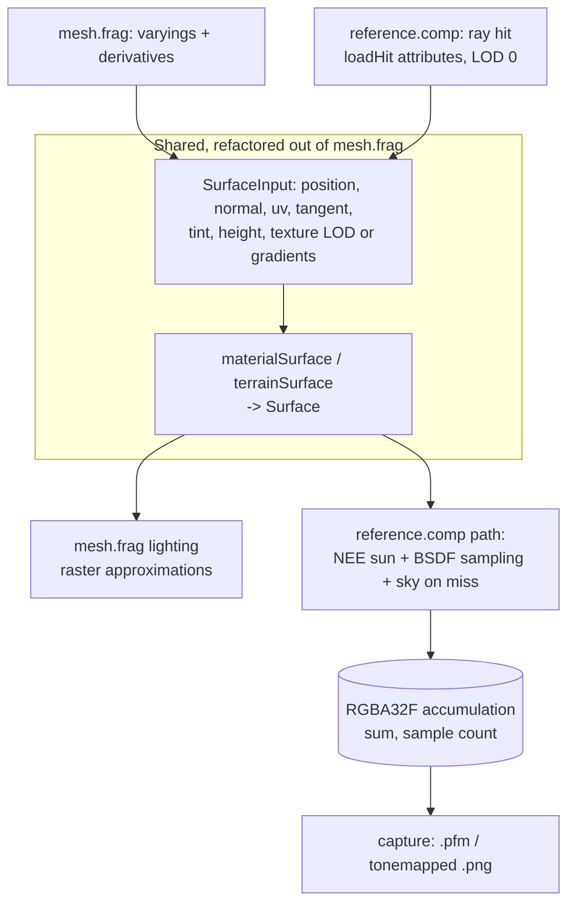

# Reference path tracer (`--reference`)

Status: approved (2026-11-23), plan next

## Why

Every lighting question since the GI landed has been judged against photos
and measured ranges (Chiao's canopy shade colour, sunfleck ratios). That can
reject an outlier but cannot say whether an approximation is right. #32 made
this concrete: after the leaf calibration, trunks went yellow-green, and only
a `--gi off` toggle could attribute it to the GI bounce. Whether that bounce
is correct, too strong or too saturated had no answer.

Unreal and Unity HDRP ship a path tracer for exactly this: ground truth for
the same scene, so the real-time approximations (Lumen, SSGI, probes) are
checked against it. Meridian has the pieces already (a TLAS of every placed
instance with full-detail prototype BLAS, ray queries, bindless materials,
the heightfield march). The reference turns "looks plausible" into "matches
or doesn't" for the GI probes (#30), the voxel far field and switch (G1), the
cascaded shadows, leaf transmission (#32) and later the screen-space
bitmask pass and G5.

## Goals

- `--reference SPP` on a capture run renders the `--camera` view path
  traced, accumulating SPP samples per pixel, and writes the result where
  `--capture` points (`.pfm`, linear; `.png` through the normal tonemap).
- Surfaces only: light transport between surfaces (sun, sky, multiple
  bounces through leaves, bark, rocks, terrain), with the same material
  evaluation as mesh.frag.
- The same scene inputs as a raster run: sun, atmosphere LUTs, haze, cloud
  shadow map, sky capture, weather, exposure.
- A comparison tool that puts a raster `.pfm` and a reference `.pfm` on the
  same scale and prints per-region luminance and chromaticity ratios.
- The reference is itself verified (furnace test, analytic cases) before any
  raster result is judged by it.

## Non-goals

- The sky and clouds as truth: atmosphere and cloud scattering stay the
  existing LUTs and lookups, used as the incoming light (user decision A,
  2026-11-23). Volumetric path tracing of the atmosphere is a later,
  separate project.
- Interactive or real-time use; denoising; the default path. The programme's
  anti-goal "ray/path tracing on the default path" stands: this is a
  capture-only validation tool.
- Validating material evaluation itself: the reference shares mesh.frag's
  material code by design (approach 1), so a bug inside it is in both. An
  offline renderer export (pbrt/Mitsuba) would check that; not now.
- Motion, temporal effects, DLSS behaviour.

## Anti-goals

- A second copy of the material code. If the reference evaluates materials
  with its own functions, every material change has to be made twice and
  the comparison measures the drift between copies, not the lighting.
- Tuning the raster path to the reference before the reference passes its
  own checks.
- Raster behaviour changing as a side effect: the material refactor must be
  image-identical on the raster path (mean difference at capture noise).

## Constraints

- Hardware: RTX 4080, 2560x1440. Per-frame dispatches stay well under the
  driver's timeout (~100 ms each); accumulation spans frames.
- Pro usage: build inline, Debug once before merge, fewest GPU runs.
- Engine stands alone: no asset-specific constants; materials as given.
- The TLAS today: placed instances (static table) and hand-placed ones, mask
  `kShadowCasterMask` / `kFarFieldCasterMask` (far-field trees). Not in it:
  the terrain (heightfield, marched), the streamed meadow layers (ring
  slots regenerated per frame).
- Curvature is a display warp on the raster path; the reference works in
  the flat world. Views compared should be near-to-mid distance (the warp
  is d^2 / 2R: 0.8 m at 3.2 km).

## Approaches (decided)

1. **Compute path tracer with ray queries inside the renderer** (picked). A
   reference mode replaces the scene passes with one compute shader that
   traces paths with `rayQueryEXT` and accumulates into an RGBA32F image.
   Material evaluation moves out of mesh.frag into a shared include that
   both use. Reuses the TLAS, BLAS, bindless tables, terrain march, sky and
   capture code. Trade-off: shared material code means material bugs are
   invisible to the comparison; it validates light transport.
2. A ray-tracing pipeline (raygen/closest-hit, shader binding table): the
   textbook structure, but no existing infrastructure, and per-material hit
   shaders buy nothing with bindless materials behind one buffer address.
3. Export to pbrt-v4/Mitsuba: independent truth including materials, but a
   large exporter (28M-triangle trees, millions of instances, heightfield,
   sky as an environment), material translation, hours per check. Later, for
   material validation.

## Design

### Shared material evaluation

- mesh.frag's `materialSurface` and `terrainSurface` (and what they call:
  layer blending, forest floor mask, detail noise, parallax) take a
  `SurfaceInput` struct instead of reading varyings and `dFdx`/`dFdy`
  directly. mesh.frag fills it from its varyings and derivatives; the
  reference fills it from the hit.
- Texture filtering: the raster path keeps its gradients and mip bias. The
  reference samples at mip 0 (`textureLod(..., 0)` / zero gradients): with
  many jittered samples per pixel, averaging the finest level is the exact
  pixel-footprint integral that mipmapping approximates.
- Terrain parallax (POM) is a raster approximation of displacement; the
  reference evaluates the terrain without it. Raster runs compared against
  the reference use `--effects pom=0` as well, so both describe the same
  surface.
- Hit attributes: `loadHit` (farfield_bake.comp: vertex pools through
  `MeshInfo`, barycentric interpolation of position, normal, UV, tangent)
  moves into a shared include and is extended with the tangent and the
  instance transform (placed: `PlacedInstance`; hand-placed: `InstanceData`,
  both through `loadInstance`).
- Acceptance: raster captures before and after the refactor match at capture
  noise on the edge, overview and meadow views (mean difference <= 0.5/255,
  OKLab mean L identical to 3 decimals).

### The path

Per pixel and frame, one sample:

1. Camera ray through a uniformly jittered point of the pixel (box filter),
   flat world, from `--camera`.
2. Closest hit: TLAS ray query (both caster masks; alpha-tested candidates
   through `alphaTestCandidate`, as the shadow rays do) against
   `terrainRayDistance` (heightfield). Terrain hits take the heightfield
   normal from the normal map and `terrainSurface`; object hits take
   `materialSurface`.
3. Next-event estimation for the sun: a direction on the sun disk
   (`sampleSunDirection`'s distribution, with a per-sample random), a
   shadow ray through the TLAS and the terrain march, times the sun's
   transmittance (`transmittanceToSun`) and `cloudShadow` at the hit. Both
   faces: the front's BRDF (Lambert x (1 - f) + GGX) when the sun is on the
   shading normal's side, the KHR transmission (f x transmission colour,
   Lambert on the back) when it is behind a thin surface.
4. Continuation: sample the BSDF (cosine hemisphere for diffuse, GGX VNDF
   for specular, the back hemisphere for transmission, chosen by their
   albedo weights), Russian roulette after 3 bounces, at most 16.
5. Miss: the sky in that direction, `skyLuminance` with the sky capture's
   clouds over it (`skyCaptureAt`), as `addAmbientLight` reads it; the sun
   disk itself is excluded from misses (it is sampled by NEE only).
6. Haze: aerial perspective from the camera to the first hit only, as the
   raster path applies it (`applyAerialPerspective`); bounce segments are
   short and stay unhazed, like the raster GI.
7. Accumulate: add the sample to the RGBA32F sum, count in alpha. Output
   is sum / count, pre-exposed with the exposure the run reports.

Random numbers: a per-pixel, per-frame, per-bounce hash (`pcg3d`, common.glsl).

### Mode and outputs

- `--reference SPP` (capture runs only; requires `--capture`; not with the
  camera velocities, `--benchmark` or `--capture-sequence`). The run warms
  up as now (exposure adapts, histories fill) over the normal frames, then
  freezes the exposure and dispatches the path tracer until SPP samples have
  accumulated, then captures.
- `Renderer::setReference(uint32_t spp)`; `renderer_reference.cpp` owns the
  accumulation image, pipeline and dispatch; `reference.comp` the shader;
  `endPass("reference")` for its GPU time.
- The startup line prints `Reference: N spp, M ms per sample pass, total S s`.
- Wind is frozen at the capture's game time (no animation between samples).

### Scene coverage

- Streamed meadow layers are not in the TLAS. v1 adds `--streamed off`
  (skips the streamed layers in any run) so a raster capture can match a
  reference with the same content; comparisons on meadow views use it on
  both sides. Adding the ring to the TLAS is deferred (backlog row).
- Far-field and voxel trees: the reference traces their full-detail BLAS
  (the TLAS has every placed tree). This is the point: the voxels are
  judged against the trees they stand for.
- Blended materials (glass test models) are skipped by the reference
  (treated as absent) in v1.

### Comparison tool

`tools/reference-compare.py raster.pfm reference.pfm [--regions FILE --view
NAME] [X0 Y0 X1 Y1 ...]`: per region, mean luminance of both, their ratio,
rgb normalized to G for both, and the whole-frame relative error; with no
regions, a 4x4 grid. Both `.pfm`s are written with the run's exposure, so
the tool also reads the EV100 the two runs printed (`--ev A B` or from
their logs) and puts them on one scale.

### Verifying the reference first

1. White furnace: a test scene mode (`--reference-furnace`) with every
   material white (albedo 1, no specular, transmission 0) and a uniform sky
   of radiance L: every pixel must converge to L within 1%.
2. Lambert ground under the sun alone (sky black, no objects): radiance
   E cos(theta) / pi x albedo, analytic, within 1%.
3. Thin leaf energy: a white leaf with f = 0.5 under the furnace sky must
   still converge to L (reflected + transmitted = 1).
4. Convergence: report noise (relative standard error of the accumulated
   mean over 16x16 tiles) so a comparison is only read once noise is below
   1% in the regions used.

### First use

The forest edge from #32 (default sun and backlit): trunk luminance and
B/G, canopy shade, interior floor sunfleck ratio, raster (GI probes) vs
reference. It answers whether the trunk tint is the GI's error or real.

## Left to the builder

- `SurfaceInput`'s exact fields and how mesh.frag's micro occlusion, crown
  visibility, stream fade and plant occlusion map onto the reference (they
  are raster approximations of geometry the path tracer sees: the reference
  sets them neutral, occlusion 1).
- Samples per dispatch (1 or more per pixel per frame) within the timeout.
- Whether the furnace scene replaces materials through a debug flag in
  `SceneData` or a separate material table.
- Ray-hit precision offsets (normal offset scale).

## Calls I made (for the user to check)

- POM off on both sides for comparisons, instead of tracing displacement.
- `--streamed off` as the v1 answer for meadow content.
- Haze on the camera segment only; bounces unhazed (same as raster GI).
- Blended materials ignored in v1.
- 16 bounces max, Russian roulette from bounce 3.
