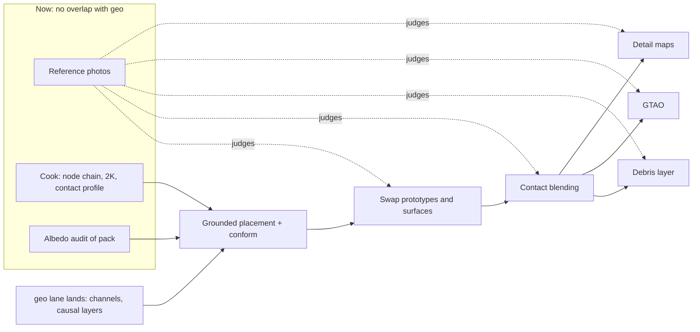

# Broadleaf forest floor: Megascans pack, grounded placement, contact

Status: design, awaiting user approval (2026-11-24).

Builds on: `2026-11-23-geo-channels-causal-placement-design.md` (the
terrain lane, merged to main on 2026-11-24). Related drafts: `2026-11-21-gtao-design.md` (G2),
`2026-11-21-materials-fidelity-design.md` (G12). Research:
`research/2026-11-23-terrain-pcg-deep-research.md` (RVT, channels).

## Intent

The POC is one large forest that reads as a real place at every distance,
from the ground at your feet to the forest kilometres away: "walking in a
place that looks unbelievably real". The user bought into the Megascans
"European Broadleaf Forest" pack on Fab (mossy ravine, moisture, erosion,
layered vegetation) and wants it to replace the current rocks and the
ground surfaces it covers, because Megascans quality is what photorealism
and a clean frame need.

The user's worry, and the point of this design: open meshes, textures,
blending and settings decide whether it looks organic or pasted on.
Today it would look pasted on: the rock layer
(`main.cpp`, layer 3) rotates rocks fully at random (an open mesh would
show its hollow underside), sinks every size by a fixed 0.3 m, scales
0.5-1.5x, and nothing joins a rock to the ground (hard seam, no debris,
no material change, no crease shadowing).

The look target is the Chlorophyll frames' *qualities* (fidelity, frame
cleanliness, coherence), not their scenes. Napf is not required; its
ravines suit the pack, so the test area stays the terrain lane's 0.5 m
relief patch (`assets/terrain/relief-0.5.height`).

## The floor, by what nature puts there

The composition is not painted: it follows the geo channels, as a real
beech forest's does. Dense beech canopy shades out undergrowth, so most
of the floor is open litter.

| Ground | What is there | Pack content |
|---|---|---|
| Flat, gentle (low slope, low talus) | Leaf litter and soil; few rocks: small half-buried stones; roots at trunk bases | ground_dirt surfaces; ground_rock_s/m; ground_root_s/m |
| Slopes | Litter thinning, rock through it, moss on stone | rock_moss, rock_coarse surfaces; rock_s/m |
| Steep ravine walls (slope > ~40 deg) | Mossy rock, ledges, roots clinging | ledge_rock, cliff_s/l, cluster_rock, scatter_root |
| Ravine floors, flow lines, below steep sources (talus, flow) | Rockfall gathered at the foot, eroded banks, gravel, darker wet soil | rock_l, embankment_riverbed, gravel_coarse |

No water surface: streambeds stay dry (backlog row).

## The pack (in `~/Downloads`, 2026-11-24, Fab Standard License)

- 50 meshes, `forest_european_broadleaf_*_gltf_high.zip`: glTF from Fab's
  converter, one mesh, one material each, 8k-32k triangles, 4K albedo
  (JPEG), normal (JPEG), ORM (PNG, glTF occlusion/roughness/metal). Units:
  centimeters, with the 0.01 scale and a Z-up rotation pair on two parent
  nodes (matrices, not TRS); the mesh node has no transform. "Open mesh":
  the underside is not modelled. Sizes 0.9 m (rock_s_03) to 18 m
  (cliff_l_01); full table from `gltfstat.py` in the design session.
- 16 surfaces, `*_4k_ue_high.zip`: same layout as the current terrain
  layers (B, N, ORM, H, JSON; T on rock_moss and detail_rock_rough_04),
  1-2 m tiles, tileable. 9 of them are `detail_rock_*` (1 m, 3-10 cm relief)
  meant as close-range detail over the meshes' own textures.

## Goals

1. **Cook the meshes.** `meridian-cook` bakes the whole node chain's
   transform (matrices included) into a mesh used by one node, so Fab
   meshes come out in meters, Y up, base at y = 0. Textures cooked at 2K
   (1K for meshes under 1.5 m; the cook's choice is the builder's within
   that), so the full set fits a VRAM budget the plan states. The cook
   also writes per mesh its *ground contact profile*: the height below
   which the open bottom is (the lowest ring of boundary vertices), so the
   sink depth can be exact per mesh instead of guessed.
2. **Colour truth.** Every mesh and surface passes the albedo audit
   (`--stats`, `tools/albedo-audit.py`): mean linear albedo in the physical
   range for moss, rock, soil, litter. Meshes and the terrain surface of
   the same rock agree in mean colour (`TerrainLayer` tint), because
   beyond the rocks' draw distance the terrain rock *is* those rocks.
3. **Grounded placement (engine, generic).** `PlacementLayer` gains:
   - `Rotation::Slope`: yaw at random, then tilt toward the terrain normal
     by a per-layer fraction (0 = upright, 1 = fully on the slope; real
     rocks sit between), plus a small random tilt bounded so the open
     bottom never faces the camera's side of the ground.
   - Sink by the prototype's contact profile scaled by instance scale,
     plus the layer's extra sink, and lowered to the terrain's lowest point
     under the footprint (no corner floating on a slope).
   - Scale range per layer kept near 1 (0.85-1.15 default for scans).
   - Draw distance per prototype by size (a 18 m cliff stays to a few km;
     a 1 m stone to ~150 m), so large rocks don't pop at a layer-wide
     distance.
   All bit-exact on CPU and GPU like the rest of placement (integer path
   for keep/reject; the transform may be float as it is today).
4. **Conform for flat ground meshes.** ground_rock and ground_root are thin
   (9-40 cm) and wide (up to 6 m): on curved ground a rigid mesh bridges
   hollows ("overhangs", the known Megascans-in-PCG problem). A per-
   prototype flag bends their vertices onto the heightfield in mesh.mesh
   (vertex y += heightAt(x, z) at the vertex minus at the origin, faded
   with the vertex's height above the base), as terrain_detail already
   lifts streamed instances.
5. **Contact blending.** A mesh fragment within a blend height of the
   terrain under it takes on the terrain's own surface
   (`terrainSurface`, surface.glsl), height-blended against the mesh's
   material by the mesh's AO/height and its upward normal; the same
   technique as Unreal's RVT mesh blending, but evaluating the terrain
   material directly since Meridian shades the terrain analytically. Off
   where the mesh faces down or is far above the ground. Normals blend
   too, so lighting is continuous across the seam. Cost bounded: only
   fragments inside the band pay for a terrain evaluation.
6. **Debris around rocks.** A child layer (geo spec goal 3's layer
   dependence, extended to instance-level: "near an instance of layer L")
   scatters small stones, roots and litter around large rocks and at
   cliff feet. If instance-level dependence costs too much, the fallback
   is a density channel the cook writes from the rock layer's CPU
   reference (`evaluatePoint`) before placement.
7. **Contact shadowing.** GTAO (spec `2026-11-21-gtao-design.md`) lands as
   part of this work: creases and rock bases darkened by ambient
   occlusion. Its three open decisions get answered when this stage
   starts.
8. **Close-up detail.** A generic material detail map (tiling normal +
   albedo modulation over a mesh's own maps, faded in under ~5 m), fed by
   the `detail_rock_*` surfaces, so rocks hold up at 0.5 m. Generic engine
   feature; which detail map goes on which mesh is the cook's/game's.

## Non-goals

- Water surfaces, streams, wetness darkening by weather.
- Hand-placed landmarks (Houdini, roadmap phase 2); a later layer on top.
- New trees or plants (separate lanes); this is rocks, roots and ground.
- Runtime virtual texturing: Meridian evaluates the terrain material
  analytically; an RVT cache is a performance option, not needed for the
  look.

## Anti-goals (failures even if it "works")

- A visible seam or floating edge where any rock meets the ground, at any
  distance and sun angle.
- A visible open underside from any walkable or flyable viewpoint.
- Repetition readable at a glance (the same rock twice in view at the same
  yaw and scale).
- Rocks popping in or out while walking or flying.
- Rocks whose colour, roughness or brightness doesn't match the ground
  around them ("stickers").
- Shimmer or smear on rock detail in motion (motion gates).

## How it is judged

- **Real photos:** a set of real European beech-ravine forest photos (free
  licences, Wikimedia Commons or equivalent), one or more per band: floor
  at the feet, a rock and its base at 2-10 m, a ravine wall at 10-50 m,
  the forest from 500 m. In `assets/reference/forest-floor/` (git-ignored,
  as the cloud photos), with sources listed.
- **Measured:** albedo audit (goal 2); `--reference` vs raster at the
  rock-contact views (the contact blend and GTAO must not move luminance
  away from the path tracer); motion gates on a walk past rocks.
- **Route:** a walk and fly route through the patch's forest
  (`tools/routes/`): feet-level floor, a ravine floor, along a ravine wall,
  a forest edge, aerial. Per-segment frame budget from the parity route
  (no segment below 105 fps, route above 180).
- **The user's walk-through** is the final judge.

## Approaches

- **A (chosen by the user): one combined piece of work on top of the geo
  channels.** Rocks are placed once, by the final causal rules, with the
  contact features; largest scope, nothing looks finished until contact
  blending lands.
- B: pack first on slope rules, channels later. Visible sooner, but
  placement is built twice and rocks spread evenly over slope until then:
  the "not organic" look the user is worried about.
- C: author the placement in Houdini (phase 2) and export instances. Best
  control for landmarks, doesn't scale to a whole forest for the POC; a
  later addition to A.

## Sequencing with the terrain lane

Cook, audit and photos run now: they touch `tools/cook/cook.cpp`'s
`bakeNodeTransform` (the geo lane adds a separate CLI branch) and assets.
Everything in `placement.h/.glsl`, `main.cpp`'s layer tables and
`surface.glsl` waits for the geo lane to merge, because its Task 8
rewrites the rock layer and it changed those files.

## Decided

- Approach A; the pack replaces the current rocks (Poly Haven
  rock_moss_set, boulder) and the terrain surfaces it covers.
- Look target: Chlorophyll's qualities, not its scenes; test terrain is
  the relief patch; Napf optional.
- No water in this work.

## Left to the builder

- Which subset of the 50 meshes ships (all if the VRAM budget allows),
  texture size per size class.
- Tilt fractions, sink extras, blend heights, draw distances per size:
  tuned against the photos and the route.
- How instance-level dependence is evaluated (goal 6), within the bit-exact
  rule.
- Which surfaces replace which terrain variants, by the albedo audit and
  the photos.

## Builder check (2026-11-24): calls made

Claude's calls unless marked; the user checks them on review.

- **Swap is a hard cut** once a stage passes its checks; a mesh failing the
  albedo audit is retinted in the cook (base colour factor) or dropped,
  never shipped as is. Missing pack assets fall back to today's rocks
  (the game already drops missing models).
- **Budget:** RTX 4080, 16 GB. The pack's mesh textures stay under 1.5 GB
  of VRAM; the route's fps floors (180 route, 105 per segment) hold. If
  over, cut in this order: texture size of small rocks, mesh count, debris
  density; GTAO, contact blend and detail maps are the look and are not cut
  (the user's priority order: photorealism first).
- **GTAO's three open decisions** (its spec, "Decisions") are the user's:
  the plan stops for them when that stage starts.
- **Conform** is a per-prototype flag, applied as a function of world xz in
  both mesh.mesh and shadow.mesh, so every LOD level bends identically (no
  cracks) and shadows match; the BLAS stays unbent (rt shadows are an A/B)
  and `--reference` lists it as a known difference.
- **Contact blend** lives in surface.glsl, so the raster and `--reference`
  both get it; clusters only (rocks are not in the far field).
- **Contact profile:** one scalar (open-bottom height) per prototype; the
  footprint comes from the prototype bounds' xz extent (centre + 4
  corners sampled for the lowest terrain point).
- **Debris:** static child of a static parent only (the rock layers are
  static); streamed children are out of scope.
- **Plan:** written in two task groups; group 1 (cook, audit, photos) now,
  group 2 finalised against the geo lane's merged `PlacementLayer` after
  it lands.
