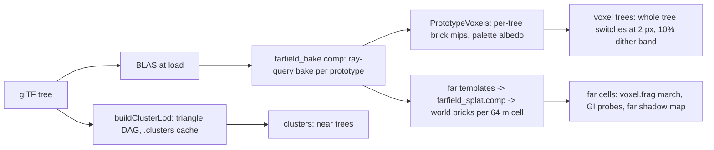
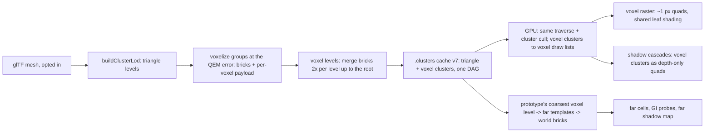

# Voxels inside the cluster LOD hierarchy (G1) — design

Status: approved by the user 2026-11-24 (CPU voxelizer; acceptance criteria
below); plan next.

Issue #1 (G1, distant forests read as grey speckle); also closes the
backlog rows "Voxel switch band with opaque leaves", "Far-field bake needs
ray queries", "Crown light optical depth from the prototype voxel grids"
and issue #11 (G11, no tree shadows at distance) where the shadow task
lands. Supersedes the mid tier of `../archive/specs/2026-11-20-far-field-design.md`
(rasterized prototype voxels, decisions.md "Mid tier: rasterized prototype
voxels").

## Intent

Trees drawn as voxels must be impossible to tell from trees drawn as
triangles: no visible switch while walking or flying toward a forest, no
blocky or speckled look at any distance, one appearance from the nearest
tree to the horizon. The voxels are also where large forests get their
frame time, so the tier has to be fast. The user wants this aspect of the
engine done and closed, the way the Chlorophyll Engine does it (its author:
"gpu driven with meshlets and small triangles are rendered as voxels (with
minimal to no detail loss)"; voxels generated inside his meshoptimizer LOD
build). Coarser voxels at larger distances are expected, as long as each
distance shows the same quality.

## Today (main, 2026-11-24)

What makes the voxels visible today:

- The switch is per tree: the whole tree changes representation at once,
  across a 10% band of per-pixel dither. Since the leaves became opaque
  geometry the band no longer cross-fades (the leaves draw whole under the
  dithered voxels).
- Voxels are 2 px quads, each fully opaque or absent by a hash of (tree,
  voxel), shaded flat at the voxel center with one normal and a palette
  albedo, without leaf transmission (`NoL > 0` only): the clusters' leaves
  transmit and vary per texel. Up close to the switch that reads as
  coloured squares; far out as salt-and-pepper speckle.
- Three separate voxel data sets (prototype mips, far templates, world
  bricks) each derived differently, so each transition can step.

## Goals

1. Voxels live in each mesh's cluster DAG: built at cook/cache time, chosen
   per cluster group by the same LOD cut as triangles, coarsening with
   distance.
2. A voxel represents what the triangles it replaces look like on screen:
   coverage per view direction, colour, transmission, normal spread.
3. No switch visible still or in motion, no visible voxels at
   any distance, far forests consistent with near ones (Acceptance).
4. Faster than today in every tree-heavy view (gates P1-P3), and a faster
   startup (no ray-query bake).
5. One voxel source: the far field's cell bricks, the GI probes' foliage
   and the far shadow map read voxels derived from the same DAG voxels.

## Non-goals

- Tree wind and skinned foliage (Nanite animates voxels; ours stay static
  until the wind milestone, backlog "Tree wind").
- Ray tracing against voxels (the TLAS keeps the full BLAS for `--shadows
  rt` and the reference path tracer).
- Streaming of cluster/voxel pages (backlog "Cluster compression and
  streaming"); everything stays resident as today.
- Voxelizing non-foliage meshes (rocks, models): only meshes that opt in
  (below) get voxel nodes.
- A low-end 2D canopy (backlog "Low-end far field").

## Anti-goals (failure even if it technically works)

- A tree that changes look at any distance while approaching it (colour,
  density, brightness, sparkle).
- Shimmer or crawling voxels on a still camera, or smear in motion beyond
  the triangles' own.
- Forests that thin, darken or turn grey with distance where the reference
  path tracer (full geometry) does not.
- Two voxel paths kept alive side by side (the old per-tree voxels as a
  "fallback"): the old tier is removed once the new one passes.
- Frame time regressions in any parity route segment.

## Constraints

- Engine stands alone: voxelization is generic (glTF triangles, base
  colour texture and alpha, KHR_materials_diffuse_transmission); no asset
  pack knowledge. A mesh opts in by a generic rule (below), not by name.
- Raster direction: no ray queries needed to build or draw voxels.
- DLSS-ready inputs: voxels write depth, motion, the albedo and normal
  guides like triangles.
- Every GPU structure mirrored in `gpu_types.h`; CPU references for the
  build and the selection (`selectClustersBvh` must keep matching the GPU
  traversal exactly).
- Latest meshoptimizer release (pinned v1.0 today; 1.2+ exist, verify at
  fetch time) before the DAG build changes.
- Usage: Pro account, inline work, fewest GPU runs; captures batched per
  gate.

## Approaches

- **A. Keep the per-tree voxel tier, fix its look** (filtered coverage,
  shading, transmission, band fix). Days of work, keeps today's speed
  gains, but keeps a whole-tree switch and three voxel data sets: a seam
  by construction. Rejected by the user in favour of B.
- **B. Voxels as nodes of the cluster DAG (chosen, user 2026-11-24)**: the
  Nanite Foliage / Chlorophyll way. A cluster group is voxelized during the
  DAG build; where the voxels' error is lower than the simplified
  triangles', the coarser levels continue as voxel clusters. The LOD cut
  then switches each part of a tree independently at the distance where
  both are sub-pixel-equivalent. Weeks of work; every cache and load path
  changes.
- **B'. Per-cluster switch over today's per-prototype voxel grids.**
  Dropped: two data sets that never quite match is the seam B removes.
- **GPU voxelizer** (considered with the user, 2026-11-24). Set aside: the
  voxels are built once per model into the `.clusters` cache, never per
  frame or per warm start, so the GPU would only speed up a first build;
  the build is a sequential per-group loop (voxelize, compare errors, retry
  coarser, decide what the next level comes from) that would become GPU
  round trips; a CPU build is deterministic, testable against a CPU
  reference and runs in the cook tool without a GPU (Nanite and the
  Chlorophyll author both voxelize in their CPU builders). Fallback if the
  first build measures too slow: move only the inner ray-triangle tests to
  a compute shader, the decisions stay on the CPU.

## Design

### Data flow after the change

### 1. Which models get voxels

The unit is the model (one glTF, one `.clusters` cache, one placed
prototype), because the per-voxel occlusion and the far templates need the
whole tree, bark included. A model opts in when it holds a tree crown by
the engine's existing generic rule: a mesh whose material has
`diffuseTransmission > 0` (or alpha mode MASK) and whose bound is over 4 m
tall (the crown rule mesh.mesh already uses). Then every mesh of that
model, leaves and bark, gets voxel levels: at the distances where voxels
win, trunks and branches are sub-pixel too, and far cells and GI need them.
Grass, ferns, flowers and other plants under 4 m do not opt in (distant
grass as voxels stays its own backlog row); rocks and models never do.
(My call, from the builder check.)

### 2. Building voxel levels inside the DAG (CPU, at cache build)

- The build needs control over the DAG's coarser levels, which
  clodBuild's callback does not give (`cluster.cpp:399-430` only sees each
  group's output; clodBuild keeps simplifying triangles). So
  `clusterlod.h` is vendored and modified (the Chlorophyll author's route:
  a modified meshoptimizer LOD build), in `engine/third_party/` with the
  upstream release and commit it was forked from in its header, updated
  with meshoptimizer; meshoptimizer itself stays FetchContent at the latest
  release. (My call: a vendored single-header fork is smaller than an own
  DAG builder and keeps upstream's grouping and simplification.)
- One voxel lattice per model: voxel edges are powers of two in metres
  (2^k), anchored at the model-space origin, so every mesh of a tree and
  every group share aligned grids, coarser levels merge 2x2x2 exactly, and
  the far templates read the 1 m level directly. At each group
  simplification the group is also voxelized at the smallest lattice edge
  at or above its QEM error; if that exceeds the brick budget (at most 128
  bricks of 4^3 per voxel cluster, as Nanite) the next edge up is used. If
  that voxel edge is lower than the group's QEM error before the leaf-area
  move (`cluster.cpp:391-399` adds the leaf-scale move to the error; the
  comparison uses the error without it), the group's coarser version is
  voxel clusters and every coarser group of that branch is voxels.
- Mixed groups: clodBuild groups clusters by adjacency, so a coarser group
  can hold voxel and triangle children. Rule: once any child of a group is
  voxels, the whole group is voxelized from the original triangles of
  everything under it (voxels are sticky upward; nothing is ever built from
  voxels and triangles mixed). Whether `keepLeafArea` is still needed below
  the voxel levels is measured (it exists to fight thinning, which the
  voxels now take over); remove it if the switch looks the same without.
- Voxelization runs on the CPU from the original (finest) triangles of the
  group, never from simplified triangles. Starting point: the `farm-cpuvox`
  prototype (branch restored on origin), which voxelizes one whole-tree
  grid at height/128 by rays from each voxel face (4x4 per face per axis,
  Loubet and Neyret 2017) and matched brute-force ray tests with 0
  mismatches in 0.16-0.45 s per 1-4M-triangle tree. It samples no
  textures (alpha 1): this design adds texture sampling at the hit UVs
  (base colour + alpha for MASK, transmission, roughness) from the
  transcoded textures the loader already decodes, and per-group, per-level
  voxelization with budget retries. Its build time is therefore unknown
  and measured in P3 (multithreaded per group; target: a first cache build
  of the 30 Megascans variants within a few minutes, warm loads unchanged).
- The cache key covers the geometry, the materials and textures that feed
  the payload (their content hashes) and a voxelizer version, not geometry
  alone as today (`model.cpp:290-302`).
- Error of a voxel level: its voxel edge (the projected size that decides
  the cut, as a triangle cluster's QEM error does), so the existing
  `LodBounds` and `lodVisible` apply unchanged and the cut stays crack-free
  (each part of the surface drawn once).
- Coarser voxel levels keep coverage as today's mips do (decisions.md
  "Mips keep coverage": a coarse voxel keeps its children's mean
  transmittance along each axis, not their mean extinction).

### 3. What a voxel stores

Per voxel, packed (target 16 B; builder may change the packing if the
gates need it):

- Directional coverage: optical depth through the voxel along the 3 axes
  (the projected coverage seen from any direction is blended from them as
  today's `v / S` rule does), plus the 6 axis optical depths out of the
  prototype's box (today's occlusion word) for self-shadowing toward the
  sun and sky occlusion: intra-crown light without a TLAS ray.
- Albedo: mean linear RGB of the hit texels (not a palette index),
  coverage-weighted, from the base colour texture at the hit UVs.
- Transmission: mean diffuse transmission colour/factor of the hits
  (KHR_materials_diffuse_transmission, as the triangles' leaves).
- Normal distribution: mean normal plus its spread (length of the
  unnormalized mean, or SGGX-style second moments; builder's call by
  the acceptance captures), from the hits' geometric and shading normals.
- Roughness: mean perceptual roughness of the hits (for the sky specular;
  matters for the silvery-leaf backlog row).

The per-voxel payload lives in the cluster vertex pool's sibling (a voxel
pool next to the cluster pools, grown by `grownPool`), addressed from the
cluster record.

### 4. Selection on the GPU

- `cluster_traverse.comp` and `cluster_cull.comp` treat voxel clusters as
  clusters: same BVH, same LOD test. `cull.comp`'s per-tree voxel switch,
  `voxel_bricks.comp`'s per-tree brick listing and the band dither
  (`voxel_band.frag`, `kVoxelSwitchPixels`, `kVoxelSwitchBand`) go away.
- Accepted voxel clusters go to their own draw list(s) (binned apart from
  triangle clusters, as Nanite does), with the cluster cull's frustum and
  Hi-Z tests and the terrain sun code per cluster.
- The LOD threshold for voxel clusters is set so a voxel projects to about
  1 px at the cut (Nanite's "near pixel-sized"); today's 2 px choice is
  re-measured: the gate decides between 1 and 2 px, not the old argument
  about list overflow (clusters bound the count now).

### 5. Drawing and shading voxels

- Each voxel is a camera-facing quad of the cube's projected area (today's
  `voxel_instance.mesh` rule: area v^2 S, chord v / S). A voxel cluster
  holds up to 8192 voxels and a mesh workgroup emits 64
  (`voxel_instance.mesh:17-18`), so the path keeps a compaction stage (as
  `voxel_bricks.comp` does today: bricks in the frustum, voxels whose
  optical depth toward the camera is under the skip limit, 64 per mesh
  workgroup) or uses task-shader amplification; builder's call by P2.
- Coverage: a voxel's opacity along the view is `1 - exp(-depth along the
  view)`. How partial opacity reaches the screen without speckle is the
  core quality question, decided by the acceptance captures between two candidates:
  (a) today's stable hash per (instance, voxel), now at ~1 px so DLAA
  resolves it spatially, and (b) a hash that also cycles with the jitter
  phase (a fixed sequence, so a still camera converges and never boils).
  Blending is not an option (order-dependent, no depth for DLSS).
- Shading goes through the same `lighting.glsl` path as leaf triangles:
  front diffuse and transmission by the voxel's normal distribution
  against the sun (an aggregate of leaves facing many ways: the lit
  fraction and transmitted fraction come from the normal spread, not from
  one normal), GGX with the mean roughness, the self-shadow from the axis
  depths, then the cascades from where the sun ray leaves the box, cloud
  shadow, GI probes for ambient, micro/crown occlusion as triangles get it.
- Writes depth, motion, the transparency mask (0), and the albedo/normal
  guides with the voxel's mean values.

### 6. Far field from the same voxels

- The far templates (`kFarTemplateVoxel` 1 m) are made from each
  prototype's DAG voxel level nearest 1 m instead of the ray-query bake:
  `farfield_bake.comp` and its BLAS dependency go away (startup faster;
  Release loses most of today's far-field build time).
- The world bricks (4/8/16 m per 64 m cell) carry the same payload kinds as
  DAG voxels (albedo RGB, transmission, normal spread), so `voxel.frag`'s
  far-cell march, the GI probes' `farFieldTransmittanceScatter` and the far
  shadow map shade foliage with the same model. The far-cell switch (a
  cell whose 4 m voxel is under ~1 px) is judged like the near switch.

### 7. Shadows

Voxel clusters cast into the shadow cascades as depth-only quads (the
cascades' own cull chain with `shadowView`, as triangle clusters do): trees
at distance cast shadows on the ground (G11; branch `far-m-shadow2` has the
earlier per-tree attempt and its counters split). The coarsest cascade's
far-cell casting stays.

### 8. What is removed

`protovoxel.{h,cpp,glsl}` (per-prototype voxel grids), `voxel_bricks.comp`,
`voxel_instance.*` (replaced by the voxel-cluster path), `voxel_band.frag`,
`farfield_bake.comp`, the prototype bake in `renderer_farfield.cpp`,
`--voxel-trees` (replaced by an A/B flag that forces triangles everywhere,
for the seam gates: `--voxel-lod off`). Docs (CLAUDE.md, the reference
docs, decisions.md) say what replaced them.

## Acceptance (user, 2026-11-24)

The user's criteria, simple and final:

1. **No noticeable voxelization** at any distance: no squares near the
   switch, no speckle or grey noise far out, forests keep their density
   and colour.
2. **No noticeable voxel level swaps**: neither triangles to voxels nor
   one voxel level to the next nor voxels to far cells pops, still or in
   motion.
3. **Proper lighting and shadows** for the photorealistic target: voxels
   lit like the leaves they replace (sun, transmission, sky and GI,
   self-shadow), and distant trees cast shadows.

Rigour without a test matrix (the user: "no need to do a million tests,
but the code has to be good, performance has to be good"):

- Unit tests only where logic is new and checkable on the CPU: the
  voxelizer against brute-force rays, levels keeping coverage, the LOD cut
  covering every surface once over mixed triangle/voxel levels
  (`selectClustersBvh`).
- Evidence for the user's eye, batched: side-by-side captures of voxels vs
  full-detail triangles (`--voxel-lod off --lod-error 0`) at the switch
  distances (forest edge, summit ridge) and far out (forest overview, high
  overview, summit horizon), plus one fly-toward sequence across all
  switches. The voxels' target is the full-detail triangles as the raster
  draws them; the reference path tracer is information only (where the
  triangles miss it, that is the canopy-lighting lane's problem). Cheap
  numbers back the eye where they help (region luminance ratio, Laplacian
  std of the forest crop, `tools/motion-clarity.sh` forest rows), not as
  extra gates.
- One lighting difference is by design: triangles self-shadow through the
  cascades, voxels through their baked axis depths and then the cascades
  from where the sun ray leaves the box, so a voxel tree never receives its
  own cascade shadow twice.

Performance (Release, same `Render WxH`, medians of a few runs), measured
on main first:

- **P1** Parity route (`--trees`): no segment slower than the baseline.
- **P2** Tree passes (cull, traverse, cluster cull, the scene passes' tree
  share, voxel draw, far field) at forest edge, forest overview and
  summit: at least 20% cheaper in total; reported per pass.
- **P3** Release startup no slower (expected faster: no bake); geometry +
  voxel VRAM, `.clusters` size and first build time reported.

## Order of work (for the plan)

0. Baseline: the evidence views and P1-P3 numbers on main (today's
   `--voxel-trees off` stands in for `--voxel-lod off`).
1. meshoptimizer to the latest release; cache version bump.
2. Voxelizer in the DAG build (CPU), payload, voxel levels, cache v7;
   unit tests: coverage vs brute-force rays, mips keep coverage, the cut
   covers each surface point once (`selectClustersBvh` over mixed levels).
3. GPU: voxel clusters through traversal and cull, voxel draw lists,
   the voxel raster and shading; old per-tree path removed.
4. Quality loop to the acceptance criteria (coverage candidate, normal
   spread, 1 vs 2 px).
5. Far field from DAG voxels; bake removed; the far switch judged the same
   way.
6. Shadows from voxel clusters (G11).
7. Performance pass to P1-P3; docs, decisions.md entry, backlog rows
   closed, Status lines.

## Left to the builder

Packing of the voxel payload, the voxel-brick budget per cluster if 128 bricks measures badly, the
normal-distribution representation, the draw-list split (single- vs
double-sided does not apply to voxels), how the shadow pass bins voxel
clusters, compaction vs task-shader amplification for the voxel draw.

## Calls made in writing this (for the user to check)

- The unit of voxelization is the whole tree model, bark included, chosen
  by the existing 4 m crown rule; meadow plants stay out.
- `clusterlod.h` is vendored and modified; meshoptimizer is updated to its
  latest release.
- Voxel sizes snap to power-of-two metres per model; voxels are sticky up
  the DAG; mixed groups are voxelized whole.
- Ground truth for every gate is the full-detail triangles, not the
  reference path tracer.

## Sources

- Epic, Nanite Foliage (UE 5.7+):
  https://dev.epicgames.com/documentation/unreal-engine/nanite-foliage
  (voxelize clusters into at most 128 4^3 bricks; voxels where their error
  is lower than the triangles'; near pixel-sized; binned and rasterized
  separately; per-voxel normal distribution, one normal picked per pixel).
- Maven Kim, Interactive Moana part 3 (2025-11), notes on Epic's
  `NaniteBuilder/Private/Cluster.cpp`: voxel size matched to the QEM
  error, re-voxelize coarser if over budget, keep voxels for every later
  step once they win; normals by rays from a disk at each voxel against
  the original mesh (SGGX).
  https://mavenkim2.github.io/2025/11/19/interactive-moana-part3.html
- GodotNext issue #165, a clean-room Nanite-voxels spec (stable hash
  against 8-bit coverage; FLIP and flicker targets):
  https://github.com/Legoless/GodotNext/issues/165
- Loubet and Neyret 2017, hybrid mesh-volume LoDs:
  https://hal.archives-ouvertes.fr/hal-01468817v1
- zeux, meshoptimizer 1.0 and clusterlod.h:
  https://zeux.io/2025/12/09/meshoptimizer-v1/,
  https://zeux.io/2025/09/30/billions-of-triangles-in-minutes/
- Chlorophyll Engine author (X, 2026-11-20): meshlets, small triangles as
  voxels, voxels generated in a modified meshoptimizer LOD build
  (memory/inspiration notes; resume.md).
