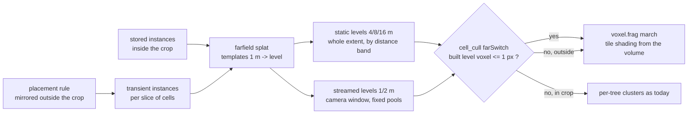

# Far tile tier (forest patch proxies) — design

Status: in progress (stage 2 part 1 done, streaming deferred; hardening done, review next, 2026-11-27; decided by the director 2026-11-26 night; the user chose "far forest as
patch proxies" and delegated the technical design). Look gates stay the
user's by eye. Plan: `plans/2026-11-26-far-tile-tier.md`.

Covers resume.md step 7, the backlog rows "Far tile tier" and "Cascade 4
casts placed trees as far-cell voxels", baseline F4 and F22, and the
scene finding "horizon bare beyond the crop" (director log 2026-11-26).

## Intent

In the Chlorophyll frames forest covers every hill to the horizon and
reads as closed crowns at every distance; the author's renderer stops
processing trees individually at far distances and draws voxel proxies for
whole patches of forest (FAQ 2026-11-26; baseline F4: per-tile voxel
hierarchy, tiles unique, streamed, built on the player's hardware, no
per-instance data).

Meridian today:

- Nothing grows beyond the heightfield crop. The showcase core is the 4 x 4
  km relief patch, so from the scene views the forest ends 0.7 to 3.4 km
  away and the mirrored terrain behind it is bare.
- Every tree in the crop is drawn as its own voxel clusters (26.6M to
  37.2M voxel quads at the overviews for 3.7M pixels; voxel pass 10.24 ms
  at Part B; decisions.md "Caster LOD of one texel in every cascade").
- A patch proxy already exists: the far field (`farfield.h`,
  `renderer_farfield.cpp`): per 64 m placement cell, sparse brick columns
  of 4, 8 and 16 m voxels splatted on the GPU from the placed instances and
  the prototypes' 1 m templates, ray-marched per pixel inside the cell's
  box (`voxel.frag`). It takes over only where a cell's tallest tree is
  under 6 px: 12.5 km for the broadleaf scenery's 41 m tallest trees per
  cell (1828 px per meter at 1 km, 2560x1440, 70 degrees), beyond every
  crop cell, so at the scene views it draws nothing (stage 0, ledger; the
  spec first said about 5 km, true only for ~17 m trees). It covers only
  the crop, is built once at load, and
  shades with one palette colour per mesh slot and no occlusion.

The tier is the far field grown into its intended role, not a new system.

## Decision

1. **The proxy stays what it is**: unique voxel bricks per 64 m cell,
   splatted from the placement rule and the prototype templates, marched
   per pixel. No impostors, no prototype patches (repetition, and forest
   edges and clearings would not match the trees that replace them).
2. **Forest beyond the crop**: the placement rule is evaluated on mirrored
   coordinates for cells outside the crop (the heightfield already mirrors
   on CPU and GPU). Those instances are transient input to the splat:
   never stored, never in the instance table, the cell table's instance
   ranges or the TLAS. Extent `farExtent` from the crop centre, at most the
   fixed-point range of placement (cells -256..255, about 16 km).
3. **Fine levels exist, not streamed (director, 2026-11-27, after stage 2
   part 1)**: 1 m and 2 m levels are built at load over a static window
   inside the placement grid (`--far-fine M`, default off, an A/B). Measured
   need: 0.29 MiB per crop cell at 1 m, 0.05 at 2 m. The 1 m level is the
   drawn one from 1.8 to 3.7 km (where 2 m reaches 1 px), not inside 1.8 km
   as first estimated. Inside the crop the trees exist, and per-tree voxels
   give the same image for less: at a1 with the whole crop fine, far pass
   +7.5 ms against voxel trees and cluster cull -2.5 ms, +1.4 GB resident.
   So streaming is deferred; the coarse levels (4, 8, 16 m) stay static.
4. **The switch rule**: a cell with trees draws its bricks once the voxel
   of the finest level it has built projects to at most 1 px
   (`kFarSwitchPixels`); the 6 px tallest-tree rule is gone. By default
   that is the 4 m level at about 7.3 km at 1440p and 70 degrees: no crop
   cell at the scene views, so the crop keeps its trees as before. With
   `--far-fine` the switch sits at about 1.8 km. Cells outside the crop
   draw their finest level always.
5. **The tier shades like the trees it replaces**: per-voxel colour from the
   template (not one colour per mesh slot), sun attenuated by the optical
   depth marched through the bricks toward the sun, sky occlusion from the
   coarser level above the voxel. The crown light model is the one the leaf
   lane settles for cluster voxels (branch `crown-light`); the tier feeds it
   from the volume instead of the per-model baked depths.
6. **Stored instances beyond the tier distance** (trees inside the crop that
   are always drawn as tiles) are not removed in this spec. Out of scope:
   memory at 10M trees needs streamed tree placement, a later spec.

## Stages

Each stage ends with a report to the director and is judged on whole
frames beside 5.jpg and 7.jpg (`assets/reference/chlorophyll/
twitter-2026-11-25/`) at the scene views (below). Nothing merges to main
without the user's eye.

- **Stage 0, premise.** A flag moves the switch (`--far-switch-px N`,
  replaces `kFarSwitchPixels` for the run). One run each at the default and
  with the switch forced in to where the 4 m level is 1 px and 2 px: voxel
  pass ms, voxel quads, far pass ms, frames. Shows what the tier can save
  and how far the present far-cell look is from the cluster voxels.
- **Stage 1, forest to the horizon.** Decision 2 with the static levels
  only. Outside the crop a cell has no trees, so it always draws bricks at
  the finest level it has. Level bands by distance from the crop so memory
  stays bounded. Delivers the whole-frame change: no bare hills.
- **Stage 2, streamed fine levels and the switch.** Decisions 3 and 4.
- **Stage 3, tile shading and shadows.** Decision 5; cascade 4 and the far
  shadow map with the extended grid; the double self-shadow row.
- **Stage 4, close-out.** Motion proof across the switch, docs, backlog,
  independent review.

## Constraints (decided elsewhere, binding here)

- Voxels, no impostors (decisions.md "Far field", option C).
- Placement keep/reject stays bit-exact on CPU and GPU, mirrored cells
  included: the fold is an integer operation written once per side, and the
  Debug replica check samples cells outside the crop.
- The forest truth data is never a placement input.
- VRAM: resident at most 12288 MiB, peak at most 14336 MiB at the scene
  views; main is at 11370 MiB resident (918 MiB headroom).
- Frame time is reported, not capped, while the look is being found
  (user, 2026-11-26); the far pass gate of 1.0 ms (decisions.md) is
  restated against the tier's larger share of the screen in stage 4.
- Engine stays asset-agnostic: nothing here knows tree species.
- Every tuning value is a named constant or a flag, with its reason.

## VRAM delta (estimate; each stage reports the measured figure)

| Item | Estimate |
|---|---|
| Static 4 m level, crop + 2 km band (48 km2 more) | +36 MiB |
| Static 8 m to +6 km, 16 m to the extent | +30 MiB |
| 1 m level, measured (only with `--far-fine`; whole 4 km crop) | 1204 MiB (0.29 MiB per cell) |
| 2 m level, measured (only with `--far-fine`; whole crop) | 209 MiB (0.05 MiB per cell) |
| Per-voxel colour (stage 3; palette index stays 8 bit, larger palette) | about 0 |
| Far shadow map over the extent (8 m texels, capped by `farShadowGrid`) | at most +32 MiB |

Default (no fine levels): the static rows only. The first estimate (+600
MiB with 200 / 300 MiB streamed pools) assumed the wrong 1 m annulus.

Open item (not decided): near the crop edge the forest beyond it is 4 m
tiles. Candidates: a mirrored margin of real placed trees (trees are
cheaper than tiles per the stage 2 numbers) plus a streamed 2 m level
outside the crop only (backlog row "Far forest past the crop edge"). Transient: the splat's slices stay at 256 MiB.

## Acceptance

1. From a1, H2 and H1 (handover views) no bare terrain where the rule grows
   forest, out to the extent; whole frames beside 5.jpg and 7.jpg.
2. The user cannot point at the switch between trees and tiles, on foot or
   in flight (the G1 bar); motion run across the switch no worse than main
   on the forest-edge and aerial segments.
3. Voxel quads at the overviews fall by the share of trees beyond the
   switch; aerial segment time reported against main.
4. VRAM gates hold; no cull list overflow in any pass, shadow views
   included; maxima over the whole run.
5. Debug run: validation clean, splat replica check passes for sample
   cells inside and outside the crop, streamed levels included.
6. Fly-through from the core to the crop edge and past it: no holes while
   fine levels stream in (a cell always has something to draw).

## Risks

- **Look at the switch** (highest). 1 m bricks at 1 px against cluster
  voxels of the same size differ in shading model and coverage rule.
  Stage 0 measures the gap before anything is built; stage 3 exists to
  close it. If it cannot be closed at 1.8 km, the switch moves out and the
  1 m pool shrinks.
- **Near the crop edge** tiles are the only forest: at 700 m a 1 m voxel
  is 2.6 px. If the scene keeps views that close to the edge, the placed
  area grows by a mirrored margin of real trees (the same mirrored rule,
  stored); instance and TLAS cost measured first. Decided after stage 2.
- **Streaming hitches**: the splat is sliced; the stream budget per frame is
  a named constant, measured with the frame-time spikes of a fly-through.
- **Mirrored hills look mirrored**: content, not this spec (the 15 km Napf
  terrain as backdrop is the later answer).
- **Dependency on crown light**: stage 3 starts after the director rules on
  the leaf lane's `crown-light` premise; stages 0 to 2 do not depend on it.

## Not in this spec

Streamed tree placement and dropping stored far instances; a 32 m level
and forest beyond 16 km; the visibility buffer path for tile pixels; wind
on tiles; the GI clipmap of opacity volumes (baseline F21).
