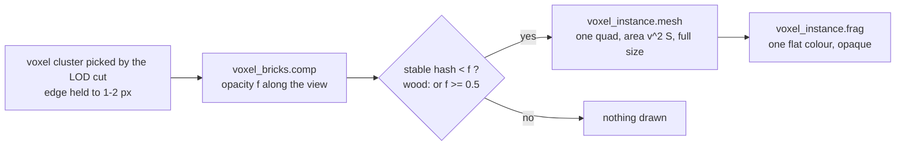

# Voxel leaf coverage and look — design

Status: draft. Stage 0 and stage 1 (premises and switchable variants) are
decided and can start; the coverage rule itself is chosen by the user's eye
on stage 1's sheets and is then written into this file.

Covers the backlog rows "G1 Distant forests read as grey speckle", "Terrain
shows through crowns more than in the reference", "Trunk holes below half
coverage", "Far-crown white specks are grazing-view specular", "Visible
step at the 0.125 -> 0.25 m voxel level" and "Leaf and wood meshes of one
model choose voxel levels independently". Continues
`2026-11-24-dag-voxel-foliage-design.md`, whose acceptance criterion 1 ("no
noticeable voxelization at any distance") is not met and whose section 5
left the coverage question open between two candidates, of which only the
first was ever built.

## Intent

The user's top complaint (2026-11-26): trees drawn as voxels read as
"pixels erased, low resolution". They must be indistinguishable from the
same trees drawn as triangles, at walking range (45 to 150 m) and far out
(300 m and beyond, from above), still and in motion.

## Today (main 99266f0), read from the code

- A voxel is one camera-facing quad of the cube's whole projected area:
  edge `v sqrt(S)`, `S = |dx| + |dy| + |dz|` in [1, 1.73]
  (`voxel_instance.mesh`, `voxel_shape.h`).
- Voxel levels give way to coarser ones at `kVoxelPixels` = 2 px per edge
  (`cluster.h`), so a drawn quad is about 1 to 2.6 px wide.
- Partial coverage is a draw chance: the quad is drawn whole with
  probability `f = 1 - exp(-depth along the view / S)` and dropped whole
  otherwise (`voxelDraws`, `voxel_lod.glsl`). The hash is keyed on instance,
  brick lattice place, edge, cluster seed and voxel: fixed for all time, so
  a still view never boils.
- Shading is flat per voxel and opaque. No blending (order, DLSS depth).

What follows from that: far foliage has about half the screen's resolution,
whole 1 to 2.6 px blocks are missing where coverage is partial, and
because the pattern never changes, the jitter and DLAA have nothing to
average. The covered area errs per voxel by `2 f (1 - f)` of the quad on
average. The round 6 entry in decisions.md measured the same mechanism on
trunks ("a dropped voxel is a hole the size of a pixel or two, and nothing
averages it") and fixed only opaque voxels at `f >= 0.5`.

Not measured yet (stage 0): how leaf voxels spread over `f`, and how many
quads each rule below would draw.

## Known, do not redo

- Leaf voxel colour is smooth; a colour prefilter does nothing (decisions.md
  "Voxel colour prefilter: tried, no effect").
- Crown-scale normals and per-primitive voxelizing are ruled out as causes
  of the speckle (director log 2026-11-26).
- 1 px instead of 2 px voxels barely moves the switch distance and costs the
  cube (decisions.md "Voxel switch distance floor"; 32.6 ms on the old mid
  tier).
- A lobe-scaled opacity against the specks is parked on
  `voxel-specks-parked` (64bc372): crown specular share 0.26 -> 0.22.
- Leaf voxels change when wood voxels change (fold and axis depths,
  `bakeModelAxisDepths`): gate leaf identity before the bake, not on final
  bytes.

## User decisions (chat, 2026-11-26)

1. Both ranges count equally: the near set and the far set gate the work.
2. No frame-time limit while the look is being found; a general
   performance pass comes later. Every variant still reports its cost.
   Limits that break a run stay: no list overflow, no VRAM paging.

Standing: look is judged by the user's eye on images; a stability number is
a guideline, look outranks it; no bare tuning literals.

- Stage 1 pick (chat, 2026-11-26 evening): `area-pixel-phase`, seen on the
  far and near sheets beside Chlorophyll crops and on the clips. Measured
  at Part B: pixel-scale variance -47%, voxel pass 5.05 -> 10.24 ms, main
  view need 33.7M entries (cap 24.66M today), resident +395 MiB (11288).
  `area` and `area-offset` are not runnable at the far views (need 72M to
  90M). The pick does not close the look: the 150 m grain is leaf shading
  present on triangles too, and voxel crowns pass more terrain than the
  path tracer (0.33 against 0.23) under every rule.
- Every look sheet carries a Chlorophyll reference crop at a comparable
  distance; the target is the kind of image, not a pixel match.

## Goals

- Partial coverage reaches the screen as partial coverage, not as missing
  blocks, in both ranges.
- No new pop at the triangle-to-voxel switch or between voxel levels, and
  no boiling on a still camera that the user can see.
- One rule for leaves and wood, so trunks need no special case if the rule
  allows it (the dashed small-beech trunk of crown round 9b is a test view).
- Inputs for DLSS stay valid: opaque depth, motion vectors, guides.

## Non-goals

- Frame time (later pass), bark materials (own lane), far wood triangle
  cost (crown round 9), the far tile tier, cascade caster rules beyond what
  stage 2 needs.

## Candidates

Any rule that draws a quad of area fraction `a` with probability `p` keeps
the expected coverage when `a p = f`. The variance of one voxel's covered
area is `f (a - f)` quad areas: largest today (`a = 1`), zero at `a = f`.

| Name | a | p | Draws | Expected effect | Main risk |
|---|---|---|---|---|---|
| `hash` (today) | 1 | f | f N quads | baseline | - |
| `area` | f | 1 | N quads | nothing erased; jitter and DLAA resolve sub-pixel quads as they do small triangles | regular dot lattice (moire); more quads; still-camera shimmer |
| `area-offset` | f | 1 | N quads | as `area`, the quad placed inside the voxel's footprint by the stable hash, which breaks the lattice | as above without the lattice |
| `mixed` | sqrt(f) | sqrt(f) | sqrt(f) N quads | variance `f (sqrt(f) - f)`, about a third of today's at f = 0.25 | keeps some holes |
| `phase` | 1 | f | f N quads | as `hash`, but voxels under one pixel take their draw decision from a fixed sequence over the jitter phases, so a still camera converges to f over one cycle (the 2026-11-24 spec's candidate b) | DLAA may not accumulate a toggling opaque quad cleanly; ghosting in motion |
| `area-pixel` (added in stage 1) | max(f, 1/q) capped at 1, q the full quad's area in pixels | f / a | measured 2.78 x `hash` at Part B | no quad shrinks below one pixel, so the count stays runnable where `area` overflows; covered-area error 0.17 to 0.21 per frame against 0.77 | still holes for voxels under one pixel |
| `area-pixel-phase` (added in stage 1, **chosen**) | as `area-pixel` | f / a, the draw decision from the jitter-phase sequence | as `area-pixel` | covered-area error about 0.002 over the 8-phase cycle; lowest frame-pair jitter measured | twice the voxel pass |

The exponents are the family's two ends and its geometric midpoint, not
tuned values. `N` counts present voxels in view that the hidden-depth test
keeps. All variants keep the quad camera-facing, flat shaded and opaque.
Wood voxels follow the same rule in every variant except `hash`, which
keeps `kOpaqueVoxelFloor`.

Every one of these is a candidate from reading code, not a result. Three
text-only candidates from the director failed on 2026-11-26; none of these
is chosen without stage 1's images.

## Stage 0: premises on the CPU (no engine change)

From the `.clusters` caches of the three Field_01 trees and the five
forest models with the most instances in Part B:

1. Per voxel level and per mesh kind (leaf, wood), the histogram of `f`
   over the six axis views and four diagonals: shares under 0.25, 0.25 to
   0.75, over 0.75, and the mean. If nearly all leaf voxels sit near 0 or
   near 1, partial coverage is not the cause and the spec's premise is
   false: stop and report.
2. Per rule, the quads drawn relative to `hash` (`N / sum f`,
   `sum sqrt(f) / sum f`) at the Part B and overview cuts, against
   `kMaxVoxelQuads` (24.66M, 0 dropped today). A need above the cap is
   reported, not solved by raising it.
3. Per rule, the expected covered-area error per level
   (`sum f (a - f) / sum f`).

Done when the three tables exist with their commands and raw lines.

## Stage 1: switchable variants for the eye

A development flag `--voxel-coverage hash|area|area-offset|mixed|phase`
(default `hash`, a line in `docs/reference/cli.md`), main view only; the
cascades keep `hash` in every variant so a difference on screen is the
view's rule and nothing else.

- `voxel_bricks.comp` takes the draw decision (`p`), `voxel_instance.mesh`
  scales the quad (`a`); the mesh shader recomputes `f` from the packed
  voxel and the view it already has, so no list entry or buffer layout
  changes. `voxel_shape.h` mirrors each rule and a CPU test checks
  `a p = f` and the offset staying inside the voxel's footprint.
- The area statistics (`kCounterVoxelArea`, `kCounterVoxelSubpixel`) follow
  the scaled quad.
- `phase`: the sequence gives a voxel `round(phases x f)` draws per cycle,
  spread evenly, keyed by the same stable hash.
- No constant without a derivation or a name with unit and reason.

Views, Release, 2560x1440, each through the GPU lock:

- Near set: the crown lane's lone trees (`../meridian-crown/.superpowers/
  crown8/views.txt`: beech 60, 130, 150, 170 m; hornbeam 120, 140, 160 m),
  the alder at 60 m, and the small beech trunk of round 9b at 116 m
  (instance and camera in `../meridian-crown/.superpowers/crown9/`).
  Reference: the same pose with `--voxel-lod near` (triangles, same light).
- Far set: Part B, forest edge, overview. There is no clean triangle
  reference (`--voxel-lod off` overflows the lists); the path tracer
  (`--reference 256`) is information, and the user compares against
  `assets/reference/chlorophyll/`.
- Motion: one walk toward the lone beech from 170 m to 60 m and one slow
  pan at the forest edge, at user speeds, as frame sequences turned into a
  short clip per variant; plus `tools/motion-clarity.sh`'s still-camera
  jitter for the forest rows.

Evidence, per variant: one sheet per view set (variants in columns, the
triangle reference where it exists, crops at 4x nearest-neighbour so
pixels are visible), the clips, and one table: GPU ms per pass, quads
drawn, list need against the caps, dropped entries over the whole run,
resident VRAM, still jitter, the thin-pixel and terrain-through-crown
shares the crown lane already measures. Same-build repeat noise is
measured first; a difference inside it is reported as none.

Done when the user has the sheets and clips and has picked a rule, or has
said that none is good enough (then the stage reports what each variant
got wrong and the spec is revised before anything else is built).

## Stage 2: the chosen rule, built properly

- The flag and the losing variants are removed; one rule in
  `voxel_lod.glsl`, `voxel_shape.h` and their tests.
- Cascades: decide by measurement whether voxel casters take the same rule
  (shadow sheets at the forest interior and one dappled ground view);
  `kOpaqueVoxelFloor` goes if the rule makes it unnecessary.
- List caps set from measured need over every pass and cascade, first
  frame included; no cap is raised before the need is shown sane.
- VRAM delta: 0 expected for the rule itself; each extra million entries
  of the voxel quad list costs 8 MB per list. Reported at the showcase
  views; the gate (resident <= 12 GB) holds.
- Independent Opus review of the diff before merge; decisions.md entry;
  the 2026-11-24 spec's section 5 gets a "superseded by" line.

## Stages 3 to 5: re-measure first, each its own decision

Each starts with one measurement on the stage 2 build, because the
coverage rule changes what is left of it.

3. **Level step** (0.125 -> 0.25 m at about 140 m). Measure the step again.
   If it remains: candidates are a cut that changes level per cluster by
   screen size as today but with the coarser level's quads sized by its own
   `f` (already true under an area rule), or a distance band where both
   levels' statistics agree. No design before the measurement.
4. **White specks** (grazing specular; edge-on leaf planes drawn 2.6 to
   3.9x too often by the `d^2` axis blend). Re-measure the speck rate; then
   the parked lobe-scaled opacity or a specular term that follows the lobe.
5. **One voxel hierarchy per model** (leaf and wood meshes pick levels
   independently; up to 33% of wood voxel coverage misplaced at level
   transitions). Structural: cache format, `buildClusterLod` per model
   instead of per mesh, the fold and the axis depths. It gets its own spec
   section and plan after stage 2, with crown round 9's findings on wood.

## Interactions

- Visibility buffer: voxel quads go through it later; smaller quads change
  nothing in its design. Stage 2 lands before it.
- Wind: voxels will need previous-frame positions; the stable hash stays
  keyed on the lattice, not on the displaced position.
- Crown lane: rule A (root wood groups join the voxels) waits for stage 1's
  trunk view; if an area rule closes the dashed trunk, rule A merges after
  stage 2 without a threshold of its own.

## Calls made in writing this (director; the user can overturn any)

- Stage 1 before any rule is chosen, because text-only choices failed
  three times in one day.
- Cascades keep `hash` during stage 1 for attribution.
- The far set has no triangle reference; the user's eye against the
  Chlorophyll frames decides there.
- Finer voxels (`kVoxelPixels` 1) are not a stage 1 variant: already
  measured as costly with little change. Reconsidered only if every
  variant fails.

## Sources

`engine/shaders/voxel_lod.glsl`, `voxel_bricks.comp`,
`voxel_instance.mesh`, `voxel_instance.frag`;
`engine/include/meridian/voxel_shape.h`, `cluster.h`, `voxelize.h`;
decisions.md "Voxels inside the cluster DAG", "Opaque wood voxels at half
coverage always draw", "Voxel colour prefilter: tried, no effect", "Voxel
switch distance floor"; `2026-11-24-dag-voxel-foliage-design.md` sections
4, 5 and Acceptance.
