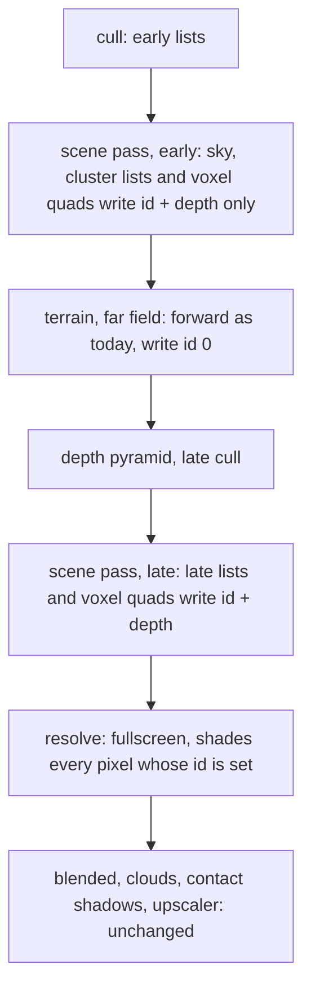

# Visibility buffer — design

Status: in progress (decided by the director 2026-11-27, technical calls
delegated by the user). Stage 0 done: go
(`docs/superpowers/research/2026-11-27-vb-stage0.md`). Plan:
`docs/superpowers/plans/2026-11-27-visibility-buffer.md`, whose "Spec
premises found false" section corrects the id layout below (it does not
fit as written) and the gates' tool assumptions.

Decision behind it: decisions.md "Visibility buffer is unconditional"
(2026-11-24). Resume step 5. Reference: Chlorophyll baseline F17 (the
author's stated answer to foliage overdraw); Burns and Hunt 2013 (the
visibility buffer); Karis 2021 (Nanite: material resolve from a
visibility buffer, analytic derivatives); The Forge / Schied and
Dachsbacher 2015 for barycentrics and their screen derivatives.

## Problem

Cluster triangles and voxel quads are shaded forward: every rasterized
fragment runs the full material, the cascade lookups, the GI read and the
aerial perspective, and a triangle or quad smaller than a pixel still
pays for a 2x2 fragment quad. Leaves are opaque geometry, so a forest
view is mostly sub-pixel triangles and pixel-sized quads. Any new
per-pixel term (crown fill today, ambient occlusion next) multiplies by
the same overshading.

Measured today, one view, not the gate views (far-tier ledger,
2560x1440): `scene early 6.03, voxel trees 3.35` ms. The split of that
between geometry and shading on the current trees is not measured; the
only breakdown on record ("Frame cost measured, perf lane") predates
opaque leaves and G1. The 8 to 12 ms saving in the decision entry
predates them too. Stage 0 measures it.

## Goals

- Opaque and alpha-masked cluster geometry and voxel quads are shaded
  once per visible pixel.
- One place where a pixel's sun visibility, ambient and occlusion are
  evaluated, so ambient occlusion (resume step 6) and per-pixel shadow
  filtering land on the resolve, not in every forward shader.
- No change in look: the image matches the forward path within the
  parity gates below, still and in motion.
- DLSS inputs stay complete: jitter, motion vectors, depth, exposure,
  guides.
- The previous-frame position of a displaced vertex (wind, resume step 9)
  has one home.

Not goals: terrain through the buffer; far cells and far tiles through
it (a later stage, see "Later"); blended surfaces; a compute-shader
resolve or material tile classification; removing the forward mesh
shader (blended surfaces and the debug set keep it).

## Design

### The id target

A new scene attachment, `RG32UI`, render-sized, cleared to 0:

- `x`: instance id (24 bits) | the draw entry's terrain sun code (8 bits),
  exactly the draw list entry's first word.
- `y`: kind (2 bits: none, cluster triangle, voxel) | cluster index and
  triangle index (7 bits, clusters hold at most 128 triangles), or the
  voxel's index in the frame's voxel list.

The id names the instance, cluster and triangle directly, not a draw
list slot, so it is the same for the early and the late phase and does
not depend on list order. The plan checks the bit budget against the
pool sizes (`kMaxVoxelQuads` is 24.66M: 25 bits; the cluster pool's
size) and static_asserts it.

64 bits rather than 32 because the terrain sun code and a 24-bit
instance id leave no room for cluster and triangle in one word.

### Who writes it

It is attachment 7 of the scene pass (0 to 6 stay as they are), so the
two-phase structure of the frame does not change.

- Cluster lists (opaque, masked; single and double sided) and voxel
  quads draw with visibility pipelines: colour write mask 0 on
  attachments 0 to 6, id and depth written. `mesh.mesh` gets a
  `VISIBILITY` variant that emits positions and a per-primitive id, plus
  uv and vertex alpha for the masked lists only; its fragment shader is
  the present masked depth test (`mesh_masked_depth.frag`'s alpha test)
  plus the id write, and nothing else for opaque. The masked depth
  pre-pass and the depth-EQUAL shaded pass both go: a masked list is
  drawn once.
- Voxel quads: `voxel_instance.mesh` unchanged in what it emits to the
  rasterizer; the fragment shader writes the voxel's list index. No
  discard, early depth holds as now.
- Terrain (`mesh.frag` TERRAIN) and the far field (`voxel.frag`) stay
  forward and write id 0, so a pixel they cover is never resolved from a
  stale id. The sky writes nothing there (the clear value).
- Blended surfaces: forward after the resolve, id write mask 0.

NVIDIA's `maxColorAttachments` is 8 and the debug set already uses
attachment 7 for the debug id. The debug set (debug views, the report)
keeps the forward pipelines for now, without the id target. See "Later".

### The resolve

One fullscreen fragment pass after the late scene pass and before the
blended surfaces. Colour attachments 0, 1, 3, 4, 5, 6 loaded; the id
target sampled; a pixel with kind none discards.

Cluster triangle pixel:

1. Load the instance (`loadInstance`), cluster, mesh, the triangle's
   three cluster vertices (`loadVertex`).
2. Transform them with the same function the visibility mesh shader
   uses (one shared GLSL function for "displayed position of a cluster
   vertex", current and previous), into the jittered clip space.
3. Barycentrics at the pixel centre and their screen derivatives,
   perspective correct (Schied and Dachsbacher's formulation as used by
   The Forge and Nanite).
4. Interpolate relative position, normal, tangent, uv, vertex alpha;
   from the derivatives: `dpdx`, `dpdy`, uv gradients, normal gradients.
   The geometric normal is the triangle's cross product; facing is its
   sign against the view vector (replaces `gl_FrontFacing`).
5. Per-instance and per-cluster values that are flat varyings today are
   read directly: material index, tint, LOD error, stream fade, terrain
   sun code (from the id). Crown visibility and the tuft height are
   evaluated per pixel at the interpolated position instead of per
   vertex.
6. Shade with the same functions as `mesh.frag` (`materialSurface`,
   `beginShading`, `addSunLight`, the leaf transmission branches,
   `addAmbientLight`, `applyAerialPerspective`), write the same six
   outputs. Motion = previous clip of the interpolated previous position
   minus current, in UV, as now.

Voxel pixel: load the voxel list entry, rebuild what
`voxel_instance.mesh` passes as flat varyings today (`inRelative`,
`inVoxel`, `inInfo`) through a shared function, then the body of
`voxel_instance.frag`.

One shader with a branch on kind, not two passes: the kinds interleave
at the voxel switch, and a second pass would need a stencil or a second
full-screen id read.

### Shared shading code

The shading math stays in shared functions (programme call 3's rule).
What has to change for the resolve to reuse it:

- `surfaceIn` gains `uvDx`, `uvDy` and the normal gradients; nothing
  under `surface.glsl`, `material.glsl` or `lighting.glsl` calls `dFdx`,
  `dFdy` or relies on implicit texture LOD. `sampleTexture` under
  `SURFACE_FRAGMENT` becomes `textureGrad` with the gradients scaled by
  `2^mipBias` (the pattern at surface.glsl:133 already does this).
  The forward shader fills them from `dFdx`/`dFdy`; the resolve from the
  barycentric derivatives.
- `SHADING_PIXEL` (`gl_FragCoord.xy`) is valid in the resolve as it is.
- The body of `mesh.frag`'s `main` for the non-terrain case, and of
  `voxel_instance.frag`, move into functions both callers use. The
  forward mesh shader stays for blended surfaces and the debug set.

### Wind (not built here, but fixed here)

The resolve recomputes a displaced vertex's position for this frame and
the last one by calling the same displacement function as the
visibility mesh shader, with `scene.wind` and `scene.previousWind`. No
per-vertex previous position is stored and none goes through the id.
Stage 1 lands the shared position function with zero displacement so the
wind spec only fills it in.

### What it costs and what it removes

- Added per visible pixel: three vertex fetches, instance, cluster and
  mesh records, the barycentric math. Not measured; stage 0 bounds it.
- Removed: shading of hidden and helper fragments; the masked lists'
  second draw; most of the mesh shader's per-vertex work for these lists
  (normal matrix, tangent, crown visibility, twelve varyings).
- VRAM: +28.1 MiB resident (2560 x 1440 x 8 B), nothing else. Main's
  resident is 11998 MiB at the forest edge against the 12288 gate.
  New pipelines add no measurable memory.

## Stages

Each stage is one branch state that builds, passes its checks and can be
reviewed alone. `--visibility off|on` selects the path until stage 4.

**Stage 0: premise (no engine change kept).** At the forest edge, the
overview, s1 (`--camera 218 1408 1298 -0.785 -0.57`) and one meadow
view, on main, 2560x1440 Release:

- `scene early` and `voxel trees` as they are;
- the same with the fragment shading stripped to a constant (depth and
  the masked alpha test kept): the difference is the most the buffer can
  remove;
- a fullscreen pass that runs `mesh.frag`'s shading once per pixel on
  the forward pass's own outputs is not available yet, so the resolve's
  cost is bounded instead: pixel count covered by cluster and voxel
  geometry at each view times the per-fragment shading cost measured at
  a view with no overdraw (a single close crown filling the frame).

Go: the projected net saving at the forest edge and the overview is at
least 2 ms each. Below that, stop and report to the director; the
buffer would then rest on the ambient-occlusion argument alone and the
user is asked.

**Stage 1: explicit derivatives.** The shared-code changes above, forward
path only. Check: captures at the start view, the forest edge and a
close leaf view match main within 0.02/255 mean; `ctest`; one short
Debug capture, 0 validation errors. Mergeable on its own.

**Stage 2: cluster geometry.** The id target, the visibility pipelines
for the four cluster lists, the resolve for cluster triangles. Voxels
still forward (they write id 0). Midpoint independent review here.

**Stage 3: voxel quads.**

**Stage 4: default on.** Forward pipelines for the cluster lists and
voxel quads remain only in the debug set. Docs: architecture.md frame
order, scene attachments and the id layout; cli.md; decisions.md;
backlog rows G10, "Visibility buffer", "Visibility buffer before forward
GTAO" updated or removed. Independent review and fix check before merge.

## Gates (stages 2 to 4, `--visibility on` against `off`, same commit)

All at 2560x1440 Release, every game run through the GPU lock.

- Look, still: whole-frame mean absolute difference at the start view,
  forest edge, overview, s1, a meadow view and a close leaf view, each
  reported; expected below 0.5/255 with the difference concentrated on
  triangle edges of textured leaves (texture LOD there now comes from
  the triangle, not the pixel quad). Above that, or any visible change:
  a whole-frame A/B sheet goes to the user.
- Look, motion: `tools/motion-gates.sh` and `tools/motion-clarity.sh`
  not worse than off (shimmer, smear, in-motion jitter).
- Motion vectors and guides: attachments 1, 3, 4, 5, 6 compared off
  against on at two views (mean and max difference, reported).
- Voxel switch: the seam ratio at the triangle-to-voxel switch unchanged.
- Cost: the per-pass line off against on at the six views; the forest
  views must gain what stage 0 projected within a third; no view may
  lose more than 0.3 ms. One repeat for a surprising figure.
- Counters: no list overflow at any view, cascades included (the
  cascades do not use the buffer; they must be unchanged).
- VRAM: resident +28 MiB, peak not above main's.
- Debug: one short capture per stage, 0 validation errors; the debug
  views still work (forward).

## Risks

- **Texture LOD on sub-pixel triangles.** Analytic gradients extrapolate
  inside one triangle where the forward path used a pixel quad. The
  image can get sharper (shimmer) or softer. This is the likeliest look
  change and it is the user's call if visible.
- **Foliage specular AA** widens the lobe by the shaded normal's screen
  derivative, normal map included. The resolve has the vertex normal's
  gradient analytically; the normal map's share needs the texture's own
  gradient or is dropped. Stage 2 measures the sparkle number from the
  crown-light ledger off against on.
- **Resolve fetch cost** on incoherent sub-pixel triangles could eat the
  saving. Stage 0 bounds it; stage 2 measures it.
- **Depth agreement.** The resolve recomputes positions the rasterizer
  already produced; both must use one function and the same jittered
  matrix, or the reconstructed barycentrics fall outside the triangle on
  edge pixels. Clamp and count: a debug counter of pixels whose
  barycentrics needed clamping by more than 1e-3.
- **Streamed plants' fade and placed-instance thinning** live in
  `loadInstance`; the resolve must get the same answer as the frame's
  cull did. It reads the same scene data in the same frame, so it does;
  the plan adds a check.
- **Late-phase pixels over forward terrain**: terrain shaded early and
  then covered by late geometry is overwritten by the resolve. Correct,
  and no worse than today.

## Later (not in this spec)

- Ambient occlusion on the resolve (resume step 6): its own spec, GTAO
  against the visibility bitmask.
- Far cells and far-tier tiles as a third kind, so a marched pixel is
  shaded once (the far tier's cost question on `far-tier`).
- Debug views and the report read the id target instead of the debug id
  attachment, which frees attachment 7 in the debug set and removes the
  forward cluster pipelines entirely.
- Per-pixel shadow filtering (contact hardening) and wind.
